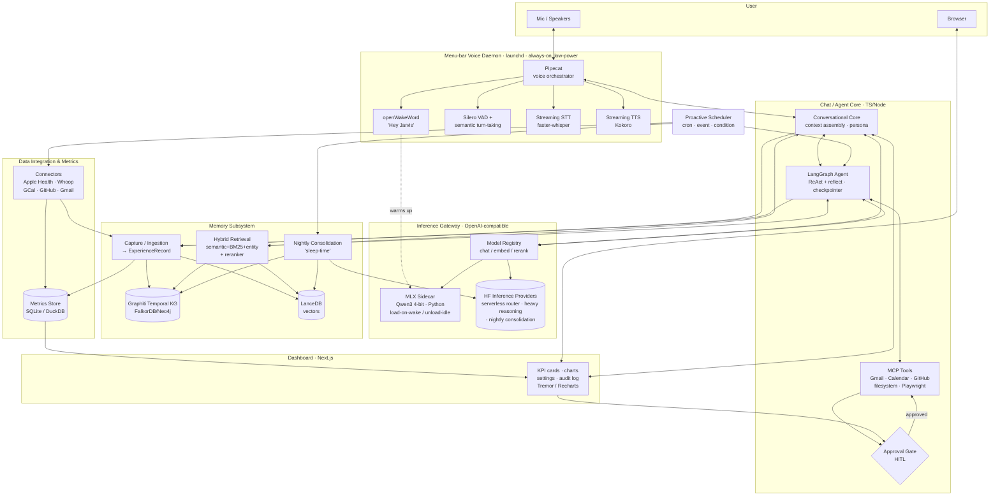
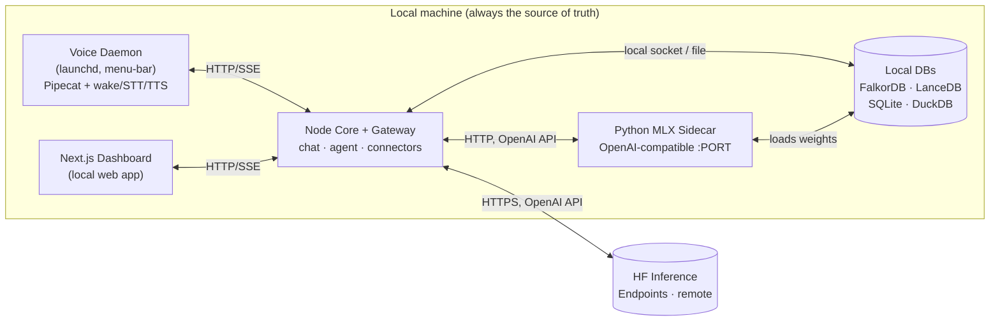

# Jarvis — System Architecture

> The anchor architecture doc. Every feature spec in `../features.md` and every
> cross-cutting doc in this folder links back here. This is the system-level map:
> what the components are, how they talk, what the data looks like, and what the
> hardware actually allows.

Jarvis is a **local-first, persistent-memory personal AI assistant** ("second brain"
/ Iron Man Jarvis) for **one technical user**. You talk to it with low latency, it
remembers everything about you, it learns with you each night, it shows a dashboard
of your life metrics, and it acts as an agent that does tasks for you.

---

## 1. Overview & Principles

The whole design falls out of a handful of decisions made up front. They are not
negotiable defaults — they are the spine.

- **Local-first.** The brain runs on your machine. Chat, voice, memory, and the
  dashboard all work with the network off. The cloud is an *accelerator*, never a
  dependency. If HF is down, Jarvis degrades to the local model, not to nothing.
- **Own the storage, rent the intelligence.** Your data — memories, metrics,
  conversations, audit log — lives in local files (DBs on disk) that you own and
  can back up. Heavy *compute* (big-model reasoning, nightly consolidation) is
  rented from Hugging Face endpoints on demand. We never rent storage of personal data.
- **Capture everything.** Single user, privacy is not a constraint on *capture*
  (it is still a constraint on *outbound action* — see the approval gate). Default
  every source ON. The harder problem is not "what to keep" but "how to consolidate
  and forget" — that's what nightly sleep-time does.
- **Free / OSS preferred.** Pipecat, LangGraph, Graphiti, openWakeWord, MLX,
  faster-whisper, Kokoro, LanceDB — all free/OSS. Build from primitives only where
  nothing good exists. The one paid line item is HF endpoints (cost is not a constraint).
- **Hybrid local + cloud compute.** Small local Qwen (MLX, 4-bit) for the
  latency-critical chat + voice loop; HF Inference Providers (serverless router) for heavy
  reasoning and overnight batch. The model layer is swappable behind one gateway.
- **Stream everything.** Wake word, STT, LLM tokens, TTS audio — every stage is
  streaming. Perceived latency is dominated by *time-to-first* of each stage, not
  total time, so we optimize first-token / first-audio relentlessly.
- **On-demand lifecycle.** The 16GB machine cannot keep a big model warm 24/7. The
  local LLM loads on "Hey Jarvis" and unloads after ~10 min idle. A few-second
  cold start with a "waking up…" cue is acceptable.

---

## 2. Component Diagram



The diagram has five planes that recur through this doc: **voice I/O** (daemon),
**inference** (gateway + models), **cognition** (chat/agent/tools/approval),
**memory**, and **data/metrics/dashboard**, all poked by the **scheduler**.

---

## 3. Tech Stack

| Layer | Choice | Why |
|---|---|---|
| Orchestration / glue | **TypeScript / Node** | One language for agent core, gateway, connectors, and dashboard backend; great async + streaming (SSE) story; LangGraph.js + MCP SDK are first-class. |
| Dashboard UI | **Next.js + Tremor / Recharts** | App Router + server components for a local web app; Tremor gives batteries-included KPI cards/charts, Recharts for custom. Single pane of glass + settings + audit log. |
| Local model serving | **Python MLX sidecar (`mlx-lm`)** | MLX is the fastest path to Apple-Silicon inference (unified memory, 4-bit); runs as a separate Python process exposing an OpenAI-compatible HTTP API. Isolated from the Node core so a model crash never takes down the brain. |
| Heavy inference | **HF Inference Providers (serverless router)** | Serverless, OpenAI-compatible router (`router.huggingface.co/v1`) to partner-hosted big models for reasoning + nightly consolidation; pay-per-token, zero idle cost, nothing to provision. Cost is not a constraint; latency-tolerant work only. |
| Chat / embed / rerank models | **Qwen3 (~4B chat, 4-bit) · Qwen3-Embedding-0.6B · Qwen3-Reranker-0.6B** | Same model family = consistent tokenizer/behavior; 0.6B embed+rerank are tiny enough to stay resident for sub-second retrieval; chat model swappable via registry. |
| Temporal knowledge graph | **Graphiti + FalkorDB (or Neo4j)** | Graphiti gives bi-temporal facts (valid-time + ingestion-time) and conflict resolution out of the box — the hard part of memory. FalkorDB is a light local Redis-module graph; Neo4j if richer Cypher is needed. |
| Vector store | **LanceDB (Chroma fallback)** | Embedded, file-based, zero-server, fast ANN on disk — fits local-first. Chroma as a drop-in alternative. |
| Metrics + checkpoints | **SQLite + DuckDB** | SQLite for OLTP (conversations, to-dos, audit log, LangGraph checkpointer = durable/resumable agent state). DuckDB for analytical roll-ups over `MetricSeries` powering the dashboard. |
| Voice pipeline | **Pipecat** | Orchestrates streaming STT → LLM → TTS with VAD, turn-taking, and barge-in; sentence-chunked LLM→TTS so audio starts before the full reply exists. |
| STT / TTS | **faster-whisper · Kokoro** | Local, streaming, fast on Apple Silicon; both OSS. |
| Wake word | **openWakeWord** | Always-on, low-power, fully local "Hey Jarvis"; also the trigger that warms the LLM. |
| Agent runtime | **LangGraph** | Graph-based ReAct + reflection, plan-and-execute, and a SQLite checkpointer for long/overnight resumable runs. |
| Tools | **MCP servers** | Standard tool protocol: Gmail, Google Calendar, GitHub, filesystem, Playwright (browser) — each its own server, each behind the approval gate. |

---

## 4. Data Model

These are the entities that cross component boundaries. Sketches are TS-style; the
backing stores differ (KG vs SQLite vs vectors) but the shapes are the contract.

```ts
// CAPTURE — every source normalizes to this before it touches memory.
interface ExperienceRecord {
  id: string;
  source: "conversation" | "note" | "email" | "calendar" | "github" | "health" | "metric";
  occurredAt: string;          // when it happened (valid-time anchor)
  capturedAt: string;          // when we ingested it
  actor?: string;              // who/what produced it
  content: string;             // normalized text body
  raw?: unknown;               // original payload for re-processing
  refs?: { kind: string; id: string }[];  // links to Message/Metric/etc.
}

// TEMPORAL KG — the long-term "second brain" (Graphiti).
interface MemoryNode {            // an entity: person, project, place, preference-target
  id: string;
  type: "person" | "project" | "topic" | "preference" | "habit" | "object";
  name: string;
  summary?: string;
}
interface Fact {                  // a bi-temporal edge between nodes
  id: string;
  subject: string;                // MemoryNode.id
  predicate: string;              // "prefers" | "works_on" | "lives_in" ...
  object: string;                 // MemoryNode.id or literal
  tier: "semantic" | "procedural";
  validFrom: string;              // valid-time
  validTo?: string;               // null = currently true; set on supersession
  confidence: number;
  derivedFrom: string[];          // ExperienceRecord / Episode ids
}
interface Episode {               // an event-grained memory (episodic tier)
  id: string;
  occurredAt: string;
  summary: string;
  participants: string[];         // MemoryNode ids
  derivedFrom: string[];          // ExperienceRecord ids
  embeddingRef: string;           // → LanceDB row
  importance: number;             // for recency×importance×relevance scoring
}

// DASHBOARD — time-series metrics (SQLite/DuckDB).
interface MetricSeries {
  key: string;                    // "sleep.hrv" | "github.commits" | "calendar.busy_min"
  source: string;
  unit: string;
  points: { t: string; v: number }[];
}

// CONVERSATION — chat history (SQLite).
interface Conversation { id: string; startedAt: string; title?: string; channel: "voice" | "text"; }
interface Message {
  id: string; conversationId: string;
  role: "user" | "assistant" | "tool" | "system";
  content: string; createdAt: string;
  injectedMemoryIds?: string[];   // which memories were surfaced this turn
}

// AGENT — execution, approval, audit (SQLite; checkpointer-backed).
interface AgentRun {
  id: string; goal: string;
  status: "running" | "waiting_approval" | "done" | "failed" | "cancelled";
  startedAt: string; checkpointId: string;   // resumable LangGraph state
  steps: { tool: string; input: unknown; output?: unknown; reasoning: string }[];
}
interface ApprovalRequest {
  id: string; runId: string;
  action: { tool: string; input: unknown };  // e.g. gmail.send
  risk: "read" | "reversible" | "irreversible";
  status: "pending" | "approved" | "denied"; decidedAt?: string;
}
interface AuditLog {              // immutable, append-only
  id: string; ts: string; runId?: string;
  event: string; payload: unknown; reasoning?: string;
}
```

**How they relate.** Everything enters as an `ExperienceRecord`. Capture writes
records; consolidation reads them and emits `Episode`s and `Fact`s into the KG
(with embeddings in LanceDB). `Message`s are themselves captured as records and
referenced by the `Episode`s derived from a conversation. Connectors emit both
`ExperienceRecord`s (→ memory) and `MetricSeries` points (→ dashboard). The agent
produces `AgentRun`s; any outward action spawns an `ApprovalRequest`; every step
and decision is appended to the `AuditLog`. `Fact.validFrom/validTo` is the
mechanism that lets fresh facts supersede stale ones instead of competing with them.

---

## 5. Hardware & Compute Reality

Target: **MacBook Air M3, 16GB unified memory, fanless** (macOS Tahoe 26.5).
Fanless means sustained heavy compute throttles — so local work is *bursty* and
*on-demand*, and anything sustained goes to HF.

### RAM budget (while voice loop is active)

| Consumer | Approx RAM | Notes |
|---|---|---|
| macOS + background | ~3–4 GB | Baseline; non-negotiable. |
| Local Qwen3 chat (4-bit, ~4B) | ~5–6 GB | The big tenant; loaded only on wake. |
| STT (faster-whisper) | ~0.5–1 GB | Streaming, resident while daemon is hot. |
| TTS (Kokoro) | ~0.3–0.5 GB | Small, fast. |
| Embedding + reranker (0.6B ea, 4-bit) | ~1–1.5 GB | Stay resident for sub-second retrieval. |
| Node core + Next.js + DBs | ~1–2 GB | Agent, gateway, dashboard, SQLite/LanceDB. |
| **Total (active voice)** | **~11–15 GB** | Tight but feasible; why the chat model unloads on idle. |

### Model lifecycle (on-demand)

- **Idle:** only openWakeWord + the daemon + DBs + dashboard run. Big LLM unloaded.
- **Wake ("Hey Jarvis"):** MLX sidecar loads the chat model (few-second cold start;
  "waking up…" cue). Embed/rerank were already resident.
- **Active:** full voice loop within budget.
- **~10 min idle:** chat model unloads; RAM returns to the OS.

### Local vs HF

| Runs **local** | Runs on **HF endpoints** |
|---|---|
| Wake word, VAD, STT, TTS | Heavy reasoning / long-context synthesis |
| Chat model (latency-critical turns) | Nightly consolidation (sleep-time) batch |
| Embeddings + reranking (retrieval) | Big agent plans that exceed local budget |
| All storage (KG, vectors, metrics, audit) | (no personal-data storage, ever) |

---

## 6. Latency Budget

Goal: **perceived first audio ~700ms–1.5s** after the user stops speaking. We budget
*time-to-first* of each streaming stage, not total.

| Stage | Target | Notes |
|---|---|---|
| Wake detection | off critical path | Continuous; not counted in turn latency. |
| End-of-turn (VAD + semantic) | ~150–300 ms | Detecting the user is done — pure overhead, minimize. |
| STT (final partial) | ~100–250 ms | Streaming; mostly done *during* speech. |
| **LLM time-to-first-token** | **~300–700 ms** | **The bottleneck.** Local 4-bit Qwen TTFT dominates the loop. |
| TTS first audio | ~100–200 ms | Kokoro on the first sentence chunk. |
| **Perceived first audio** | **~700 ms–1.5 s** | Sum of first-of-each, overlapped where possible. |

**The bottleneck is LLM TTFT.** Mitigations: keep the model warm during a session,
prefix/prompt caching for the system prompt + injected memories, small 4-bit model,
and a tight context (retrieval surfaces only the few memories that matter). **Stream
everything** so we emit the first TTS sentence as soon as the LLM produces one clause
— the user hears audio long before the full reply is generated. Barge-in lets the
user interrupt, which resets the loop without waiting for completion.

---

## 7. Runtime Topology

Four local processes plus one remote service. Nothing is containerized; everything
is plain local processes managed by `launchd`.



- **Voice daemon** (launchd, auto-restart, menu-bar UI): owns the mic; the only
  always-on heavy-ish process, kept light because the LLM is unloaded most of the time.
- **Node core + inference gateway**: the brain. Talks to the daemon and dashboard
  over **HTTP + SSE** (token/audio streaming), to the MLX sidecar and HF over the
  **OpenAI-compatible HTTP API**, and to local DBs directly.
- **Next.js dashboard**: a local web app the user opens in a browser; SSE for live
  metrics and agent-run/approval updates.
- **Python MLX sidecar**: isolated model process (a crash can't kill the brain);
  same API contract as HF so the registry swaps them transparently.
- **HF endpoints**: the only remote piece; reachable but never required.

IPC summary: daemon↔core and dashboard↔core = **HTTP/SSE**; core↔models =
**OpenAI HTTP**; core↔DBs = **in-process / local socket**.

---

## 8. Build Order / Phases

Six phases, mirroring `../features.md`. Each phase ships something usable.

| Phase | Theme | Delivers |
|---|---|---|
| **1 — Foundation** | The brain can think & talk by text | Local Qwen inference core (MLX, OpenAI API, on-demand lifecycle, streaming, registry) + conversational chat core (context assembly, persona, memory injection). You can text-chat with Jarvis. |
| **2 — Memory** | The "second brain" | Capture & ingestion (ExperienceRecord normalization) → long-term store (Graphiti temporal KG + LanceDB) → hybrid retrieval (semantic+BM25+entity+rerank, sub-second) → nightly consolidation (extract/reflect/resolve/forget). Jarvis remembers and learns. |
| **3 — Voice** | Talk to it, low latency | Full-duplex voice (Pipecat: streaming STT→LLM→TTS, VAD + turn-taking + barge-in) + wake word ("Hey Jarvis") that also warms the model. Hands-free, sub-second-perceived. |
| **4 — Life Metrics & Dashboard** | See your life | Data-integration framework (connectors, OAuth lifecycle, schedules) + health/sleep, calendar, and work metrics → metrics store → Next.js dashboard (KPI cards + charts, settings, audit) + daily briefing. (Finance deferred to v2.) |
| **5 — Agent** | It does tasks | Agent/tool core (LangGraph ReAct+reflect, checkpointer) + approval & safety gate (HITL, immutable audit, sandboxing, injection guards) + task skills (email, calendar, to-dos, research, browser via MCP) + proactive scheduler (cron/event/condition triggers). |
| **6 — Personalization** | It becomes *yours* | Evolving, user-inspectable personal profile (preferences, people, projects, routines, style) built from memory + consolidation; optional later style-only LoRA. |

---

## 9. Cross-Cutting Links

These docs go deep on concerns that span every component. Read them alongside this one.

- **[`model-serving.md`](./model-serving.md)** — Qwen chat/embedding/reranker
  choices, MLX vs vLLM vs HF endpoints, quantization, the on-demand lifecycle, and
  hardware deep-dive behind §5 and §6.
- **[`privacy-and-security.md`](./privacy-and-security.md)** — local-first stance,
  secret storage, capture/retention/deletion policy, the approval gate + audit log,
  sandboxing, prompt-injection / confused-deputy threat model behind §4 and §7.
- **[`auth-and-integrations.md`](./auth-and-integrations.md)** — OAuth token
  lifecycle/refresh and secret management for every data source (Apple Health,
  Whoop, Google Calendar, GitHub, Gmail) feeding §3's connectors.
- **[`deployment.md`](./deployment.md)** — running the launchd daemon + local web
  app + Python sidecar + local DBs, wiring the optional HF fallback, and backups —
  the operational side of §7.

---

*This is the anchor. When a feature spec and this doc disagree, fix one of them.*
