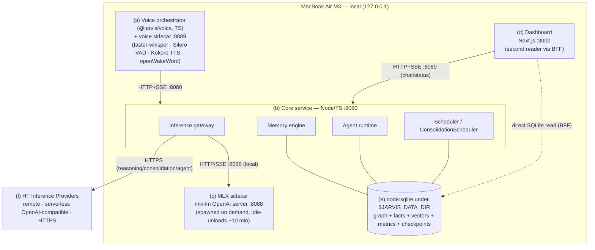

# Jarvis — Deployment & Runtime Architecture

> **Status note (updated 2026-07-04):** §1 below has been corrected to the *current* implementation. §§2-9 describe an earlier/aspirational deployment design — launchd LaunchAgents, a FalkorDB/Neo4j graph DB, LanceDB/Chroma vectors, DuckDB analytics, a Swift/Tauri menu-bar voice daemon, and an app-bundle install wizard — that the system does **not** currently use. That content is retained below a divider marking it future/aspirational (see §§2-9 heading) and is **not current ground truth**. For what actually runs today see `CLAUDE.md` and `.planning/codebase/{ARCHITECTURE,STACK,INTEGRATIONS}.md`.

How every piece of Jarvis runs on a single MacBook Air M3 (16 GB, macOS Tahoe 26.5),
plus the one remote dependency: a Hugging Face Inference Endpoint. Jarvis is
**local-first** — every component lives on the user's machine except the cloud
fallback model, and the system stays fully usable offline (degrading only the
heaviest reasoning to the remote endpoint when present).

This document is the operational counterpart to the component design docs: it
describes processes, ports, lifecycle, on-disk layout, install, updates, and the
day-to-day runtime behavior on Apple Silicon.

---

## 1. Runtime topology

Jarvis runs as a small set of cooperating processes on `localhost`. Nothing
listens on a public interface; all sockets bind to `127.0.0.1`.

| # | Component | Tech | Lifetime | Port / channel |
|---|-----------|------|----------|----------------|
| a | **Voice orchestrator** (`@jarvis/voice`, TS leaf package) + **voice sidecar** | Node orchestrator + Python FastAPI/WS (faster-whisper STT, Silero VAD, Kokoro TTS, openWakeWord) | voice sidecar on-demand (`npm run sidecar:voice`); orchestrator runs the PTT/hands-free loop | voice sidecar HTTP+WS `127.0.0.1:8089` |
| b | **Core service** | TypeScript / Node (Hono) | on-demand (`npm run core`, or via `npm start`) | HTTP+SSE `127.0.0.1:8080` (`CORE_PORT`) |
| c | **MLX sidecar** | Python `mlx-lm` OpenAI-compatible server | **on-demand**, spawned/idle-unloaded (~10 min) by core | HTTP `127.0.0.1:8088` |
| d | **Web dashboard** | Next.js | on-demand (dev/local) | HTTP `127.0.0.1:3000` |
| e | **Storage** | `node:sqlite` (in-process, built-in) under `$JARVIS_DATA_DIR` (real data home `services/core/data/`) — bi-temporal knowledge graph, facts/entities, vectors, metrics, agent checkpoints | embedded, no separate process | file(s) on disk; `sqlite-vec` optional loadable accelerator, JS cosine fallback; JS BM25 keyword search (no FTS5) |
| f | **HF Inference Providers** | remote, serverless OpenAI-compatible router | always available (network) | HTTPS to `router.huggingface.co` (`HF_ENDPOINT_URL`) |

### Communication

- **Voice orchestrator ↔ voice sidecar**: HTTP for commands, a WebSocket for the streaming
  voice loop (partial transcripts up, token/audio events down); the orchestrator also talks
  to core over HTTP/SSE for chat + hands-free session state (`POST /voice/start|stop`,
  `GET /voice/status|events`, `POST /voice/wake`).
- **Core → MLX sidecar**: HTTP `POST /v1/chat/completions` with SSE streaming
  (`stream: true`), identical wire format to HF, so the inference
  gateway can swap local ⇄ remote behind one interface.
- **Core → HF Inference Providers**: HTTPS, same OpenAI schema, bearer token (`HF_TOKEN`)
  from `.env`.
- **Core ↔ storage**: in-process `node:sqlite` file handles — no network hop, no separate
  DB server or protocol; there is no graph-DB or vector-DB process to talk to.
- **Dashboard ↔ storage**: the dashboard is a **second, independent reader** of the same
  SQLite files via a server-only BFF (`apps/dashboard/app/lib/services.ts`) — it does
  **not** proxy all reads through core's API. Its only writes are todo actions and profile
  corrections/pins; OAuth consent and manual syncs are delegated by spawning the connect
  CLI so credentials stay on core's path.

### Mermaid topology



---
# Part II — Future / aspirational design (NOT the current implementation)
> Everything below describes a planned/earlier deployment model the current system does not use (launchd agents, FalkorDB/Neo4j, LanceDB/Chroma, DuckDB, a native voice daemon, an app-bundle install wizard). Retained for future reference. See §1 and `CLAUDE.md` for what actually runs today.

## 2. Process management (launchd)

The always-on processes are managed by **launchd** as per-user **LaunchAgents**
(`~/Library/LaunchAgents/`), so they start at login, restart on crash, and run
without a root daemon. There are three persistent agents:

- `com.jarvis.core` — the Node core service (gateway, memory, agent, scheduler).
- `com.jarvis.voiced` — the menu-bar voice daemon.
- `com.jarvis.graphdb` — FalkorDB/Neo4j (or rely on its own installer's agent).

The **MLX sidecar is NOT a LaunchAgent.** It is spawned, supervised, and killed
by the core service (see §3), because its lifetime is tied to model demand.

The **web dashboard is not always-on** — it is launched on demand
(`jarvis dashboard` → `next start`, or a Tauri webview) and stopped when closed.

### Sample LaunchAgent plist

`~/Library/LaunchAgents/com.jarvis.core.plist`:

```xml
<?xml version="1.0" encoding="UTF-8"?>
<!DOCTYPE plist PUBLIC "-//Apple//DTD PLIST 1.0//EN"
  "http://www.apple.com/DTDs/PropertyList-1.0.dtd">
<plist version="1.0">
<dict>
  <key>Label</key>
  <string>com.jarvis.core</string>

  <key>ProgramArguments</key>
  <array>
    <string>/opt/homebrew/bin/node</string>
    <string>/Applications/Jarvis.app/Contents/Resources/core/dist/main.js</string>
  </array>

  <key>EnvironmentVariables</key>
  <dict>
    <key>NODE_ENV</key>
    <string>production</string>
    <key>JARVIS_HOME</key>
    <string>/Users/USERNAME/Library/Application Support/Jarvis</string>
    <key>JARVIS_PORT</key>
    <string>8765</string>
  </dict>

  <key>RunAtLoad</key>
  <true/>

  <key>KeepAlive</key>
  <dict>
    <key>SuccessfulExit</key>
    <false/>
    <key>Crashed</key>
    <true/>
  </dict>

  <!-- Be gentle on a fanless, RAM-constrained Mac -->
  <key>ProcessType</key>
  <string>Background</string>
  <key>Nice</key>
  <integer>5</integer>
  <key>ThrottleInterval</key>
  <integer>10</integer>

  <key>StandardOutPath</key>
  <string>/Users/USERNAME/Library/Logs/Jarvis/core.out.log</string>
  <key>StandardErrorPath</key>
  <string>/Users/USERNAME/Library/Logs/Jarvis/core.err.log</string>
</dict>
</plist>
```

Manage it with:

```bash
launchctl bootstrap gui/$(id -u) ~/Library/LaunchAgents/com.jarvis.core.plist
launchctl kickstart -k gui/$(id -u)/com.jarvis.core   # restart
launchctl print gui/$(id -u)/com.jarvis.core          # status
launchctl bootout gui/$(id -u) ~/Library/LaunchAgents/com.jarvis.core.plist
```

(`bootstrap`/`bootout` replace the deprecated `launchctl load/unload` on Tahoe.)

### Sidecar supervision

The core service owns the sidecar process directly:

- **Spawn**: `child_process.spawn("python", ["-m", "mlx_lm.server", ...])` with
  a fixed `--port 8770`. Core captures stdout/stderr into `logs/mlx.log`.
- **Readiness**: core polls `GET 127.0.0.1:8770/v1/models` until it answers
  (or times out → fall back to HF).
- **Supervise**: a health check on each request; if the sidecar dies mid-stream
  the gateway retries against HF and re-spawns lazily.
- **Kill on idle**: an idle timer (default 5 min, configurable) sends `SIGTERM`
  to free RAM; `SIGKILL` after a grace period. The core process being the parent
  guarantees the sidecar dies if core dies (no orphan model server).

---

## 3. On-demand model lifecycle (deployment view)

The heavy local model (e.g. an 8B-class MLX model, ~4–8 GB resident) is **not**
loaded at boot. In runtime terms:

1. **Idle / boot**: only core + voice daemon + DBs are resident. Sidecar absent;
   ~0 GB of model memory in use. Routine work (memory, scheduling, light agent
   steps, anything routed to HF) runs without it.
2. **Wake**: a voice/dashboard request that needs local inference triggers core
   to spawn the sidecar (§2), which loads weights into unified memory. First
   request after a cold start pays the load latency; subsequent requests are warm.
3. **Serving**: while warm, all local-routed inference hits `:8770`.
4. **Idle unload**: after the idle window with no local requests, core kills the
   sidecar, returning unified memory to the system.
5. **HF endpoint** is **always available remotely** and stateless — used as the
   default for heavy reasoning when the local model is unloaded, when RAM is
   pressured (§8), or when explicitly preferred by routing policy. No local
   memory cost.

This makes "model loaded" a transient, observable state (surfaced in §9), not a
permanent resource commitment — the right trade-off on a 16 GB fanless machine.

---

## 4. Local data layout

All persistent state lives under macOS's standard per-user app-support path.
Secrets do **not** live here — they go in the **macOS Keychain**.

```
~/Library/Application Support/Jarvis/
├── config/
│   ├── config.json            # user settings (ports, idle timeout, routing policy)
│   ├── models.json            # model registry: local model id, HF endpoint URL, embed model
│   └── sources.json           # connected sources (calendar, mail, notes…) — no secrets
├── journal/                   # SOURCE OF TRUTH — append-only capture log
│   ├── 2026/06/09.jsonl       # raw events, one JSON object per line, never edited
│   └── ...                    # everything downstream is derived from this
├── graph/                     # memory graph store
│   └── falkordb/ (or neo4j/)  # entity/relationship knowledge graph
├── vectors/                   # vector store
│   └── lance/                 # LanceDB tables: embeddings + metadata
│       └── memories.lance
├── db/
│   ├── metrics.sqlite         # runs, latencies, token counts, sync/consolidation history
│   ├── checkpoints.sqlite     # agent run checkpoints / resumable state
│   └── analytics.duckdb       # (optional) read-only analytics over metrics
├── models/                    # downloaded local model weights (MLX format)
│   └── <org>--<model>/        # cached snapshot; large — excluded from cloud backup
├── cache/                     # regenerable: embedding cache, HF response cache, tmp
└── secrets.note               # README only: "secrets are in Keychain, see below"

~/Library/Logs/Jarvis/         # logs (macOS convention, separate from app support)
├── core.out.log  core.err.log
├── voiced.log
├── mlx.log
└── ...
```

**Secrets in Keychain.** HF token, source OAuth tokens, and any API keys are
stored as generic password items under service `com.jarvis` (e.g.
`security add-generic-password -s com.jarvis -a hf_token -w <token>`), read by
core at runtime. They are never written to `config/` or the journal.

**Source-of-truth principle.** `journal/` is append-only and authoritative. The
graph, vectors, and metrics DBs are **derived** and can be rebuilt by replaying
the journal — which is why backup (§5) centers on it.

---

## 5. Backups

### What to back up (priority order)

1. **`journal/`** — the source of truth. If you have only this, everything else
   can be reconstructed. Small, append-only, compresses well.
2. **`graph/` + `vectors/`** — the memory store. Re-derivable from the journal,
   but re-consolidation/re-embedding is slow, so back these up to save time.
3. **`db/metrics.sqlite` + `db/checkpoints.sqlite`** — operational history and
   in-flight agent state.
4. **`config/`** — settings and the model registry.

Explicitly **not** backed up to cloud: `models/` (re-downloadable) and `cache/`
(regenerable). Secrets live in Keychain, which Time Machine already covers.

### Approach & cadence

- **Time Machine** (built into macOS) for the whole `Application Support/Jarvis`
  tree except `models/` and `cache/` — add those as Time Machine exclusions.
  Hourly local snapshots, daily off-disk.
- **Periodic export**: a daily scheduler job runs `jarvis export --out
  ~/JarvisBackups/jarvis-YYYY-MM-DD.tar.zst` bundling journal + graph + vectors +
  db + config into one compressed archive (good for copying to another disk or
  cloud drive). Keep a rolling 30-day window.
- **Journal sync** (optional): because the journal is append-only and small, it
  can also be mirrored continuously to an iCloud/Drive folder.

### Restore

1. Reinstall Jarvis (§6), then stop core (`launchctl bootout …`).
2. Restore the `Jarvis/` tree from Time Machine, or
   `jarvis import ~/JarvisBackups/jarvis-DATE.tar.zst`.
3. Re-download the local model (`jarvis model pull`).
4. Restart core. If only the journal survived: `jarvis rebuild --from-journal`
   replays it to regenerate graph + vectors + metrics.

---

## 6. Install / bootstrap

### Dependencies

```bash
# Toolchain
brew install node@22 python@3.12
xcode-select --install            # for native voice-daemon audio bits

# Local inference (Apple Silicon)
pip install --upgrade mlx mlx-lm

# Graph DB (pick one)
brew install falkordb            # or: Neo4j Desktop / brew install neo4j
# Vector DB is embedded (LanceDB) — no separate install; Chroma is optional.
```

The Jarvis app bundle ships the core service, voice daemon, and dashboard;
Homebrew/pip cover the runtimes above. The installer writes the three
LaunchAgent plists (§2) and bootstraps them.

### First-run setup wizard

Launching `Jarvis.app` the first time opens the dashboard wizard:

1. **Create data home** under `~/Library/Application Support/Jarvis/` and seed
   `config/`, `journal/`, empty DBs.
2. **Connect sources** — OAuth/permission flows for calendar, mail, notes, etc.;
   tokens stored in Keychain, source list in `sources.json`.
3. **Set HF endpoint** — paste the Inference Endpoint URL + token (→ Keychain),
   write the URL into `models.json`; wizard does a test call.
4. **Pick & pull local model** — choose from the registry, then
   `jarvis model pull` downloads the MLX weights into `models/`.
5. **Grant macOS permissions** — Microphone (voice daemon), Accessibility/Login
   Items so launchd agents survive reboot.
6. **Smoke test** — wizard fires one local and one HF inference and confirms the
   health view (§9) is green.

---

## 7. Updates & versioning

- **App updates**: replace the `Jarvis.app` bundle (Sparkle-style auto-update or
  re-install); the LaunchAgents point at stable paths so a restart picks up new
  binaries. `launchctl kickstart -k` restarts core after an update.
- **Model updates**: edit `config/models.json` (the model registry) to point at a
  new local model id or a new HF endpoint, then `jarvis model pull`. Old weights
  in `models/` can be garbage-collected with `jarvis model gc`.
- **DB schema migrations**: core runs versioned migrations on startup. SQLite
  migrations are forward-only with a recorded `schema_version`; the graph store
  has its own migration steps. A failed migration aborts startup rather than
  corrupting data; restore from backup if needed.
- **Embedding-model change (reindex consideration)**: vectors are only comparable
  within one embedding model. **Changing the embedding model invalidates the
  vector store** — distances across models are meaningless. So an embed-model
  change triggers a full **reindex**: re-embed every memory from the journal/graph
  into a new LanceDB table, then atomically swap it in. This is offloaded to a
  background job (it can be long and RAM-heavy) and may route batches through the
  HF endpoint to spare local memory. The old table is kept until the new one
  verifies, then dropped.

---

## 8. Resource & thermal notes

The M3 Air is **fanless** and has **16 GB unified memory** shared by CPU, GPU,
and model weights — so deployment is tuned to stay light.

- **Memory budget (rough)**: macOS + apps ~6–8 GB; core + DBs ~1–2 GB; leaving
  ~6 GB headroom. An 8B 4-bit MLX model (~4–5 GB) fits, but only when loaded —
  hence the on-demand lifecycle (§3). Two heavy things at once is the danger.
- **Thermal / fanless throttling**: sustained local inference heats the SoC and
  the CPU/GPU clock down. Mitigations: prefer short bursts, cap concurrent local
  requests to 1, and lean on the always-cool HF endpoint for long/heavy jobs.
  `ProcessType=Background` + `Nice` in the plists keep background work yielding.
- **Under RAM pressure** (core watches `memory_pressure` / vm stats):
  1. **Unload the local model** (kill the sidecar) immediately.
  2. **Route inference to the HF endpoint** until pressure clears.
  3. Pause/throttle background consolidation and reindex jobs.
  4. Shrink caches (`cache/`) if needed.
  These steps are automatic and surfaced as events in the dashboard.
- **Battery**: local inference is the biggest drain; routing policy can prefer HF
  when on battery and prefer local when plugged in.

---

## 9. Observability

### Logs

Plain files under `~/Library/Logs/Jarvis/` (macOS convention), one per process:
`core.{out,err}.log`, `voiced.log`, `mlx.log`. Structured JSON lines from core;
rotated by size. `log stream --predicate 'process == "node"'` and `Console.app`
work too since launchd output is captured.

### Metrics & runs

`db/metrics.sqlite` records every run with timestamps, latency, token counts,
route (local vs HF), and outcome — for inference calls, source syncs, memory
consolidations, and agent runs. The optional DuckDB view enables ad-hoc queries.

### Dashboard health views

The Next.js dashboard (`:3000`, data via core SSE) surfaces:

- **Model status** — local model loaded/unloaded, sidecar PID + uptime, current
  resident memory, HF endpoint reachability and latency, active route.
- **Sync runs** — per-source last-run time, items ingested, errors.
- **Consolidation runs** — memory consolidation history (entities/edges written,
  vectors added) and the next scheduled run.
- **Agent runs** — live and historical agent executions with step traces and
  checkpoint state from `checkpoints.sqlite`.
- **System** — unified-memory headroom, memory-pressure state, recent
  auto-mitigations (model unloaded / routed-to-HF), and reindex job progress.

Health is also exposed at `GET 127.0.0.1:8765/healthz` for scripts and for the
setup wizard's smoke test.
