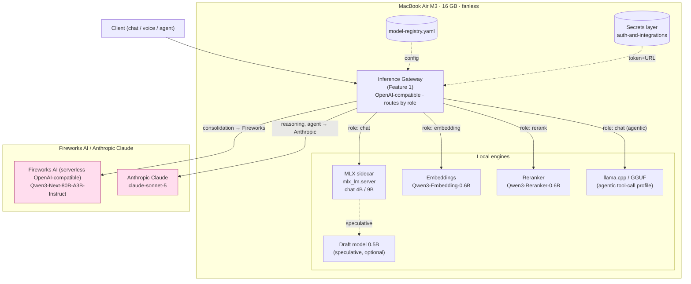

# Model Serving Strategy

> Status: design baseline · Last updated: 2026-06-09
> Owner: Jarvis core · Target hardware: MacBook Air M3, 16 GB unified memory, fanless, macOS Tahoe 26.5

This document defines **how Jarvis serves model inference**. It is the foundation that
Feature 1 (inference core / gateway), the memory/RAG features, and the agent/tool-calling
features all depend on. The guiding principle is **local-first**: everything that *can*
run on-device runs on-device, and only sustained heavy reasoning and nightly memory
consolidation are offloaded to a hosted endpoint.

Three hard constraints shape every decision below:

1. **16 GB unified memory.** RAM is the binding budget. The chat model, voice models,
   embeddings, and the OS all share one pool. Nothing that needs >~8 GB resident can
   stay loaded full-time.
2. **Fanless thermals.** The M3 Air has no fan. Under *sustained* compute (multi-minute
   generations, batch jobs) it throttles hard. Bursty interactive chat is fine; long
   reasoning chains and nightly batch work are not.
3. **Local-first, not local-only.** Privacy and latency favor on-device, but we
   pragmatically use a hosted endpoint for the jobs the Air cannot do well.

---

## 1. Model lineup

| Role | Model | Where | Size / quant | Notes |
|------|-------|-------|--------------|-------|
| Chat (default) | Qwen3-4B-Instruct-2507 | Local (MLX) | ~2.5 GB @ 4-bit | Primary interactive model (`mlx-community/Qwen3-4B-Instruct-2507-4bit`). Fast TTFT, fits comfortably with voice loaded. |
| Chat (quality tier) | Qwen3.5-9B-class-Instruct | Local (MLX) | ~5–6 GB @ 4-bit | Optional "thoughtful" local mode. Cannot coexist with voice; load on demand. |
| Heavy reasoning | Qwen3-Next-80B-A3B-Instruct (`accounts/fireworks/models/qwen3-next-80b-a3b-instruct`) | Fireworks AI (serverless, OpenAI-compatible) | n/a (hosted) · 262K ctx | 80B MoE (~3B active), instruct/non-thinking, tool-calling. **Does NOT fit on 16 GB locally** — hosted only. |
| Frontier reasoning | Claude Sonnet 5 (`claude-sonnet-5`) | Anthropic Claude (serverless, OpenAI-SDK-compatible) | API-only · 1M ctx | **No open weights.** The quality-critical lane for the `reasoning` + `agent` task classes. |
| Nightly consolidation | Qwen3-Next-80B-A3B-Instruct (`accounts/fireworks/models/qwen3-next-80b-a3b-instruct`) | Fireworks AI (serverless, OpenAI-compatible) | n/a · 262K ctx | Batch memory summarization/dedup. Runs while the Air sleeps/charges (see §4). |
| Embeddings | Qwen3-Embedding-0.6B-8bit | Local (MLX) | ~0.6 GB @ 8-bit | RAG vectorization (`mlx-community/Qwen3-Embedding-0.6B-8bit`). The sidecar pools the transformer's hidden states (last-token) — not `model()` logits. |
| Reranker | Qwen3-Reranker-0.6B | Local (MLX) | ~0.6 GB @ 8-bit | Cross-encoder rerank of retrieved chunks. Loaded on retrieval, can unload after. |
| Draft (optional) | Qwen3.5-0.5B | Local (MLX) | ~0.3 GB @ 4-bit | Speculative-decoding draft model for the chat tier (see §5). Off by default. |

Notes on the heavy tier:

- **Qwen3-Next-80B-A3B-Instruct** is an 80B mixture-of-experts model with only ~3B active
  params per token — near-large-model quality at small-model cost/latency. It is an
  **instruct (non-thinking)** model: it answers directly instead of emitting reasoning
  tokens, supports tool-calling, and has a 262K context on Fireworks. At 80B total weights
  it is far too large to keep resident in the Air's 16 GB pool, so it is a **hosted-only**
  model in Jarvis, reached **serverless** (no weights downloaded, no GPU provisioned) via
  Fireworks AI — see §3.
- **Claude Sonnet 5** ships **no downloadable weights** — it is an API product. We treat it
  as the top quality lever for tasks where correctness matters more than privacy or cost
  (deep reasoning, agent planning).
- The two local chat tiers are **mutually exclusive with voice**: the 9B tier and the
  STT/TTS stack cannot both be resident on 16 GB (see RAM budget in §4).

---

## 2. Why MLX for local serving

**MLX is the default local engine.** On Apple Silicon, MLX is the fastest path for both
prefill (time-to-first-token) and decode, because it is built directly on the unified
memory architecture and Metal.

- **TTFT / prefill is ~5x faster than Ollama** on M-series for typical prompt sizes.
  Prefill speed dominates *perceived* latency for chat with a long-ish system prompt and
  retrieved context, so this matters more than raw tokens/sec.
- **`mlx-lm` ships an OpenAI-compatible HTTP server.** We run it as a **Python sidecar**
  process (`mlx_lm.server`). The inference gateway (Feature 1) talks to it over
  `http://127.0.0.1:<port>/v1/...` exactly as it talks to the cloud providers — same
  request shape, so routing local↔remote is a URL/header swap, not a code fork.
- **Unified memory = zero copy.** Weights and KV cache live in the same pool the OS and
  app use; there is no VRAM/host-RAM transfer. This is also *why* the RAM budget (§4) is
  so tight — there's no separate GPU memory to hide in.

### GGUF / llama.cpp as an alternate profile

We keep **llama.cpp (GGUF)** as a selectable serving profile, used for one thing MLX is
weaker at today: **long agentic, multi-turn tool-call stability**. llama.cpp's grammar /
GBNF guided decoding and its mature tool-call parsing are battle-tested for sessions with
many sequential tool invocations. The model registry (§7) lets a model declare which
engine it prefers; the agent feature can pin the GGUF profile when running long
tool-calling loops.

### Quantization guidance

| Model size | Default quant | Rationale |
|------------|---------------|-----------|
| ≥ 7B | MLX 4-bit | Best quality/RAM tradeoff; quality loss negligible at this scale. |
| < 7B | MLX 8-bit | Small models degrade more from 4-bit; 8-bit is affordable on the footprint. |
| Embeddings / reranker (0.6B) | 8-bit | Retrieval quality is sensitive to representation precision. |
| Draft model (0.5B) | 4-bit | Draft only needs to be *fast*; the target model verifies correctness. |

Rule of thumb: **4-bit is the default for chat-class weights; reserve 8-bit for the
small models** where the absolute RAM cost is low but the relative quality cost of 4-bit
is high.

---

## 3. Why serverless third-party providers for the heavy tier

The fanless Air cannot serve a 27B model, and even if it could, **sustained** heavy
generation would thermally throttle within minutes and crater interactive latency for
everything else. We offload the heavy tier to two **serverless, OpenAI-compatible
providers** reached directly (no rotating third-party router in between): **Fireworks
AI** (`https://api.fireworks.ai/inference/v1`) for the open Qwen heavy/consolidation
lane, and **Anthropic Claude** (`https://api.anthropic.com/v1`) for the quality-critical
reasoning/agent lane — each billed per-token through its own API key.

> **Decision update (2026-06-09):** this tier originally targeted a *dedicated* HF
> Inference Endpoint (TGI, kept warm). We switched to **serverless Inference Providers**.
> For a single-user assistant that hits the cloud only for occasional heavy reasoning and
> one nightly batch, a reserved GPU is the wrong shape: it either bills 24/7 or, with
> scale-to-zero, eats the same cold start a serverless call would — while adding GPU
> sizing, region availability, and endpoint lifecycle to operate. Serverless removes all
> of that.

> **Decision update (2026-07-31):** the heavy tier moved off the HF Inference Providers
> router to **Fireworks AI** (open Qwen, cost-efficient, high-volume consolidation) plus
> **Anthropic Claude** (quality-critical `reasoning`/`agent`), because the HF-era
> token/endpoint pair had gone stale and 401'd (Phase 8 finding) and the credits now
> available are Fireworks + Anthropic. The "why serverless, why not a dedicated GPU"
> rationale above is unchanged — only the provider identity changed.

Why serverless providers specifically:

- **Zero idle cost.** Pay only per token actually generated; nothing runs between
  requests. A dedicated GPU sitting idle ~99% of the day (our actual usage profile) is
  pure waste. There is also a free monthly tier.
- **Nothing to operate.** No GPU instance to size, no region/availability hunting, no
  scale-to-zero to remember to enable, no endpoint URL/name to manage — just a provider
  API key and a model id. Each provider's fixed base URL drops straight into the shared
  `openAiCompatProvider.ts` client with no code change.
- **Thermals are someone else's problem.** Long reasoning chains and the nightly
  consolidation batch run on the provider's GPU, off the Air entirely. The Air stays cool.
- **Cost is explicitly not a concern** for this project, but serverless is *also* the
  cheaper and simpler choice here, so there is no tradeoff to optimize away.

**Accepted tradeoffs.** Requests go directly to the named provider's own API — Fireworks
for consolidation, Anthropic for reasoning/agent — so the data is seen by that one
provider under its own retention policy, with no rotating third-party intermediary in
between (see `privacy-and-security.md`; voice/chat still stay local). First-token latency
varies by provider. The default heavy model is **instruct (non-thinking)** so it returns
content directly; note that if a *thinking* model is ever selected for this tier it emits
reasoning tokens before any content, so `max_tokens` must be budgeted generously or the
response can come back empty. Model choice per task class is fixed in `config/models.yaml`
(`routing.cloudTaskProviders`).

### How the gateway routes local ↔ cloud (ref Feature 1)

The inference gateway is the single client-facing entry point. It exposes one
OpenAI-compatible API and routes per request:

- **Routing key = taskHint** (`voice`/`chat`/`reasoning`/`consolidation`/`agent`/
  `embedding`/`rerank`), resolved deterministically against the registry (§7) plus the
  routing config.
- `voice` / `chat` → local MLX sidecar.
- `embedding` / `rerank` → local MLX (always local; never leaves the device).
- `consolidation` → **Fireworks AI**; `reasoning` / `agent` → **Anthropic Claude** —
  selected per task class by `routing.cloudTaskProviders` in `config/models.yaml` (§7),
  with `defaultCloudProvider` as the fallback for token-overflow/RAM-guard escalation on
  hints with no explicit entry.
- **Failover:** if the configured cloud provider is unreachable, the gateway retries once
  on the local model and records `fallbackActive` in telemetry.

Auth/secrets for the endpoint (token, base URL) come from the secrets layer described in
`auth-and-integrations.md` — never hard-coded.

---

## 4. RAM budget (16 GB)

The single most important table in this document. macOS Tahoe + apps leave roughly
**~6 GB** for everything Jarvis wants to keep resident, which is *not enough* for chat +
voice + retrieval simultaneously at the quality tier. Hence **on-demand load/unload**.

### Baseline interactive profile (chat + voice, default 4B chat)

| Component | Budget | Notes |
|-----------|--------|-------|
| macOS Tahoe + background apps | ~5.5–6.5 GB | OS, WindowServer, browser/editor, Jarvis app shell. |
| Local chat model (Qwen3-4B-Instruct-2507, 4-bit) | ~2.5 GB | Weights resident. |
| Chat KV cache (working) | ~0.3–0.8 GB | Grows with context length; bounded by cache policy (§5). |
| STT + TTS (voice) | ~1.5–2 GB | Speech-to-text + text-to-speech models for voice mode. |
| Embeddings (0.6B) | ~0.6 GB | Always resident for RAG. |
| Reranker (0.6B) | ~0.6 GB | Loaded during retrieval; unloadable between queries. |
| Headroom / safety | ~1.5–2 GB | Prevents swap/compression thrash; protects responsiveness. |
| **Total (typical)** | **~13–14 GB** | Fits, with margin, in the 4B + voice configuration. |

### Why on-demand load/unload is mandatory

The numbers above only fit because we run the **4B** chat tier with voice. The moment a
user wants the **9B quality tier (~5–6 GB)** *and* voice (~2 GB) *and* the reranker, the
budget blows past 16 GB and macOS starts memory-compressing / swapping — which on a
fanless device means both jank *and* heat.

So the gateway treats resident models as a **managed cache, not a static set**:

- Only **one** chat tier is resident at a time. Switching 4B↔9B unloads the other.
- **Voice models are loaded when voice mode is active**, unloaded when it's idle. The 9B
  tier and full voice stack are **mutually exclusive**.
- The **reranker** is loaded for a retrieval burst and may be unloaded after.
- Heavy/frontier requests cost **0 local RAM** — they're remote — which is another reason
  the heavy tier lives on Fireworks/Anthropic: it lets the local pool stay small.
- An **LRU + role-priority eviction policy** decides what to drop under pressure
  (embeddings are stickiest; draft model is droppable first).

### Nightly consolidation profile

Nightly memory consolidation runs **while the Air is idle/charging**. It is offloaded to
Fireworks AI, so it consumes **no local RAM and generates no local heat** — exactly the
workload class the fanless design cannot do well on-device.

---

## 5. Latency levers

Perceived latency, not throughput, is what the user feels. The levers, in priority order:

1. **Streaming tokens.** Always stream. **TTFT is the perceived latency** — the user sees
   words appear ~immediately even if total generation takes seconds. Both MLX sidecar and
   TGI stream natively; the gateway streams through to the client.
2. **Prompt / prefix caching.** Keep the **system prompt short and *stable*** so its
   prefix KV is cached and reused across turns. A churning system prompt defeats the
   cache and re-pays prefill every turn. Retrieved context goes *after* the stable prefix.
3. **KV cache.** Reuse the conversation KV cache across turns instead of re-prefilling
   history. Bound its growth with a max-context / sliding policy to protect the RAM budget
   (§4) — KV cache is the component that grows unboundedly if left unchecked.
4. **Speculative decoding (optional).** A small **Qwen3.5-0.5B draft model** proposes
   tokens that the chat model verifies in parallel, boosting decode throughput. It is
   **off by default** because the draft model costs RAM and the win is workload-dependent;
   enable it for the 4B tier when voice is off and there's headroom.
5. **Tool-call parser + guided decoding (agent).** Use the **Hermes tool-call parser**
   plus **guided/structured decoding** so the model is *constrained* to emit valid
   tool-call JSON. This both improves latency (no wasted retries on malformed output) and
   is the foundation of tool-call reliability (§6).

---

## 6. Tool-calling reliability

Raw local tool-calling is **unreliable**. In the worst case, small local models emit
**<7% valid tool calls** — malformed JSON, hallucinated tool names, wrong arg schemas.
For an agent that chains tool calls, this is fatal: one bad call breaks the whole chain.

Jarvis fixes this with two layers (the detailed design lives in **Feature 16**):

1. **Guided / structured decoding.** Constrain generation to the tool's JSON Schema (via
   a grammar / guided-decoding backend — GBNF in llama.cpp, structured outputs in
   TGI/MLX). The model *cannot* emit tokens that violate the schema. This alone moves
   validity from single digits toward near-100%.
2. **Validate-and-retry harness.** Every tool call is parsed and validated against its
   schema before execution. On failure, the harness re-prompts with the validation error
   appended, up to a bounded retry count. Combined with guided decoding, this gets
   effective valid-tool-call rates to **~100%**.

For long, multi-step tool-calling sessions the agent may pin the **GGUF/llama.cpp
profile** (§2) for its mature grammar-constrained tool parsing.

---

## 7. Swappability

Models are **configuration, not code**. A central **model registry** (consumed by the
Feature 1 gateway) describes every model:

```yaml
# model-registry.yaml (illustrative)
models:
  chat-default:
    role: chat
    engine: mlx
    repo: mlx-community/Qwen3-4B-Instruct-2507-4bit
    quant: q4
    resident: true
  chat-quality:
    role: chat
    engine: mlx
    repo: Qwen/Qwen3.5-9B-Instruct-4bit
    quant: q4
    resident: false          # load on demand; mutually exclusive with voice
  fireworks-heavy:
    role: heavy                          # consolidation + heavy chat lane
    engine: fireworks                    # OpenAI-compatible Fireworks AI
    endpoint: ${FIREWORKS_ENDPOINT_URL}  # https://api.fireworks.ai/inference/v1
    model: accounts/fireworks/models/qwen3-next-80b-a3b-instruct
  anthropic-agent:
    role: reasoning                      # reasoning + agent lane
    engine: anthropic                    # Anthropic's OpenAI-SDK-compatible endpoint
    endpoint: ${ANTHROPIC_ENDPOINT_URL}  # https://api.anthropic.com/v1
    model: claude-sonnet-5
  embedding:
    role: embedding
    engine: mlx
    repo: mlx-community/Qwen3-Embedding-0.6B-8bit
    quant: q8
  rerank:
    role: rerank
    engine: mlx
    repo: Qwen/Qwen3-Reranker-0.6B
    quant: q8

routing:
  agentLocalTokenCap: 12000
  localCtxSafe: 14000
  ramFloorGB: 2
  agentLatencyBudgetMs: 8000
  cloudTaskProviders:
    consolidation: fireworks
    reasoning: anthropic
    agent: anthropic
  defaultCloudProvider: fireworks    # token-overflow / RAM-guard escalation default
  agentPreferCloud: true             # agent task class defaults to its configured cloud provider
```

Consequences:

- **Flipping local↔cloud, or rebalancing which cloud provider serves a task class, is a
  config edit — no gateway code changes.** Point `fireworks-heavy` at a local engine, or
  point `chat-default` at a cloud provider, and the gateway routes by `role` and dials the
  declared `engine`/`endpoint`.
- **Upgrade path is a registry bump.** When the next Qwen ships (e.g. a Qwen3.6 dense
  small model, or a Qwen3.8-Max), swap the `repo`/`model` field, re-quantize if local, and
  the rest of Jarvis is unchanged. Roles are stable; the models behind them rotate.
- **A/B and rollback** are trivial — keep two registry entries for a role and switch.

---

## 8. Setup notes

### Local engine

- **MLX:** `pip install mlx-lm` (in the Jarvis Python venv). Serve with
  `mlx_lm.server --model <repo> --port <port>`. Pre-download/convert quantized weights so
  the gateway never blocks on a first-run download.
- **LM Studio** (optional GUI alternative) can host MLX/GGUF models with an
  OpenAI-compatible server, useful for quick local experimentation and for the
  GGUF/llama.cpp profile.
- **llama.cpp / GGUF:** install for the agentic tool-call profile (§2); register models
  with `engine: gguf`.

### Fireworks AI (serverless — no endpoint to create)

1. Create an API key at `fireworks.ai/account/api-keys`. There is no GPU, region, or
   endpoint to provision.
2. Base URL is fixed: `https://api.fireworks.ai/inference/v1` (override via
   `FIREWORKS_ENDPOINT_URL`). Streaming and OpenAI-compatible tool/JSON params work as on
   any OpenAI endpoint.

### Anthropic

1. Create an API key at `console.anthropic.com/settings/keys`. Serverless, nothing to
   provision.
2. Base URL is fixed: `https://api.anthropic.com/v1` (override via
   `ANTHROPIC_ENDPOINT_URL`) — Anthropic's OpenAI-SDK-compatible endpoint; `max_tokens` is
   always sent (its compat layer requires it).

### Secrets / env (ref `auth-and-integrations.md`)

- `FIREWORKS_API_KEY`, `FIREWORKS_ENDPOINT_URL` — Fireworks AI (heavy/consolidation lane).
- `ANTHROPIC_API_KEY`, `ANTHROPIC_ENDPOINT_URL` — Anthropic Claude (reasoning/agent lane).
- All injected from the secrets layer; **never** committed to the registry or source.
  The registry references them via `${VAR}` interpolation only.

---

## Serving topology



**Reading the diagram:** the gateway is the only thing clients talk to. Chat, embeddings,
reranking, and the optional draft model stay **on-device**; only the consolidation,
reasoning, and agent task classes cross the network to Fireworks/Anthropic. The registry
supplies routing config and the secrets layer supplies endpoint credentials — both feed
the gateway, neither is exposed to the client.
