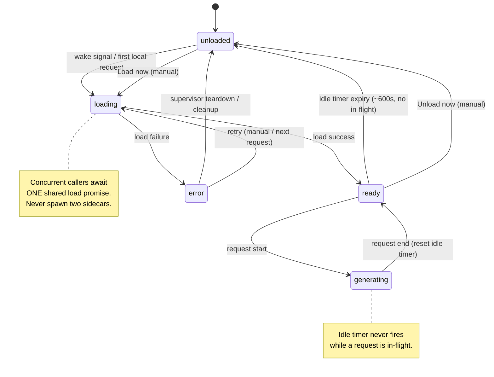
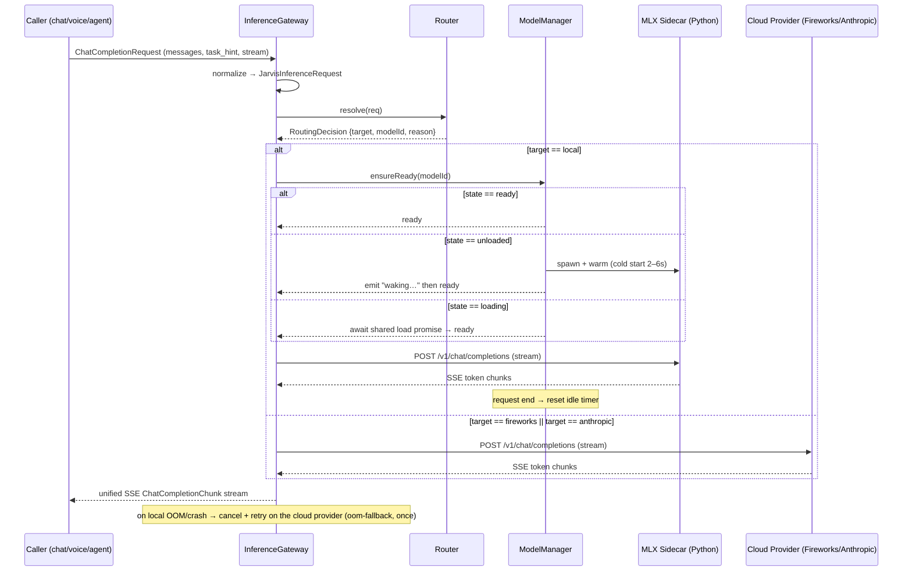

# Local Qwen Inference Core

> Priority/build order: 1  ·  Tier: deep

## Summary
The inference core is Jarvis's model-serving backbone. It runs the latest viable Qwen chat model **locally on Apple Silicon via MLX** behind an **OpenAI-compatible API**, so all chat/agent/voice code is provider-agnostic. On the fanless M3 Air (16GB unified RAM) the local model is **on-demand**: it loads on the "Hey Jarvis" wake signal (feature 8), serves fast chat + voice turns, and **auto-unloads after ~10 min idle** to reclaim RAM for STT/TTS and embeddings. Heavy reasoning and the nightly consolidation batch (feature 6) route to **serverless cloud providers behind one OpenAI-compatible client** — Fireworks AI (`https://api.fireworks.ai/inference/v1`) for consolidation and Anthropic Claude (`https://api.anthropic.com/v1`) for reasoning and agent planning — because the Air throttles on sustained load, the heavy model is too large to hold locally, and serverless has zero idle cost (cost is not a concern either way).

A **model registry** abstraction lets the chat model, embedding model (Qwen3-Embedding-0.6B), and reranker (Qwen3-Reranker-0.6B) be swapped independently, and lets any single request be flipped between local and a cloud provider — and between cloud providers — by **config, not code**. Routing is rule-based (task type + token-count + latency budget) and deterministic; thresholds and model IDs are configurable.

Orchestration is **TypeScript/Node**; the local serving process is **mlx-lm's OpenAI-compatible server** (or LM Studio's server in dev) supervised as a Python sidecar.

## Data flow  *(REQUIRED)*

- **Inputs:**
  - Chat/agent requests from feature 2 (chat core) and feature 16 (agent loop): OpenAI-style `ChatCompletionRequest` (messages, tools, stream flag, optional `task_hint`).
  - Wake signal from feature 8 → `loadModel()` warm-up trigger.
  - Embedding/rerank requests from the memory subsystem (features 5/6).
  - Config: model registry entries, routing thresholds, idle timeout (`config/models.yaml`).
  - Provider API keys (env: `FIREWORKS_API_KEY`, `ANTHROPIC_API_KEY`) plus optional
    `FIREWORKS_ENDPOINT_URL`/`ANTHROPIC_ENDPOINT_URL` base-URL overrides for the cloud path.

- **Processing / pipeline:**
  1. **Request normalization** — incoming request hits the Node `InferenceGateway`. Body is validated/normalized to a canonical `JarvisInferenceRequest`. A `task_hint` (`voice` | `chat` | `agent` | `reasoning` | `consolidation` | `embedding` | `rerank`) is attached (explicit from caller, else inferred from endpoint/context).
  2. **Routing decision** — `Router.resolve(req)` applies the rules in *Logic/rules* to pick a `target: 'local' | 'fireworks' | 'anthropic'` and a registry `modelId`. Decision is logged with reason code.
  3. **Lifecycle gate (local only)** — if `target === 'local'`, `ModelManager.ensureReady(modelId)`:
     - state `ready` → proceed immediately.
     - state `unloaded` → spawn/warm the MLX sidecar (cold start ~2–6s), emit `waking` event, surface "waking up…" to UI.
     - state `loading` → await the in-flight load promise (no double-load).
  4. **Dispatch** — request forwarded as OpenAI-compatible call: local → MLX sidecar `http://127.0.0.1:<port>/v1/chat/completions`; cloud → the provider's OpenAI-compatible `…/chat/completions`. Prompt/prefix cache reused on the local path (stable system prompt prefix).
  5. **Streaming** — tokens streamed back SSE → caller as they arrive (TTFT is the voice bottleneck). Gateway re-emits a unified SSE chunk stream.
  6. **Idle accounting** — every completed local request resets the idle timer. On timer expiry (~600s) `ModelManager.unload()` tears down the sidecar / frees weights.
  7. **Telemetry** — TTFT, tokens/s, target, model, fallback flag, RAM headroom recorded → status surfaces + life-metrics dashboard.

- **Outputs:**
  - Streamed `ChatCompletionChunk`s (OpenAI shape) to callers.
  - `EmbeddingResponse` / rerank score arrays.
  - `ModelStatusEvent`s to the menu-bar app + dashboard.
  - Structured logs/metrics (routing reason, latency, fallback).

- **Schemas:**

```ts
type Target = 'local' | 'fireworks' | 'anthropic';
type TaskHint =
  | 'voice' | 'chat' | 'agent'
  | 'reasoning' | 'consolidation'
  | 'embedding' | 'rerank';

type ModelKind = 'chat' | 'embedding' | 'reranker';
type ModelState = 'unloaded' | 'loading' | 'ready' | 'generating' | 'error';

interface RegistryEntry {
  id: string;                 // e.g. "qwen-local-chat"
  kind: ModelKind;
  provider: 'mlx' | 'fireworks' | 'anthropic' | 'lmstudio';
  modelRef: string;           // mlx repo id or cloud provider model ref
  quant?: '4bit' | '8bit' | 'fp16';
  ctxWindow: number;
  approxRamGB?: number;       // local memory budget hint
  endpointUrl?: string;       // cloud providers only (fireworks/anthropic)
  default?: boolean;          // default for its kind
}

interface JarvisInferenceRequest {
  messages: ChatMessage[];
  tools?: ToolSpec[];
  stream: boolean;            // default true
  taskHint: TaskHint;
  maxTokens?: number;
  forceTarget?: Target;       // escape hatch / tests
}

interface RoutingDecision {
  target: Target;
  modelId: string;
  reason: 'task-cloud' | 'task-local' | 'token-overflow'
        | 'forced' | 'local-unavailable-fallback' | 'oom-fallback';
  estPromptTokens: number;
}

interface ModelStatusEvent {
  modelId: string;
  state: ModelState;
  target: Target;
  ramHeadroomGB: number;
  fallbackActive: boolean;
  ts: number;
}
```

### Lifecycle state machine (diagram)



### Request flow (sequence diagram)



## Frontend flow  *(REQUIRED)*
This is a backend service; the "frontend" is the operator-facing surface: a **menu-bar (macOS tray) status indicator** plus a **Settings panel in the web dashboard**.

- **Screens / states:**
  - **Menu-bar icon** reflects `ModelState`:
    - `unloaded` — dim/hollow dot, tooltip "Idle (model unloaded)".
    - `loading` — animated pulse, tooltip **"waking up…"**.
    - `ready` — solid dot, tooltip "Local • Qwen ready".
    - `generating` — subtle activity glyph.
    - `error/OOM` — red dot, tooltip "Model error — see settings".
    - `cloud-fallback-active` — cloud glyph, tooltip "Running on the cloud lane".
  - **Dashboard → Settings → Models:** registry table (chat/embedding/reranker rows), each showing provider (local/Fireworks/Anthropic), current state, RAM headroom, and TTFT/tokens-s from last run.

- **Key controls:**
  - Per-kind default model selector (dropdown bound to registry entries).
  - **Local vs cloud override** toggle per kind, plus a global "Prefer cloud (throttle-safe)" switch.
  - **Load now / Unload now** buttons (manual lifecycle override).
  - Idle-timeout slider (default 600s) and routing-threshold inputs (token cutoff, latency budget).
  - Live event log (last N `RoutingDecision` + `ModelStatusEvent`).

- **User journey:**
  1. User says "Hey Jarvis" → wake signal → menu-bar shows **"waking up…"** during the cold start.
  2. Within a few seconds state → `ready`; voice/chat turns stream with low TTFT; icon flickers to `generating` per turn.
  3. User walks away; after ~10 min idle the model unloads, icon dims, RAM is freed.
  4. User asks a heavy multi-step question; router sends it to the configured cloud provider; icon shows cloud-fallback glyph and dashboard logs reason `token-overflow`/`task-cloud`.
  5. If local OOMs, dashboard shows the OOM error and the request auto-retries on the cloud provider (`oom-fallback`); operator can pin "Prefer cloud" until resolved.

## Logic / rules  *(deep tier)*

**Load/unload state machine (deterministic):**
- States: `unloaded → loading → ready → generating → (ready) → unloaded`; plus `error`.
- Triggers:
  - Wake signal (feature 8) **or** first local-routed request → `loading` (idempotent; concurrent callers await one load promise).
  - Load success → `ready`. Load failure → `error` (then fall back to the cloud provider for the pending request).
  - Request start → `generating`; request end → `ready` and **reset idle timer**.
  - Idle timer expiry (default **600s**, configurable) with no in-flight request → `unload()` → `unloaded`. Weights + KV cache freed; sidecar may stay as a thin parked process or be killed (configurable; default kill to reclaim full RAM).
  - Manual **Unload now** forces `unloaded`; **Load now** forces `loading`.
- Only the **chat** model participates in idle auto-unload. The embedding model (Qwen3-Embedding-0.6B, ~0.6GB) is tiny and may stay resident (configurable). Cloud providers have no local lifecycle.

**Reference: `Router.resolve()` (routing rules, deterministic order):**

```ts
// src/inference/router.ts
const AGENT_LOCAL_TOKEN_CAP = 12_000; // configurable
const LOCAL_CTX_SAFE        = 14_000; // configurable

export class Router {
  constructor(
    private registry: Registry,
    private ram: RamProbe,
    private cfg: RoutingConfig, // cloudTaskProviders, defaultCloudProvider, agentPreferCloud, ...
  ) {}

  resolve(req: JarvisInferenceRequest): RoutingDecision {
    const estPromptTokens = estimateTokens(req.messages, req.tools);

    // 1. explicit override / escape hatch
    if (req.forceTarget) {
      return this.decide(req.forceTarget, req.taskHint, 'forced', estPromptTokens);
    }

    // 2. hard context ceiling — overrides task preference
    if (estPromptTokens > LOCAL_CTX_SAFE) {
      const cloudTarget = this.cfg.cloudTaskProviders[req.taskHint] ?? this.cfg.defaultCloudProvider;
      return this.decide(cloudTarget, req.taskHint, 'token-overflow', estPromptTokens);
    }

    switch (req.taskHint) {
      // 3. heavy / long agentic work → cloud, provider chosen per task class
      case 'consolidation':
      case 'reasoning':
        return this.decide(this.cfg.cloudTaskProviders[req.taskHint], req.taskHint, 'task-cloud', estPromptTokens);

      // 4. latency-critical short turns → local
      case 'voice':
      case 'chat':
        return this.decide('local', req.taskHint, 'task-local', estPromptTokens);

      // 5. agent: cloud-preferred by default (agentPreferCloud); otherwise
      //    local-first, escalating on token/latency budget
      case 'agent': {
        if (this.cfg.agentPreferCloud) {
          return this.decide(this.cfg.cloudTaskProviders.agent, 'agent', 'task-cloud', estPromptTokens);
        }
        const overBudget =
          estPromptTokens > AGENT_LOCAL_TOKEN_CAP ||
          this.cfg.expectLoopOverLatencyBudget(req);
        return overBudget
          ? this.decide(this.cfg.cloudTaskProviders.agent, 'agent', 'token-overflow', estPromptTokens)
          : this.decide('local', 'agent', 'task-local', estPromptTokens);
      }

      // 6. tiny, cheap → local registry default
      case 'embedding':
      case 'rerank':
        return this.decide('local', req.taskHint, 'task-local', estPromptTokens);
    }
  }

  private decide(
    target: Target, hint: TaskHint,
    reason: RoutingDecision['reason'], estPromptTokens: number,
  ): RoutingDecision {
    // pre-flight RAM guard: a local pick with no headroom is downgraded to the
    // default cloud provider
    if (target === 'local' && this.ram.headroomGB() < this.cfg.ramFloorGB) {
      target = this.cfg.defaultCloudProvider;
      reason = 'local-unavailable-fallback';
    }
    const modelId = this.registry.defaultFor(kindFor(hint), target).id;
    log.routing({ target, modelId, reason, estPromptTokens });
    return { target, modelId, reason, estPromptTokens };
  }
}
```

**Reference: `ModelManager.ensureReady()` (load state machine + shared load promise):**

```ts
// src/inference/modelManager.ts
export class ModelManager {
  private state: ModelState = 'unloaded';
  private loadPromise: Promise<void> | null = null; // shared in-flight load
  private idleTimer?: NodeJS.Timeout;
  private active = 0; // in-flight request count

  constructor(
    private sidecar: Supervisor,
    private events: EventBus,
    private cfg: LifecycleConfig, // { idleMs: 600_000, killOnUnload: true, ... }
  ) {}

  async ensureReady(modelId: string): Promise<void> {
    if (this.state === 'ready' || this.state === 'generating') return;

    // collapse concurrent callers onto ONE load — never spawn two sidecars
    if (this.state === 'loading' && this.loadPromise) return this.loadPromise;

    this.setState('loading');
    this.events.emit({ type: 'waking', modelId }); // UI shows "waking up…"
    this.loadPromise = this.sidecar
      .spawnAndWarm(modelId)        // cold start ~2–6s
      .then(() => this.setState('ready'))
      .catch((err) => {
        this.setState('error');     // caller falls back to the cloud provider for this request
        throw err;
      })
      .finally(() => { this.loadPromise = null; });

    return this.loadPromise;
  }

  beginRequest() { this.active++; this.clearIdle(); this.setState('generating'); }

  endRequest() {
    if (--this.active === 0) { this.setState('ready'); this.armIdle(); }
  }

  private armIdle() {
    this.idleTimer = setTimeout(() => {
      if (this.active === 0 && this.state === 'ready') this.unload();
    }, this.cfg.idleMs); // default 600_000 — never fires mid-generation
  }

  private clearIdle() { if (this.idleTimer) clearTimeout(this.idleTimer); }

  async unload() {
    this.clearIdle();
    await this.sidecar.teardown({ kill: this.cfg.killOnUnload }); // free weights + KV
    this.setState('unloaded');
  }

  private setState(s: ModelState) {
    this.state = s;
    this.events.emit({ type: 'state', state: s });
  }
}
```

**Reference: launching the mlx-lm OpenAI-compatible sidecar (Python):**

```python
# src/inference/sidecar/mlx_server.py
import sys
from mlx_lm.server import run  # OpenAI-compatible HTTP server

def launch(model_ref: str, port: int) -> None:
    # Serves /v1/chat/completions, /v1/completions on 127.0.0.1:<port>.
    # Prompt/prefix KV cache is reused across turns when the system-prompt
    # prefix is stable (keep it short). hermes parser enables tool-calls.
    run(
        model=model_ref,            # e.g. "mlx-community/Qwen3-4B-Instruct-2507-4bit"
        host="127.0.0.1",
        port=port,
        adapter_path=None,
        trust_remote_code=False,
    )

if __name__ == "__main__":
    # argv: <model_ref> <port> — spawned/supervised by supervisor.ts
    launch(sys.argv[1], int(sys.argv[2]))
```

**Local vs cloud routing (deterministic rules, configurable thresholds):**
1. `forceTarget` set → honor it (`reason: forced`).
2. Any task with `estPromptTokens > LOCAL_CTX_SAFE (default 14k)` → the task hint's configured
   cloud provider, else `defaultCloudProvider` (`token-overflow`) — checked before task-class
   dispatch.
3. `taskHint ∈ {consolidation, reasoning}` → `cloudTaskProviders[taskHint]` (**Fireworks** for
   consolidation, **Anthropic** for reasoning) (`task-cloud`) — heavy/long agentic loops avoid
   throttling the fanless Air.
4. `taskHint ∈ {voice, chat}` → **local** (`task-local`) — latency-critical, short turns.
5. `taskHint === agent` → `cloudTaskProviders.agent` (**Anthropic**) when `agentPreferCloud` is
   set (the default); otherwise **local** first, escalating to `cloudTaskProviders.agent` if
   estimated prompt tokens **> AGENT_LOCAL_TOKEN_CAP (default 12k)** or the tool loop is
   expected to exceed the **latency budget** → `token-overflow`.
6. `taskHint ∈ {embedding, rerank}` → local registry default (tiny, cheap).
7. **Fallbacks:** local load/runtime failure before first token → retry once on the task
   hint's cloud provider (`local-unavailable-fallback` / `oom-fallback`); a cloud failure
   before first token → retry once locally (`fallbackActive=true`, visible in telemetry).

**Quantization & model-choice defaults for 16GB (configurable):**
- Default local chat: **Qwen3-4B-Instruct-2507 (or 9B-class), MLX 4-bit** (~5–6GB resident) — leaves headroom for STT/TTS + embeddings within 16GB.
- The heavy reasoning model (Qwen3-Next-80B-A3B-Instruct) is **excluded locally** (too large to hold in 16GB) → hosted-only via **Fireworks AI**. Claude Sonnet 5 is API-only → only ever an Anthropic target, never local.
- Serving engine: **MLX (mlx-lm)** for lowest TTFT / fastest prefill (~5x Ollama). Optional GGUF/llama.cpp profile for long agentic tool-call stability (selectable per registry entry).

**Streaming & caching (deterministic behavior):**
- `stream: true` is the default for chat/voice/agent; tokens forwarded as they arrive (perceived latency = TTFT).
- **Prompt/prefix caching** enabled on the local path: keep the system prompt **short and stable** so the prefix KV cache is reused across turns.
- Tool-call parser **hermes** + guided/structured decoding enabled for `agent` requests (consumed by feature 16).

**Deterministic vs configurable:** the state-machine transitions, routing rule *order*, and fallback chain are deterministic. Configurable: idle timeout, token/latency thresholds, default model per kind, local-vs-cloud overrides, `cloudTaskProviders`/`agentPreferCloud`, quant level, embedding-resident flag, and whether the sidecar is killed vs parked on unload.

## Edge cases & safety

| Case | Trigger | Behavior |
| --- | --- | --- |
| Cold-start during voice turn | First request after wake while `unloaded` | Pay ~2–6s cold start; emit `waking` + "waking up…" so the user isn't left in silence. Subsequent turns are warm. |
| Concurrent load requests | Two callers hit `ensureReady()` while `loading` | Both await the single shared `loadPromise`; never spawn two MLX sidecars for one model. |
| Pre-flight RAM pressure | `ramHeadroomGB < ramFloorGB` (e.g. <2GB) before a local pick | Router downgrades target to the configured cloud provider (`local-unavailable-fallback`) rather than attempting the load. |
| Runtime OOM | MLX raises OOM mid-generation | Cancel local generation, auto-retry the request once on the cloud provider (`oom-fallback`); surface OOM in dashboard. |
| Thermal throttle | Sustained local agent loop | Pre-empted by rule 4 (token/latency escalation to the cloud provider); the fanless Air is never asked to grind a long reasoning chain. |
| Sidecar crash | Python process dies unexpectedly | Supervisor restarts it; state → `error` → `unloaded`; in-flight request fails over to the cloud provider. |
| Load failure | `spawnAndWarm()` rejects | State → `error`; pending request routed to the cloud provider (`local-unavailable-fallback`); error surfaced for retry. |
| Cloud provider unavailable | Cloud is the only viable target and is down | Surface a clear error; rare for `voice/chat` since those stay local-first. |
| Idle timer race | Timer would fire while a request is in-flight | Timer only arms from `ready` with `active === 0`; `beginRequest()` clears it. Never unloads mid-generation. |
| Config hot-swap | Operator changes a registry default | Affected local model unloads lazily (next-request reload), never mid-generation. |
| Token estimation error | Fast tokenizer under-estimates; context overflows at runtime | Fail over to the cloud provider rather than truncating silently. |
| Streaming abort | Client disconnects mid-stream | Cancel the upstream generation to free the model/KV cache promptly. |
| Manual override conflict | Operator hits Unload now during `generating` | Unload deferred until `endRequest()`; no teardown mid-generation. Load now from `unloaded` forces `loading`. |
| Embedding under memory pressure | Resident embedding model + chat load exceed budget | Embedding-resident flag honored, but chat load still RAM-guarded; embedding may be evicted per config. |

## Dependencies  *(REQUIRED)*
- [architecture/model-serving.md](../architecture/model-serving.md) — MLX vs llama.cpp serving strategy, quant levels, cloud provider setup, prefix-cache config.
- [architecture/architecture.md](../architecture/architecture.md) — overall system layout; this core is the model layer all features call.
- [features/2-conversational-chat-core.md](./2-conversational-chat-core.md) — primary consumer of the OpenAI-compatible chat API and streaming.
- [features/8-wake-word-and-hands-free.md](./8-wake-word-and-hands-free.md) — emits the wake signal that triggers `loadModel()` and the "waking up…" state.
- [features/6-nightly-memory-consolidation.md](./6-nightly-memory-consolidation.md) — heavy batch job routed to Fireworks AI (`consolidation` task) + uses embedding/rerank models from the registry.
- [features/16-agent-tool-execution-core.md](./16-agent-tool-execution-core.md) — consumes tool-call parsing / guided decoding and the agent routing/escalation rules.

## File structure  *(deep tier)*
```
src/inference/
  gateway.ts              # InferenceGateway: HTTP entry, normalization, SSE re-emit
  router.ts               # Router.resolve() — routing rules + reason codes
  modelManager.ts         # load/unload state machine, idle timer, ensureReady()
  registry.ts             # model registry: entries, defaults, swap logic
  providers/
    mlxProvider.ts        # talks to local mlx-lm OpenAI server (sidecar)
    openAiCompatProvider.ts   # one parameterized OpenAI-compatible client (Fireworks, Anthropic)
    lmstudioProvider.ts   # optional dev provider (LM Studio server)
  sidecar/
    mlx_server.py         # mlx-lm OpenAI-compatible server launcher + supervisor hooks
    supervisor.ts         # spawn/kill/health-check the Python sidecar
  ram.ts                  # RAM headroom probe (unified-memory aware)
  telemetry.ts            # TTFT / tokens-s / fallback metrics
  types.ts                # shared schemas (above)
config/
  models.yaml             # registry entries, routing thresholds, idle timeout
ui/
  menubar/ModelStatus.tsx # tray indicator (unloaded/loading/ready/...)
  dashboard/ModelsSettings.tsx  # registry table, overrides, load/unload, thresholds
```
