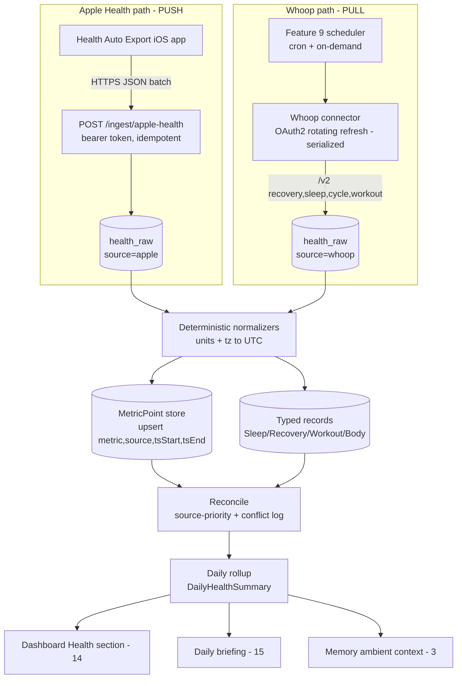

# Health & Sleep Metrics
> Priority/build order: 10  ·  Tier: deep

## Summary
Ingests and models personal **health & sleep** data from two locked v1 sources — **Apple Health** (Apple Watch, via the *Health Auto Export* iOS app POSTing JSON to a local REST endpoint; there is **no** Apple Health cloud API) and **Whoop** (OAuth2 pull, v2 API). Both sources flow through the shared connector framework (feature 9). Raw payloads are normalized into a unified, append-only `MetricPoint` store plus typed `SleepRecord` / `RecoveryRecord` / `Workout` records, then rolled up into a **daily health summary**. All transforms are **deterministic** (no LLM). Outputs feed the Health section of the dashboard (feature 14), the daily briefing (feature 15), and supply ambient context to memory (feature 3).

Most data is **T+1**: Apple Health only pushes while the device is unlocked (typically the morning after); Whoop publishes recovery/sleep after a sleep cycle completes. The system treats "no data yet today" as expected, not as an error, and surfaces a **stale (T+1)** state rather than failing.

Because both an Apple Watch and a Whoop band may report overlapping metrics (HR, sleep), a **deterministic source-priority table** decides the canonical value per metric and records conflicts for transparency.

## Data flow  *(REQUIRED)*
**Inputs:** Apple Health push (local REST) + Whoop pull (feature 9 connector) · **Outputs:** health `MetricPoint` series + typed records + daily health summary · **Schemas:** below.

Numbered pipeline:
1. **Apple Health push** — Health Auto Export app POSTs batched JSON to `POST /ingest/apple-health` (local-only, bearer-token shared secret from `architecture/auth-and-integrations.md`). The endpoint is **idempotent**: it may receive overlapping/repeat windows on every export.
2. **Whoop pull** — feature 9 scheduler invokes the Whoop connector (OAuth2, **rotating refresh token — serialized**) on a cron + on-demand, fetching `/v2/recovery`, `/v2/activity/sleep`, `/v2/cycle`, `/v2/activity/workout` since the last cursor.
3. **Raw landing** — each source writes immutable raw rows to `health_raw` keyed by `(source, externalId, payloadHash)` for idempotency and replay.
4. **Normalize** — source-specific normalizers convert raw → `MetricPoint[]` + typed records (`SleepRecord`/`RecoveryRecord`/`Workout`/body metrics), converting units to canonical SI-ish units and timestamps to UTC (storing original tz offset).
5. **Upsert (idempotent)** — `MetricPoint`s upsert on `(metric, source, tsStart, tsEnd)`; typed records upsert on `(source, externalId)`. Re-POSTed overlapping windows replace, never duplicate.
6. **Reconcile** — for metrics with multiple sources on the same day, apply the source-priority table → write canonical `MetricPoint` (`source = "canonical"`, `derivedFrom = [...]`) and log a `MetricConflict` when values diverge beyond tolerance.
7. **Daily rollup** — a deterministic job builds `DailyHealthSummary` (one row per local calendar day) from canonical points + typed records; idempotent recompute on any late/backfilled data.
8. **Fan-out** — summary + series exposed via internal query API to dashboard (14), briefing (15); a compact daily digest event is emitted to memory (3).

### Mermaid — two ingest paths → normalize → store → consumers


### Schemas
```ts
// Canonical time-series point (append-only, idempotent upsert)
interface MetricPoint {
  id: string;                 // ulid
  metric: HealthMetric;       // enum: sleepDuration | hrv | restingHr | recovery | strain | steps | activeEnergy | ...
  source: "apple" | "whoop" | "canonical";
  value: number;              // canonical unit (see mapping table)
  unit: string;               // canonical unit string, e.g. "ms","bpm","count","kcal","min","%"
  tsStart: string;            // ISO UTC (instant or window start)
  tsEnd: string;              // ISO UTC (== tsStart for instants)
  tzOffsetMin: number;        // original device offset, for local-day bucketing
  externalId?: string;        // source record id when applicable
  derivedFrom?: string[];     // for source=canonical: ids of contributing points
  ingestedAt: string;         // ISO UTC
}

interface SleepRecord {
  id: string; source: "apple" | "whoop"; externalId: string;
  localDay: string;           // YYYY-MM-DD the night is attributed to (wake day)
  bedtime: string;            // ISO UTC
  wakeTime: string;           // ISO UTC
  inBedMin: number;
  asleepMin: number;
  efficiencyPct: number;      // asleep / inBed * 100
  stages: { awakeMin: number; lightMin: number; deepMin: number; remMin: number };
  performancePct?: number;    // Whoop sleep performance
  respiratoryRate?: number;
  isNap: boolean;
  partial: boolean;           // missing stages or truncated window
}

interface RecoveryRecord {
  id: string; source: "whoop"; externalId: string;  // v1: recovery only from Whoop
  localDay: string;
  recoveryPct: number;        // 0-100
  hrvMs: number;              // RMSSD
  restingHr: number;          // bpm
  spo2Pct?: number;
  skinTempC?: number;
  scoreState: "SCORED" | "PENDING_SCORE" | "UNSCORABLE";
}

interface Workout {
  id: string; source: "apple" | "whoop"; externalId: string;
  localDay: string;
  start: string; end: string; // ISO UTC
  type: string;               // normalized activity name
  durationMin: number;
  activeEnergyKcal?: number;
  avgHr?: number; maxHr?: number;
  strain?: number;            // Whoop 0-21
  distanceM?: number;
}

interface DailyHealthSummary {
  localDay: string;           // PK
  sleep?: { asleepMin: number; efficiencyPct: number; bedtime: string; wakeTime: string;
            stages: SleepRecord["stages"]; source: string };
  recoveryPct?: number; hrvMs?: number; restingHr?: number; strain?: number;
  steps?: number; activeEnergyKcal?: number;
  workouts: { count: number; totalMin: number; totalKcal: number };
  body?: { weightKg?: number; bodyFatPct?: number };
  sources: string[];          // which sources contributed
  conflicts: MetricConflict[];
  stale: boolean;             // true if no data for today yet (T+1 expected)
  computedAt: string;
}

interface MetricConflict {
  metric: HealthMetric; localDay: string;
  values: { source: string; value: number }[];
  chosen: string;             // winning source per priority table
  deltaPct: number;
}
```

### MetricPoint mapping table (metric | source | unit | cadence)
| Metric | Source(s) | Canonical unit | Cadence |
|---|---|---|---|
| sleepDuration | whoop*, apple | min | per night (T+1) |
| sleepEfficiency | whoop*, apple | % | per night |
| sleepStages (awake/light/deep/rem) | whoop*, apple | min | per night |
| recovery | whoop* | % (0-100) | daily AM (T+1) |
| readiness (alias of recovery) | whoop* | % | daily AM |
| hrv | whoop*, apple | ms (RMSSD) | daily AM + intermittent |
| restingHr | whoop*, apple | bpm | daily AM |
| strain | whoop* | score 0-21 | daily (cycle) |
| steps | apple* | count | daily (rollup) |
| activeEnergy | apple*, whoop | kcal | daily + per-workout |
| heartRate (samples) | apple, whoop | bpm | intermittent samples |
| workout | whoop, apple | event | per event |
| weight | apple* | kg | sporadic |
| bodyFat | apple* | % | sporadic |
| respiratoryRate | whoop*, apple | breaths/min | per night |
| spo2 | apple, whoop | % | nightly/spot |

`*` = source-priority winner for that metric (see Logic / rules).

## Frontend flow  *(REQUIRED)*
Dashboard **Health section** (feature 14), read-only, queries the internal summary/series API.

Components:
- **Sleep chart** — last 14 nights stacked-bar (awake/light/deep/rem) + line for `asleepMin`; tap a bar → bedtime/waketime/efficiency detail.
- **HRV / RHR trends** — dual sparkline (7/30/90-day toggle) with rolling-baseline band; arrow vs personal baseline.
- **Recovery & Strain rings** — recovery % ring (red/amber/green bands) and strain ring (0-21), today + yesterday.
- **Workouts list** — today/this-week workouts: type, duration, kcal, strain/avg HR.

States:
- **Empty** — no source ever connected → CTA "Connect Apple Health" (setup instructions for Health Auto Export) and "Connect Whoop" (OAuth, feature 9).
- **Loading** — skeleton rings/charts while query resolves.
- **Stale (T+1)** — connected but today's data not in yet (expected): show *yesterday's* values with a muted "Updated <time>, today's data arrives after sync" badge; never an error.
- **Error** — connector in error state (feature 9 status) or query failed: inline banner with last-good values + "last synced" + retry/reconnect link.
- **Partial** — sleep present but stages missing → render duration bar greyed with "stages unavailable" note.
- **Conflict** — when `summary.conflicts` non-empty, a small info badge on the affected metric showing chosen source ("Whoop · Apple differs 8%").

## Logic / rules  *(deep tier)*
- **Local-day attribution**: each record/point is bucketed by **local calendar day** using `tzOffsetMin`. Sleep is attributed to its **wake day**. Naps (`isNap`) are excluded from the night summary but kept as records.
- **Idempotency**: raw rows keyed `(source, externalId, payloadHash)`; `MetricPoint` upsert key `(metric, source, tsStart, tsEnd)`; typed records `(source, externalId)`. Re-POSTed overlapping windows update in place.
- **Unit normalization (deterministic)**: Apple sends per-metric units in the JSON (`"units"` field) — convert to canonical (e.g. miles→`distanceM` *1609.34, kcal as-is, °F→°C). Whoop v2 returns SI; map directly. Reject unknown units to a quarantine table, never silently coerce.
- **Source-priority table (canonical value selection)**:
  - **recovery, strain, hrv, restingHr, respiratoryRate** → **Whoop** (purpose-built recovery sensor).
  - **steps, activeEnergy, weight, bodyFat, spo2** → **Apple** (watch + Health ecosystem coverage).
  - **sleep (duration/stages/efficiency)** → **Whoop** primary; fall back to Apple if Whoop night missing.
  - **workouts** → keep **both** (de-dup overlapping events by time-overlap ≥70% + same type, prefer Whoop for strain, Apple for kcal).
- **Conflict logging**: when both sources report a canonical metric for the same day and `deltaPct > tolerance` (HRV 10%, RHR 5%, sleepDuration 8%), write a `MetricConflict`; canonical still follows priority table.
- **Daily rollup** is a pure function of stored points/records → fully recomputable; recompute triggered on any insert touching that `localDay`.
- **Backfill on first connect**: Whoop connector pulls trailing **90 days** (feature 9 bounded backfill with pagination + rate-limit respect). Apple Health backfill = user does a one-time large export from the app; endpoint handles big batches via chunked processing.
- **Staleness rule**: `stale = true` when no canonical point exists for today's `localDay` after the expected arrival window (Apple: configurable, default 11:00 local; Whoop: default 10:00 local). Stale ≠ error.

## Edge cases & safety
- **No PII leaves device**: endpoint local-only; Whoop tokens in OS keychain (feature 9 / auth doc). Bearer secret required on the Apple endpoint; reject otherwise.
- Reconciliation never overwrites raw; canonical is derived and always reversible.
- Body metrics & health data flagged sensitive; excluded from any outbound LLM context except the compact digest (feature 3 redaction policy).

| # | Edge case | Handling |
|---|---|---|
| 1 | Device locked → no Apple push (T+1 gap) | Expected; mark `stale`, show yesterday + badge, no error. |
| 2 | Duplicate / overlapping Apple windows re-POSTed | Idempotent upsert on `(metric,source,tsStart,tsEnd)` + `payloadHash` dedupe. |
| 3 | Dual-source conflict (Apple vs Whoop HRV/sleep) | Source-priority table picks canonical; log `MetricConflict`, badge in UI. |
| 4 | Whoop rotating refresh token | Serialize token refresh (single-flight mutex, feature 9); persist new refresh atomically; on `invalid_grant` → mark connector reauth-needed. |
| 5 | Units differ (miles, °F, kJ) | Deterministic conversion from payload `units`; unknown → quarantine, alert, no coercion. |
| 6 | Timezone / travel across zones | Store UTC + `tzOffsetMin`; bucket by local day; DST handled via offset at record time. |
| 7 | Missing night (no sleep recorded) | `sleep` omitted from summary; UI shows gap, not zero; briefing notes "no sleep data". |
| 8 | Partial sleep (stages missing / truncated) | `partial=true`; render duration only, greyed stages, exclude from baseline if asleepMin too low. |
| 9 | Backfill on first connect (90d Whoop / bulk Apple) | Bounded paginated backfill; chunked endpoint processing; rollups recomputed per day. |
| 10 | Whoop `PENDING_SCORE` / `UNSCORABLE` recovery | Store record with `scoreState`; treat as missing for canonical until `SCORED`; idempotent re-pull updates. |
| 11 | Late-arriving / out-of-order data | Recompute affected `localDay` rollups idempotently; UI re-renders on next query. |
| 12 | Workout double-count (watch + Whoop same session) | De-dup by ≥70% time overlap + type; merge fields per priority. |
| 13 | Clock skew / future timestamps | Reject points with `tsStart > now + 5min` to quarantine. |
| 14 | Oversized Apple batch (full export) | Stream/chunk parse, cap per-request size, 413 with guidance; process async if huge. |
| 15 | Unauthenticated POST to endpoint | 401, rate-limited, logged; never process. |

## Dependencies  *(REQUIRED)*
- `features/9-data-integration-framework.md` — connector base, OAuth2 + rotating-refresh handling, scheduler, raw landing, status/error states, backfill primitives.
- `features/3-memory-capture-and-ingestion.md` — consumes compact daily health digest as ambient context (with redaction).
- `features/14-metrics-dashboard-ui.md` — renders Health section (sleep chart, HRV/RHR, rings, workouts) and consumes states.
- `features/15-daily-briefing-and-digest.md` — pulls `DailyHealthSummary` for the morning briefing.
- `architecture/auth-and-integrations.md` — local endpoint bearer secret, Whoop OAuth client/scopes, keychain token storage.
- `architecture/architecture.md` — local store (SQLite/Drizzle), job runner, internal query API conventions.

## File structure  *(deep tier)*
```
src/features/health/
  ingest/
    appleHealthEndpoint.ts      # POST /ingest/apple-health handler (idempotent)
    appleHealthNormalizer.ts    # HAE JSON -> MetricPoint[] + records
    whoopConnector.ts           # extends feature 9 base; OAuth2 rotating refresh
    whoopNormalizer.ts          # recovery/sleep/cycle/workout -> MetricPoints
  model/
    schemas.ts                  # MetricPoint, SleepRecord, RecoveryRecord, Workout, summary
    sourcePriority.ts           # deterministic priority + conflict tolerance config
    units.ts                    # unit conversion table
  store/
    healthRaw.repo.ts           # raw landing (idempotent)
    metricPoint.repo.ts         # upsert/query MetricPoint
    records.repo.ts             # typed record upserts
    summary.repo.ts             # DailyHealthSummary
  pipeline/
    reconcile.ts                # source-priority + MetricConflict
    dailyRollup.ts              # pure rollup function
  api/
    healthQuery.ts              # query API for dashboard/briefing/memory
  __tests__/
    idempotency.test.ts  reconcile.test.ts  units.test.ts  rollup.test.ts
```

### Code snippet 1 — Apple Health local endpoint (idempotent upsert of Health Auto Export JSON)
```ts
// src/features/health/ingest/appleHealthEndpoint.ts
import { createHash } from "node:crypto";
import { normalizeAppleHealth } from "./appleHealthNormalizer";
import { rawRepo, metricRepo, recordRepo } from "../store";
import { scheduleRollup } from "../pipeline/dailyRollup";

export async function handleAppleHealthPost(req, res) {
  if (req.headers.authorization !== `Bearer ${process.env.HEALTH_INGEST_SECRET}`)
    return res.status(401).end();                       // edge #15

  const body = req.body; // Health Auto Export shape: { data: { metrics: [...], workouts: [...] } }
  if (!body?.data) return res.status(400).json({ error: "no data" });

  const points = [], records = [];
  for (const m of body.data.metrics ?? []) {
    for (const sample of m.data ?? []) {                 // each sample: {date, qty/value, units?}
      const hash = createHash("sha1")
        .update(`apple|${m.name}|${sample.date}|${sample.qty ?? sample.value}`).digest("hex");
      // idempotent raw landing — overlapping re-POSTs collapse to one row
      const fresh = await rawRepo.upsert({ source: "apple", externalId: hash, payloadHash: hash, raw: sample });
      if (!fresh) continue;                              // edge #2: already seen, skip work
      const out = normalizeAppleHealth(m.name, sample, m.units); // edge #5 units, #6 tz, #13 future-ts
      points.push(...out.points); records.push(...out.records);
    }
  }
  if (points.length) await metricRepo.upsertMany(points); // key (metric,source,tsStart,tsEnd)
  if (records.length) await recordRepo.upsertMany(records);

  const days = new Set(points.map(p => p.localDay ?? p.tsStart.slice(0, 10)));
  for (const d of days) scheduleRollup(d);               // edge #11 idempotent recompute
  return res.status(200).json({ accepted: points.length + records.length });
}
```

### Code snippet 2 — Whoop recovery/sleep normalizer → MetricPoints
```ts
// src/features/health/ingest/whoopNormalizer.ts
import { ulid } from "ulid";
import type { MetricPoint, RecoveryRecord, SleepRecord } from "../model/schemas";

const localDayOf = (iso: string, tzOffsetMin: number) =>
  new Date(new Date(iso).getTime() + tzOffsetMin * 60_000).toISOString().slice(0, 10);

export function normalizeWhoopRecovery(r: any, tzOffsetMin: number) {
  const day = localDayOf(r.created_at, tzOffsetMin);
  const at = r.created_at, now = new Date().toISOString();
  const rec: RecoveryRecord = {
    id: ulid(), source: "whoop", externalId: String(r.cycle_id),
    localDay: day, recoveryPct: r.score?.recovery_score,
    hrvMs: r.score?.hrv_rmssd_milli, restingHr: r.score?.resting_heart_rate,
    spo2Pct: r.score?.spo2_percentage, skinTempC: r.score?.skin_temp_celsius,
    scoreState: r.score_state,                          // edge #10
  };
  const points: MetricPoint[] = r.score_state === "SCORED" ? [
    mp("recovery", rec.recoveryPct, "%", at, tzOffsetMin),
    mp("hrv", rec.hrvMs, "ms", at, tzOffsetMin),
    mp("restingHr", rec.restingHr, "bpm", at, tzOffsetMin),
  ] : [];                                               // pending/unscorable -> no canonical yet
  return { records: [rec], points };
  function mp(metric: any, value: number, unit: string, ts: string, tz: number): MetricPoint {
    return { id: ulid(), metric, source: "whoop", value, unit,
             tsStart: ts, tsEnd: ts, tzOffsetMin: tz, externalId: String(r.cycle_id), ingestedAt: now };
  }
}

export function normalizeWhoopSleep(s: any, tzOffsetMin: number) {
  const st = s.score?.stage_summary ?? {};
  const inBed = ms2min(st.total_in_bed_time_milli);
  const asleep = inBed - ms2min(st.total_awake_time_milli);
  const rec: SleepRecord = {
    id: ulid(), source: "whoop", externalId: String(s.id),
    localDay: localDayOf(s.end, tzOffsetMin),           // attribute to wake day
    bedtime: s.start, wakeTime: s.end,
    inBedMin: inBed, asleepMin: asleep,
    efficiencyPct: inBed ? +(asleep / inBed * 100).toFixed(1) : 0,
    stages: { awakeMin: ms2min(st.total_awake_time_milli),
              lightMin: ms2min(st.total_light_sleep_time_milli),
              deepMin: ms2min(st.total_slow_wave_sleep_time_milli),
              remMin: ms2min(st.total_rem_sleep_time_milli) },
    performancePct: s.score?.sleep_performance_percentage,
    respiratoryRate: s.score?.respiratory_rate,
    isNap: !!s.nap, partial: s.score_state !== "SCORED",  // edge #8
  };
  return { records: [rec], points: [] };
  function ms2min(x?: number) { return x ? Math.round(x / 60000) : 0; }
}
```
