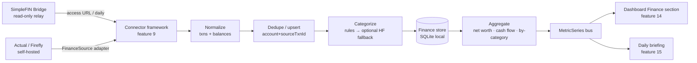

# Finance Metrics
> Priority/build order: 11  ·  Tier: deep  ·  Status: v2 (deferred — spec only, not in v1 build)

## Summary

v2 / deferred — specced now, built after v1.

Finance Metrics turns read-only banking data into the dashboard's wealth picture: account balances, net worth over time, categorized transactions, spending by category, income vs. expenses, and cash flow. The data source is **SimpleFIN Bridge** (~$15/yr, read-only relay, ~daily refresh) and/or a self-hosted **Actual Budget / Firefly III** instance — never Plaid, never write access. All ingestion runs through the shared connector framework (feature 9), so finance is "just another connector" that normalizes its raw payload into the canonical `Transaction` / `AccountBalance` shapes and emits finance `MetricSeries` for the dashboard (feature 14) and the daily briefing (feature 15).

The core is **deterministic**: balances and net worth are arithmetic over fetched data; categorization defaults to a rule engine. AI is an *optional, clearly-bounded* fallback that only suggests a category for transactions the rules cannot confidently match, routed to a local/HF model — never trusted blindly, always overridable, never on the critical path. This is single-user and local-first; statements live in the local store only.

**Why deferred:** v1 ships the connector framework, calendar, email, tasks, and notes metrics. Finance adds a paid external dependency (SimpleFIN subscription), a categorization model, and money-sensitive correctness requirements that warrant their own milestone. This document is the contract for that milestone.

## Data flow  *(REQUIRED)*

**Inputs:** SimpleFIN Bridge access URL (or Actual/Firefly API base + token) — registered as a connector credential per `architecture/auth-and-integrations.md`. Pulled on the shared connector schedule (feature 9), respecting SimpleFIN's ~24 requests/day budget (default: one full sync/day + manual refresh).

**Pipeline:**
1. **Sync trigger** — connector scheduler (feature 9) fires the `finance` connector once/day, or on manual "Refresh finance" from the dashboard.
2. **Fetch** — `SimpleFinClient.fetchAccounts({ startDate })` calls `GET {accessUrl}/accounts?start-date=…`. SimpleFIN returns `{ accounts: [{ id, name, currency, balance, balance-date, transactions: [...] }] }`. (Actual/Firefly adapters expose the same `FinanceSource` interface.)
3. **Normalize** — map raw accounts → `Account` + `AccountBalance` snapshot; map raw txns → canonical `Transaction[]` (cents as integers, ISO dates, source IDs preserved for dedupe).
4. **Dedupe & upsert** — key on `(accountId, sourceTxnId)`; pending→posted transitions update in place rather than insert.
5. **Categorize** — rule engine assigns `categoryId`; unmatched txns optionally queued for AI fallback (bounded, async, low-priority).
6. **Persist** — write `accounts`, `account_balances`, `transactions`, `categories` to the local finance store (SQLite via the shared data layer).
7. **Aggregate** — recompute derived `MetricSeries`: net worth over time, spending-by-category (rolling 30/90d), income vs. expenses (monthly), cash flow (in − out per period).
8. **Emit** — publish finance `MetricSeries` + latest net worth + recent categorized txns to the metrics bus consumed by feature 14 (dashboard) and feature 15 (briefing).

**Outputs:** finance `MetricSeries` (one per metric key), current net-worth snapshot, categorized `Transaction` list, and per-account `AccountBalance` history.

**Schemas:** see [Logic / rules](#logic--rules) for `Account`, `AccountBalance`, `Transaction`, `Category`, and finance `MetricSeries` TypeScript definitions.



## Frontend flow  *(REQUIRED)*

The dashboard's **Finance section** (feature 14 host) renders four primary widgets plus a header summary:

- **Net worth header** — current net worth (sum of balances, asset − liability), with delta vs. prior period and a sparkline.
- **Net worth trend** — line chart over time from `account_balances` history (selectable 30d / 90d / 1y / all).
- **Balances** — list/grid of accounts grouped by type (checking, savings, credit, investment, loan), each showing name, masked institution, current balance, currency badge, and last-synced timestamp.
- **Spending by category** — donut/bar over rolling window; click a slice → filtered transaction list.
- **Recent transactions** — chronological list (date, merchant/description, category chip, amount with sign/color), with inline category-edit and a "pending" badge.
- **Income vs. expenses / cash flow** — grouped bars per month (income, expenses, net).

**States:**
- **needs-connect** — no finance credential registered. Show a card: "Connect your finances" → routes to the connector setup (feature 9) explaining SimpleFIN/Actual options and the read-only, ~$15/yr nature. This is the default in any environment where finance is unconfigured.
- **empty** — connected but zero transactions/balances yet (first sync pending or new account). Show "Syncing your accounts…" with the last attempt time.
- **loading** — sync in progress or initial fetch; skeletons on each widget, existing data dimmed (never blanked).
- **error** — fetch/auth failure. Show last-good data with a non-blocking banner ("Couldn't refresh finances — showing data from {timestamp}") and a Retry action. Re-auth-needed surfaces a distinct "Reconnect" CTA.
- **stale** — last successful sync older than ~36h (daily source missed). Soft "Data may be out of date" hint.

All amounts respect the user's locale/currency formatting; multi-currency accounts show their native currency badge and are excluded from the single-currency net-worth total unless a conversion rate is available (see edge cases).

## Logic / rules  *(deep tier)*

**Determinism:** every displayed number is reproducible from stored rows. Balances are taken from the source's `balance` field (authoritative), never re-derived by summing transactions (avoids drift). Net worth = Σ posted balances, sign-adjusted by account type (liabilities negative). Aggregations are pure functions of the store.

**Money representation:** integer **minor units** (cents) everywhere; currency code stored alongside. No floats in storage or arithmetic; format only at the view layer.

**Dedupe key:** `(accountId, sourceTxnId)`. If the source lacks a stable ID, fall back to a deterministic hash of `(accountId, posted-date, amount, normalizedDescription)`. Pending transactions update in place when they post (matched by source ID, or by fuzzy match on amount+merchant within a small date window if the ID changes).

**Categorization (deterministic default):** ordered rule list — user rules first, then built-in merchant/MCC keyword rules — first match wins. Output is always a valid `categoryId` or the reserved `uncategorized`. User edits create/strengthen a rule so future identical merchants auto-match.

**AI fallback (bounded):** only invoked for txns that the rule engine leaves `uncategorized`, only when AI categorization is enabled, runs async after persist, and produces a *suggestion* with a confidence score. Suggestions below a threshold stay `uncategorized`; accepted suggestions persist as a user rule. The model only ever sees `{ description, amount, existing category names }` — no account numbers, no balances. AI never changes a rule-matched category.

```typescript
// Schemas (canonical finance types, integer minor units)
export interface Account {
  id: string;                 // internal stable id
  sourceId: string;           // id from SimpleFIN/Actual
  connectorId: string;        // feature 9 connector instance
  name: string;
  institution: string;        // masked for display
  type: 'checking' | 'savings' | 'credit' | 'investment' | 'loan' | 'cash' | 'other';
  currency: string;           // ISO 4217, e.g. 'USD'
  isAsset: boolean;           // false for credit/loan
  lastSyncedAt: string;       // ISO
  status: 'active' | 'disconnected' | 'reauth_required';
}

export interface AccountBalance {
  accountId: string;
  amountMinor: number;        // integer cents, signed
  currency: string;
  asOf: string;               // ISO (source balance-date)
  capturedAt: string;         // when we stored this snapshot
}

export interface Transaction {
  id: string;                 // internal
  sourceTxnId: string | null;
  accountId: string;
  amountMinor: number;        // negative = outflow, positive = inflow
  currency: string;
  description: string;        // raw merchant/memo
  postedAt: string | null;    // ISO; null while pending
  pendingAt: string | null;
  status: 'pending' | 'posted';
  categoryId: string;         // 'uncategorized' if unknown
  categorySource: 'rule' | 'user' | 'ai' | 'none';
  categoryConfidence?: number;
  dedupeHash: string;
}

export interface Category {
  id: string;
  name: string;
  group: 'income' | 'expense' | 'transfer';
  parentId: string | null;
  color: string;
  isBuiltIn: boolean;
}

export interface FinanceMetricSeries {
  key: 'net_worth' | 'spending_by_category' | 'income_vs_expenses' | 'cash_flow' | 'account_balance';
  unit: 'minor';
  currency: string;
  points: Array<{ at: string; value: number; dim?: string }>; // dim = categoryId/accountId
  computedAt: string;
  source: 'finance';
}
```

```typescript
// SimpleFIN fetch + normalize to canonical types
export async function syncSimpleFin(
  client: SimpleFinClient,
  startDate: string,
): Promise<{ accounts: Account[]; balances: AccountBalance[]; txns: Transaction[] }> {
  const raw = await client.fetchAccounts({ startDate }); // GET {accessUrl}/accounts?start-date=...
  const now = new Date().toISOString();
  const accounts: Account[] = [];
  const balances: AccountBalance[] = [];
  const txns: Transaction[] = [];

  for (const a of raw.accounts) {
    const type = inferAccountType(a.name, a.org);
    accounts.push({
      id: stableAccountId(a.id),
      sourceId: a.id,
      connectorId: client.connectorId,
      name: a.name,
      institution: maskInstitution(a.org?.name ?? 'Unknown'),
      type,
      currency: a.currency ?? 'USD',
      isAsset: type !== 'credit' && type !== 'loan',
      lastSyncedAt: now,
      status: 'active',
    });
    balances.push({
      accountId: stableAccountId(a.id),
      amountMinor: toMinor(a.balance, a.currency),  // string/float -> integer cents
      currency: a.currency ?? 'USD',
      asOf: isoFromEpoch(a['balance-date']),
      capturedAt: now,
    });
    for (const t of a.transactions ?? []) {
      const posted = t.posted ? isoFromEpoch(t.posted) : null;
      txns.push({
        id: internalTxnId(a.id, t.id),
        sourceTxnId: t.id ?? null,
        accountId: stableAccountId(a.id),
        amountMinor: toMinor(t.amount, a.currency),
        currency: a.currency ?? 'USD',
        description: (t.description ?? t.payee ?? '').trim(),
        postedAt: posted,
        pendingAt: t.pending ? now : null,
        status: t.pending ? 'pending' : 'posted',
        categoryId: 'uncategorized',
        categorySource: 'none',
        dedupeHash: hashTxn(a.id, posted, t.amount, t.description),
      });
    }
  }
  return { accounts, balances, txns };
}
```

```typescript
// Categorization: deterministic rules first, optional HF fallback
export async function categorize(
  txn: Transaction,
  rules: CategoryRule[],
  ai?: { enabled: boolean; threshold: number; classify: (p: { description: string; amountMinor: number; categories: string[] }) => Promise<{ categoryId: string; confidence: number }> },
  categories?: Category[],
): Promise<Transaction> {
  // 1. Deterministic rules (user rules sorted before built-ins), first match wins.
  for (const r of rules) {
    if (r.matches(txn)) {
      return { ...txn, categoryId: r.categoryId, categorySource: r.isUser ? 'user' : 'rule' };
    }
  }
  // 2. Optional AI fallback — only for unmatched txns, only metadata exposed.
  if (ai?.enabled && categories) {
    const res = await ai.classify({
      description: txn.description,
      amountMinor: txn.amountMinor,
      categories: categories.map((c) => c.name),
    });
    if (res.confidence >= ai.threshold) {
      return { ...txn, categoryId: res.categoryId, categorySource: 'ai', categoryConfidence: res.confidence };
    }
  }
  return { ...txn, categoryId: 'uncategorized', categorySource: 'none' }; // safe default
}
```

## Edge cases & safety

| # | Case | Handling |
|---|------|----------|
| 1 | Missing transactions (gap in fetch window) | Always re-fetch with overlap window (last sync − 7d); dedupe absorbs overlap; backfill job can request older `start-date`. |
| 2 | Duplicate transactions | Dedupe on `(accountId, sourceTxnId)`, fallback to `dedupeHash`; upsert never double-inserts. |
| 3 | Pending vs. posted | Stored with `status`; pending shows a badge; when it posts, match by source ID (or amount+merchant within date window) and update in place rather than create a new row. |
| 4 | Multi-currency accounts | Stored in native currency; net-worth total computed per currency; cross-currency total only when an FX rate is available, otherwise show per-currency subtotals and a note. |
| 5 | Account disconnect / re-auth | Source returns error/empty for an account → mark `status='reauth_required'`, keep last-good balances, surface "Reconnect" CTA; never delete history. |
| 6 | Categorization error / AI low confidence | Below threshold or AI failure → leave `uncategorized` (never guess); AI never overrides a rule match; all categories user-editable. |
| 7 | Balance drift (txn sum ≠ reported balance) | Reported `balance` is authoritative for display; drift is logged for diagnostics only, never auto-corrected by inventing transactions. |
| 8 | Backfill history | Initial sync requests a long `start-date`; subsequent syncs use incremental window; backfill runs as a separate bounded job to respect rate limits. |
| 9 | SimpleFIN daily request limit (~24/day) | Scheduler caps to 1 scheduled sync/day + a small manual-refresh allowance; a token-bucket gate blocks excess calls and surfaces "limit reached, try later." |
| 10 | Privacy of statements | Single-user, local-only store; raw payloads not logged at info level; AI fallback receives only description + amount + category names, never account numbers or balances. |
| 11 | Stale data (daily source missed) | If last successful sync > ~36h, mark series `stale` and show a soft hint; do not error. |
| 12 | Source outage / fetch failure | Retry with backoff; on persistent failure keep last-good data and show non-blocking error banner with timestamp. |
| 13 | Account deleted at source | Mark `status='disconnected'`, retain historical balances/txns for net-worth continuity; exclude from "current" totals. |
| 14 | Amount rounding / float input | `toMinor()` converts source values to integer cents with explicit rounding; no float math downstream. |
| 15 | Transfer between own accounts | Categorized as `group: 'transfer'`; excluded from income/expense and spending-by-category aggregates to avoid double counting. |

**Safety invariants:** read-only by source design (no write paths exist); deterministic math is never gated on AI; AI is opt-in, bounded to metadata, and always overridable; last-good data is never destroyed by a failed refresh.

## Dependencies  *(REQUIRED)*

- `features/9-data-integration-framework.md` — shared connector framework: scheduling, credential storage, retry/backoff, rate-limit gating, normalization contracts. Finance is implemented as a connector here.
- `features/14-metrics-dashboard-ui.md` — host for the Finance section widgets and `MetricSeries` rendering (charts, lists, states).
- `features/15-daily-briefing-and-digest.md` — consumes net-worth delta, cash-flow summary, and notable transactions for the digest.
- `architecture/auth-and-integrations.md` — how the SimpleFIN access URL / Actual token is captured, stored, and surfaced to the connector; re-auth flows.
- `architecture/architecture.md` — local-first data layer (SQLite), metrics bus, TS/Node service boundaries.
- External: **SimpleFIN Bridge** (~$15/yr) and/or self-hosted **Actual Budget / Firefly III**; optional local/HF categorization model.

## File structure  *(deep tier)*

```
src/connectors/finance/
  index.ts                  # registers finance connector with feature 9
  config.ts                 # source selection (simplefin | actual | firefly), rate-limit policy
  sources/
    FinanceSource.ts        # common interface (fetchAccounts/fetchTxns)
    SimpleFinClient.ts      # SimpleFIN Bridge client (access URL, start-date)
    ActualClient.ts         # Actual Budget adapter
    FireflyClient.ts        # Firefly III adapter
  normalize.ts              # syncSimpleFin + raw -> Account/AccountBalance/Transaction
  dedupe.ts                 # dedupe keys, hash, pending->posted reconciliation
  categorize/
    rules.ts                # built-in + user CategoryRule engine (deterministic)
    aiFallback.ts           # optional HF-model classifier (bounded, metadata-only)
    categories.ts           # built-in Category taxonomy
  aggregate.ts              # net worth, spending-by-category, income/expense, cash flow
  store.ts                  # SQLite repos: accounts/balances/transactions/categories
  metrics.ts                # emit FinanceMetricSeries to the metrics bus
  types.ts                  # Account, AccountBalance, Transaction, Category, FinanceMetricSeries
  money.ts                  # toMinor/format, currency helpers
src/connectors/finance/__tests__/
  normalize.test.ts
  dedupe.test.ts
  categorize.test.ts
  aggregate.test.ts
```
