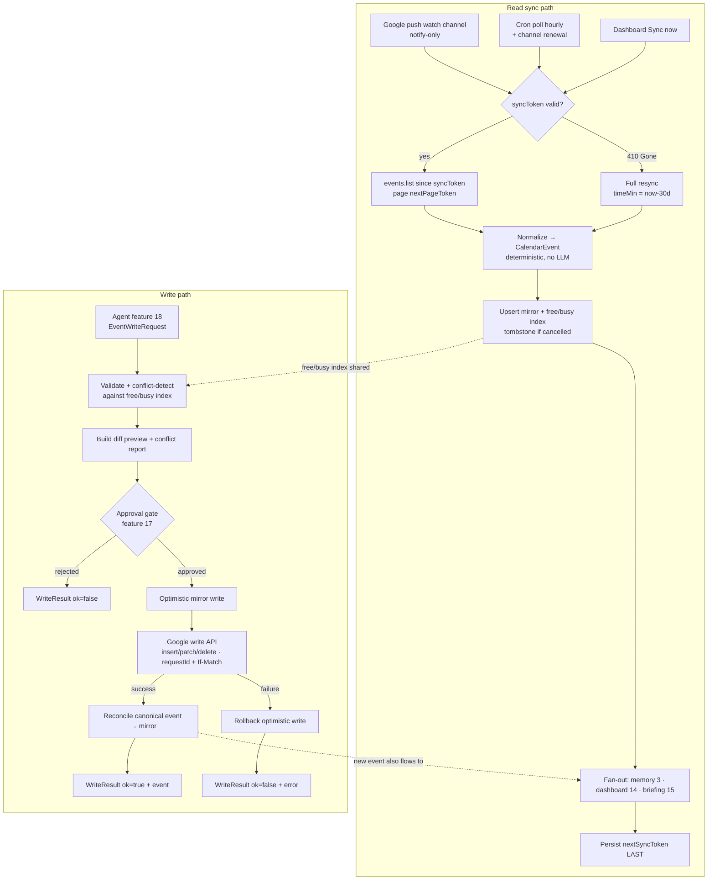

# Calendar Integration

> Priority/build order: 12  ·  Tier: deep

## Summary

The **calendar layer**: a bidirectional Google Calendar integration that **reads** the user's events (for the dashboard, daily briefing, and memory) and **writes** events (create / move / delete) on behalf of the AGENT (feature 18), with every mutation gated through the approval-and-safety gate (feature 17). It is the canonical owner of "what is on the calendar" and "when is the user free."

It is built on the **shared connector framework (feature 9)** — it reuses one OAuth2 client, one token store (OS keychain), one webhook server, and one scheduler. Calendar adds two things on top: a **read sync engine** (Google's `syncToken` incremental sync + push `watch` channels for near-realtime freshness) and a **write engine** (`createEvent` / `updateEvent` / `deleteEvent` / `findFreeTime`) that never touches the API until a `WriteResult` has cleared the approval gate.

**Authoritative source-of-truth is Google, not us.** We hold a local mirror (a read cache + a free/busy index) that is rebuilt deterministically from sync. Writes go to Google first, then we **reconcile** the returned canonical event back into the mirror. We never invent state; the agent decides *what* to schedule, and this feature *executes deterministically* — no LLM lives here.

OAuth2 is **mandatory** (Google deprecated less-secure access in 2025). The read scope `calendar.readonly` is classed **sensitive** and read/write `calendar.events` is **restricted**; since this is a single-user local app, the user keeps themselves on the OAuth consent screen's **test-user** list to skip Google's verification review entirely.

Design constraints from the M3 Air / 16GB target: sync is streaming and incremental (never a full re-pull unless forced by a `410`), the mirror is a lightweight SQLite table, and there is no model in RAM — this feature is pure I/O + deterministic logic.

## Data flow  *(REQUIRED)*

- **Inputs:**
  - Google Calendar API, reached **through the feature-9 connector** (shared OAuth2 client + keychain token + webhook server). Read inputs: incremental event deltas (via `events.list` + `syncToken`), push `watch` notifications, free/busy queries.
  - **Agent write requests** (`EventWriteRequest`) from feature 18 — "schedule X", "move Y to tomorrow 3pm", "cancel Z".

- **Read sync pipeline:** (numbered)
  1. **Trigger.** A sync fires via (a) a **push notification** on the registered `watch` channel (near-realtime; body is notify-only, carries no event data), (b) a **cron poll** (hourly safety net + channel-renewal check), or (c) a **manual "Sync now"** from the dashboard. The feature-9 pause/toggle is checked first.
  2. **Incremental list.** Call `events.list({ syncToken })` for each watched calendar, paging through `nextPageToken`. On the final page Google returns a fresh `nextSyncToken`. If the stored token is stale Google returns **`410 Gone`** → discard token, perform a bounded **full resync** (`timeMin = now − 30d`), then capture the new `nextSyncToken`.
  3. **Normalize.** Each raw Google event → deterministic `CalendarEvent` (UTC start/end + original tz kept, recurrence expanded lazily, attendee/response mapping, `status` mapping). Cancelled events (`status: "cancelled"`) become tombstones. No LLM.
  4. **Upsert mirror.** Write `CalendarEvent` into the local mirror keyed by `(calendarId, eventId)`. Tombstones delete the row. The free/busy index is updated from the same write.
  5. **Fan-out.** Emit to consumers: capture/memory (feature 3) as `calendar_event` `ExperienceRecord`s; dashboard (14) live agenda; briefing (15) "today/upcoming." All downstream, never blocking sync.
  6. **Advance token LAST.** Persist `nextSyncToken` only after the mirror upsert commits, so a crash re-pulls rather than skips.

- **Write path:** (numbered)
  1. **Request.** Agent (18) submits an `EventWriteRequest` (op = create/update/delete + payload).
  2. **Validate + preview.** Deterministically validate the request (times sane, end > start, calendar writable), run **conflict detection** against the free/busy index, and build a human-readable diff preview (before → after).
  3. **Approval gate (feature 17).** The preview + conflict report are handed to the gate. Writes **block** here until the user approves/rejects (or an auto-approve policy clears it). Reads are never gated.
  4. **Execute.** On approval, call the Google write API (`events.insert` / `patch` / `delete`) with an **idempotency key** (`requestId` / `If-Match` ETag) to make retries safe.
  5. **Reconcile.** Google returns the canonical event (with its real `id`, `etag`, expanded recurrence). Upsert it into the mirror, replacing any optimistic placeholder. Emit a `WriteResult`.
  6. **Rollback on failure.** If the API call fails after an optimistic mirror write, revert the mirror entry and return `WriteResult { ok: false }` to the gate/agent.

- **Outputs:**
  - `CalendarEvent[]` (mirror) → dashboard agenda widget, briefing.
  - `FreeBusySlot[]` (free/busy index + `findFreeTime` results) → agent scheduling, conflict checks.
  - `WriteResult` → approval gate / agent (success or failure + canonical event).
  - `calendar_event` `ExperienceRecord`s → memory (feature 3).

- **Schemas:**

```typescript
type EventStatus = "confirmed" | "tentative" | "cancelled";
type AttendeeResponse = "accepted" | "declined" | "tentative" | "needsAction";

interface CalendarEvent {
  calendarId: string;
  id: string;                    // Google event id (canonical, post-write)
  etag: string;                  // for optimistic concurrency (If-Match)
  status: EventStatus;
  summary: string;
  description?: string;
  location?: string;
  start: EventTime;
  end: EventTime;
  allDay: boolean;               // true → date-only, no time component
  recurrence?: string[];         // RRULE/EXDATE lines, master only
  recurringEventId?: string;     // set on an instance/exception
  originalStartTime?: EventTime; // set on a moved/overridden instance
  attendees: Attendee[];
  organizer?: { email: string; self: boolean };
  created: string;               // UTC ISO
  updated: string;               // UTC ISO
  source: "google";
  syncedAt: string;              // UTC ISO, when mirrored
}

interface EventTime {
  dateTime?: string;             // UTC ISO-8601 (timed events)
  date?: string;                 // YYYY-MM-DD (all-day events)
  timeZone: string;              // IANA tz the event was authored in
}

interface Attendee {
  email: string;
  displayName?: string;
  response: AttendeeResponse;
  self: boolean;
  organizer: boolean;
}

interface FreeBusySlot {
  start: string;                 // UTC ISO
  end: string;                   // UTC ISO
  state: "busy" | "free";
  source?: string;               // event id(s) causing busy, for explainability
}

interface EventWriteRequest {
  requestId: string;             // ULID — idempotency key, set by caller (agent)
  op: "create" | "update" | "delete";
  calendarId: string;
  eventId?: string;              // required for update/delete
  ifMatchEtag?: string;          // optimistic concurrency for update/delete
  patch?: Partial<{
    summary: string; description: string; location: string;
    start: EventTime; end: EventTime; attendees: { email: string }[];
    recurrence: string[];
  }>;
  reason: string;                // agent's rationale, shown in approval preview
  allowConflict?: boolean;       // agent may override conflict block (still gated)
}

interface WriteResult {
  requestId: string;
  ok: boolean;
  op: EventWriteRequest["op"];
  event?: CalendarEvent;         // canonical event on success
  conflicts?: FreeBusySlot[];    // overlaps detected at preview time
  error?: { code: number; reason: string; retryable: boolean };
  approvedAt?: string;           // UTC ISO, from the gate
}
```

## Mermaid diagram



## Frontend flow  *(REQUIRED)*

- **Screens / states:** The dashboard (feature 14) hosts a **Calendar / Agenda widget**: a "Today" column (timed blocks on a vertical time axis + an all-day banner row) and an "Upcoming" list (next N events grouped by day). A compact free/busy strip shows the next open slot. Conflicts are flagged with a red overlap badge. The same data backs the daily briefing's (15) "today's schedule" section.
  - Widget states: **needs-auth** (calendar not connected → "Connect Google Calendar" CTA), **loading** (skeleton agenda rows), **empty** ("No events today"), **error** (sync failed → last-known events shown stale-flagged + retry), **stale** (push channel expired, showing cached data with a "reconnecting" hint), **ready** (live agenda).

- **Write confirmations (via feature 17):** When the agent proposes a calendar write, the change is **never silently applied**. The approval gate surfaces a confirmation card: op (create/move/cancel), the diff (before → after with times in the user's local tz), the agent's `reason`, and any **conflict warning** ("overlaps 'Standup' 9:00–9:30"). The user taps **Approve** / **Reject** (or **Approve & ignore conflict**). On approve, the widget shows an optimistic pending event (dashed outline) that solidifies once the `WriteResult` reconciles; on failure it disappears with a toast.

- **Key controls:**
  - **Connect / Reconnect Google Calendar** — launches the shared OAuth2 flow (feature 9); surfaces `needs-reauth` when a token is revoked.
  - **Sync now** — forces an immediate incremental sync (or full resync if token is stale).
  - **Calendar selection** — choose which of the user's calendars to mirror/write to (defaults to primary).
  - **Day / Upcoming toggle** and **jump to date**.
  - Approval actions live in feature 17's UI, not here.

- **User journey:** First run shows the **needs-auth** state; the user clicks Connect, completes Google OAuth (staying on their own test-user list), and the widget flips to **loading** then **ready** with today's agenda. Thereafter it stays live via push, refreshing within seconds of a calendar change made on any device. When the agent wants to schedule something, the user sees a single approval card, approves it, and watches the event appear. They rarely visit settings — only to reconnect on a red badge or pick additional calendars.

## Logic / rules  *(deep tier)*

- **Sync is deterministic & token-driven.** Incremental sync always resumes from the stored `syncToken`; a `410 Gone` is the *only* path to a full resync, and that resync is bounded (`timeMin = now − 30d`, `timeMax = now + 365d`) to stay light. The token advances **only after** the mirror commits.
- **Watch channels (push) renewal.** A `watch` channel has a TTL (typically ≤ 7 days for Calendar). A daily cron checks channel expiry and **re-registers before expiry** (renew at TTL − 12h). On `watch` callback we never trust the body for data — it only triggers an incremental `events.list`. Channel id + resource id + expiration are persisted so we can `stop` stale channels.
- **Recurring events.** The mirror stores the **master** (with `recurrence` RRULE/EXDATE) plus any **exception instances** (`recurringEventId` + `originalStartTime`). Agenda/free/busy **expand instances on demand** for the queried window (deterministic RRULE expansion, no storage blow-up). Moving/cancelling a single instance writes an exception, not a master edit; the approval preview makes "this event" vs "all events" explicit.
- **Timezone & DST.** All times stored as UTC ISO **plus** the authored IANA `timeZone`. Display converts to the user's current local tz. RRULE expansion happens in the event's authoring tz so DST transitions land correctly (a "9am weekly" stays 9am local across a DST boundary). All-day events are date-only and tz-agnostic — never coerced into a time.
- **All-day vs timed.** `allDay` is set from presence of `date` vs `dateTime`. All-day events are excluded from minute-level conflict detection but shown in the all-day banner; timed events drive free/busy.
- **Conflict detection (deterministic).** Before any write and on demand, overlap is computed by interval-intersection against the free/busy index (expanded recurrences included). A write that overlaps an existing busy block is flagged in the preview and **blocked unless** `allowConflict` is set — and even then it still passes through the approval gate.
- **`findFreeTime` (deterministic).** Given a window, duration, and constraints (working hours, min-gap, calendars), it expands all events in the window into busy intervals, computes the complement, and returns ranked `FreeBusySlot[]` (`state: "free"`). Pure interval math — the agent picks; this only enumerates.
- **Writes are gated, idempotent, reconciled.** Every mutation: (1) carries a caller-supplied `requestId` used as Google's `insert` idempotency key and as our dedup key; (2) uses `If-Match: etag` on update/delete for optimistic concurrency (a `412` means the event changed underneath us → re-sync + re-preview); (3) reconciles the **canonical returned event** into the mirror so our state matches Google exactly.
- **Deterministic vs AI boundary.** Zero AI in this feature. Sync, normalization, recurrence expansion, conflict detection, free-time search, and reconciliation are all deterministic. The *decision* to schedule/move/cancel is made upstream by the agent (18); this feature only validates, gates, executes, and reconciles.
- **Auth.** OAuth2 via the shared feature-9 client; tokens in the OS keychain. Scopes: `calendar.events` (read+write, restricted) — sufficient for both paths; `calendar.readonly` only if a read-only deployment is ever desired. User stays on the consent screen test-user list to avoid Google verification.

## Code snippets

**Incremental sync with `syncToken` + `410` full-resync (`sync.ts`):**

```typescript
import { calendar_v3 } from "googleapis";
import { getCalendarClient } from "../connector/google-client"; // feature 9 shared client
import { loadSyncToken, saveSyncToken, clearSyncToken } from "./token-store";
import { upsertEvent, tombstoneEvent } from "./mirror";
import { normalizeEvent } from "./normalize";

const RESYNC_WINDOW_DAYS = 30;

export async function syncCalendar(calendarId: string): Promise<void> {
  const cal = await getCalendarClient();          // shared OAuth2, auto-refresh
  let syncToken = await loadSyncToken(calendarId); // null on first run
  let pageToken: string | undefined;
  let newSyncToken: string | undefined;

  while (true) {
    let res: { data: calendar_v3.Schema$Events };
    try {
      res = await cal.events.list({
        calendarId,
        singleEvents: false,        // keep masters; we expand recurrences ourselves
        showDeleted: true,          // need cancellations to tombstone the mirror
        ...(syncToken ? { syncToken } : { timeMin: resyncFloor(), timeMax: resyncCeil() }),
        ...(pageToken ? { pageToken } : {}),
        maxResults: 250,
      });
    } catch (err) {
      // 410 Gone: stored syncToken is no longer valid → drop it and full-resync once.
      if (isGone(err) && syncToken) {
        await clearSyncToken(calendarId);
        syncToken = undefined;
        pageToken = undefined;
        continue;                   // restart loop as a bounded full sync
      }
      throw err;
    }

    for (const raw of res.data.items ?? []) {
      if (raw.status === "cancelled") await tombstoneEvent(calendarId, raw.id!);
      else await upsertEvent(normalizeEvent(calendarId, raw)); // also updates free/busy index
    }

    pageToken = res.data.nextPageToken ?? undefined;
    if (res.data.nextSyncToken) newSyncToken = res.data.nextSyncToken;
    if (!pageToken) break;          // nextSyncToken only arrives on the final page
  }

  // Advance the cursor LAST — only after every upsert above has committed.
  if (newSyncToken) await saveSyncToken(calendarId, newSyncToken);
}

const resyncFloor = () =>
  new Date(Date.now() - RESYNC_WINDOW_DAYS * 864e5).toISOString();
const resyncCeil = () => new Date(Date.now() + 365 * 864e5).toISOString();

function isGone(err: unknown): boolean {
  return typeof err === "object" && err !== null &&
    (err as { code?: number }).code === 410;
}
```

**`createEvent` + `findFreeTime`, routed through the approval gate (`writer.ts`):**

```typescript
import { getCalendarClient } from "../connector/google-client";
import { requestApproval } from "../approval/gate";          // feature 17
import { detectConflicts, busyIntervals } from "./conflicts";
import { upsertEvent, revertOptimistic, writeOptimistic } from "./mirror";
import { normalizeEvent } from "./normalize";

/** Deterministic free-time search — agent calls this to pick a slot; no AI here. */
export function findFreeTime(
  windowStart: string, windowEnd: string, durationMin: number,
  opts: { workHours?: [number, number]; minGapMin?: number } = {},
): FreeBusySlot[] {
  const busy = busyIntervals(windowStart, windowEnd);        // expands recurrences
  const free: FreeBusySlot[] = [];
  let cursor = clampToWorkHours(windowStart, opts.workHours);
  for (const b of busy) {
    if (msBetween(cursor, b.start) >= durationMin * 60_000) {
      free.push({ start: cursor, end: b.start, state: "free" });
    }
    cursor = laterOf(cursor, b.end);
  }
  if (msBetween(cursor, windowEnd) >= durationMin * 60_000) {
    free.push({ start: cursor, end: windowEnd, state: "free" });
  }
  return free; // ranked enumeration only — the agent decides which slot to use
}

/** Create an event — BLOCKS on the approval gate, idempotent, reconciled. */
export async function createEvent(req: EventWriteRequest): Promise<WriteResult> {
  const conflicts = detectConflicts(req.patch!.start!, req.patch!.end!);
  if (conflicts.length && !req.allowConflict) {
    return { requestId: req.requestId, ok: false, op: "create", conflicts,
      error: { code: 409, reason: "time conflict", retryable: false } };
  }

  // Gate: nothing hits Google until the user (or policy) approves.
  const decision = await requestApproval({
    kind: "calendar.create",
    requestId: req.requestId,
    preview: buildDiffPreview(req),       // before→after in local tz
    conflicts, reason: req.reason,
  });
  if (!decision.approved) {
    return { requestId: req.requestId, ok: false, op: "create",
      error: { code: 403, reason: "rejected by approval gate", retryable: false } };
  }

  const optimisticId = await writeOptimistic(req);   // dashed pending event in UI
  try {
    const cal = await getCalendarClient();
    const res = await cal.events.insert({
      calendarId: req.calendarId,
      requestId: req.requestId,         // Google idempotency key — safe to retry
      requestBody: toGoogleEvent(req.patch!),
    });
    const canonical = normalizeEvent(req.calendarId, res.data);
    await upsertEvent(canonical);       // reconcile: replace optimistic with canonical
    return { requestId: req.requestId, ok: true, op: "create",
      event: canonical, approvedAt: decision.approvedAt };
  } catch (err) {
    await revertOptimistic(optimisticId);            // rollback on API failure
    return { requestId: req.requestId, ok: false, op: "create",
      error: { code: codeOf(err), reason: String(err), retryable: isRetryable(err) } };
  }
}
```

## Edge cases & safety

| Case | Trigger | Behavior |
|---|---|---|
| `syncToken` expired (`410 Gone`) | incremental `events.list` | Catch 410, discard token, do a bounded full resync (`now − 30d`), capture new `nextSyncToken`. Mirror upsert is idempotent so no duplicates surface. |
| Recurring event + exceptions | sync / write | Store master (RRULE/EXDATE) + exception instances (`recurringEventId`, `originalStartTime`); expand on demand. Single-instance edits write exceptions, not master changes; approval preview shows "this event" vs "all events." |
| Timezone / DST shift | display / RRULE expansion | Store UTC + IANA tz; expand recurrences in authoring tz so "9am weekly" stays 9am local across DST; display in user's current tz. |
| All-day vs timed | normalize / conflict-detect | `allDay` from `date` vs `dateTime`; all-day shown in banner, excluded from minute-level conflict math; never coerced to a time. |
| Double-booking / conflict | write preview / on-demand check | Interval-intersection against free/busy index (recurrences expanded); overlap flagged in approval preview and **blocked** unless `allowConflict`, which still requires gate approval. |
| Write needs approval | any agent mutation | Write blocks at feature 17; nothing reaches Google until approved/policy-cleared. Reads are never gated. |
| Optimistic write then API failure | `insert/patch/delete` fails post-approval | Optimistic mirror entry is reverted (`revertOptimistic`); return `WriteResult.ok=false` with `retryable` flag; UI pending event disappears with a toast. |
| `watch` channel expiry / renewal | channel TTL approaching | Daily check renews at TTL − 12h; stale channels `stop`ped; if a notification is missed, hourly cron poll + `syncToken` catches the delta with no data loss. |
| Attendee response changes | sync delta | Re-normalize `attendees[].response`; mirror reflects accepted/declined/tentative; briefing can surface "2 declined." No write triggered (read-only state). |
| Deleted / cancelled event | sync (`status: "cancelled"`) | Tombstone the mirror row (and free/busy interval); fan-out a deletion to consumers. Agent-initiated deletes go through gate + reconcile. |
| Optimistic concurrency (`412`) | update/delete with stale `If-Match` etag | Event changed underneath us; abort, trigger an incremental sync, rebuild the preview, re-request approval against fresh state. |
| Idempotent retry | network retry of `insert` | Same `requestId` → Google returns the existing event, not a duplicate; reconcile is a no-op upsert. |
| Token revoked / `invalid_grant` | sync or write | Set `needs-reauth`, stop polling, red badge in widget; mirror retained and shown stale; resumes on reconnect with no data loss. |
| Rate limit `403`/`429` | sync or write | Per-connector token-bucket + exponential backoff (feature 9); `syncToken` ensures we never re-spend quota on unchanged data. |
| Calendar not writable | write to read-only/shared calendar | Validation rejects before the gate with a clear error; agent is told the target calendar is read-only. |
| Connector paused / offline | any trigger | Pull skipped, push dropped (re-pulled on resume via `syncToken`); pending agent writes queue and re-preview on resume. Calendar never invents state. |

## Dependencies  *(REQUIRED)*

- [features/9-data-integration-framework.md](9-data-integration-framework.md) — **foundation:** shared OAuth2 client, OS-keychain token store, webhook/push server, scheduler, rate-limit/backoff. Calendar adds the read sync engine + write engine on top.
- [features/3-memory-capture-and-ingestion.md](3-memory-capture-and-ingestion.md) — consumes normalized events as `calendar_event` `ExperienceRecord`s; this feature owns the Calendar source/push setup referenced there.
- [features/14-metrics-dashboard-ui.md](14-metrics-dashboard-ui.md) — renders the Calendar/agenda widget (today + upcoming, free/busy strip, conflict badges, write-pending states).
- [features/15-daily-briefing-and-digest.md](15-daily-briefing-and-digest.md) — pulls "today's schedule / next up" and conflict/decline highlights from the mirror.
- [features/17-action-approval-and-safety-gate.md](17-action-approval-and-safety-gate.md) — **mandatory gate for all writes;** receives diff preview + conflicts, returns approve/reject; reads bypass it.
- [features/18-task-automation-and-skills.md](18-task-automation-and-skills.md) — the agent that *decides* what to schedule/move/cancel and submits `EventWriteRequest`s; consumes `findFreeTime` + `WriteResult`.
- [architecture/auth-and-integrations.md](../architecture/auth-and-integrations.md) — Google OAuth2 setup, scopes (sensitive `readonly` / restricted `events`), test-user strategy, keychain storage, webhook endpoints, channel lifecycle.

## File structure  *(deep tier)*

```
src/calendar/
  index.ts                  // calendar service bootstrap; wires sync + write + watch
  types.ts                  // CalendarEvent, EventTime, Attendee, FreeBusySlot,
                            //   EventWriteRequest, WriteResult
  sync.ts                   // incremental syncToken sync + 410 full-resync (shown above)
  normalize.ts              // raw Google event → CalendarEvent (deterministic, no LLM)
  mirror.ts                 // local SQLite mirror: upsert/tombstone, optimistic + reconcile
  freebusy.ts               // free/busy index build + busyIntervals() expansion
  recurrence.ts             // deterministic RRULE/EXDATE expansion (tz/DST-correct)
  conflicts.ts              // interval-intersection conflict detection
  writer.ts                 // createEvent/updateEvent/deleteEvent/findFreeTime via gate
  watch.ts                  // push channel register/renew/stop; daily TTL check
  token-store.ts            // per-calendar syncToken persistence
  preview.ts                // buildDiffPreview() before→after in local tz for the gate
config/
  calendars.json            // selected calendars (default: primary), working-hours, tz
test/calendar/
  sync.test.ts              // incremental + 410 resync + token-advance-last
  recurrence.test.ts        // RRULE expansion, DST boundary, exceptions
  conflicts.test.ts  freebusy.test.ts
  writer.test.ts            // gate approval/reject, optimistic+rollback, idempotency, 412
  watch.test.ts             // channel renewal + missed-notification recovery
```
