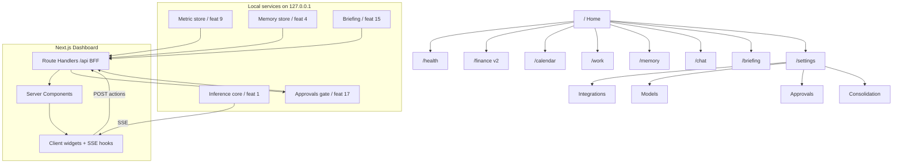

# Metrics Dashboard UI
> Priority/build order: 14  ·  Tier: deep

## Summary
The Metrics Dashboard is Jarvis's **single pane of glass** and home surface: a local-first
Next.js (App Router) web app that aggregates life metrics (Health, Finance, Calendar, Work)
into KPI cards and charts, AND hosts every Jarvis control surface — chat (feature 2), Memory
Explorer + capture toggles (3/4), integrations/connect status (9), model settings (1),
approvals/audit log (17), consolidation status (6), and the daily briefing (15).

It runs entirely on the M3 Air (16GB): `next start` on `localhost:3517`, reading from the local
metric store, memory store, and the inference/agent services over loopback HTTP + SSE. No cloud,
no auth provider (single user, bound to `127.0.0.1`). **Stack: Next.js App Router + Tremor
(KPI cards + charts) + Recharts (custom viz) + optional shadcn/ui primitives.** Server Components
fetch data; Client Components handle interactivity, live SSE for model/voice status and chat
streaming. Finance (11) renders as a **v2 placeholder**. The dashboard is read-mostly: writes
go back to services as user actions (run briefing, approve action, toggle capture, switch model).

## Data flow  *(REQUIRED)*
**Inputs:** metric store (via feature 9 data-integration framework — the canonical read API for
all Health/Calendar/Work series), memory store (4), model status (1), agent/approvals queue (17),
consolidation status (6), daily briefing (15).

**Pipeline:**
```
local services ──HTTP(loopback)──▶ Next.js Route Handlers (BFF) ──▶ Server Components (RSC fetch)
        │                                                                      │
        │                                                          render KPI cards + charts (Tremor/Recharts)
        │                                                                      ▼
        └──SSE/WS──▶ Client Hooks (useLiveStatus, useChatStream) ◀── hydrate ── HTML/RSC payload
                          ▲                                                      │
                          └── user actions (approve / run / toggle) ──POST──────┘──▶ services
```
1. **fetch** — Server Components call the BFF Route Handlers (`/app/api/*`), which proxy the
   local services. The BFF normalizes every response into shared data-contract types.
2. **render server components** — RSC produce static HTML for cards/charts on first paint.
3. **hydrate client widgets** — interactive widgets (chat, toggles, range pickers, approval
   buttons) hydrate and take over.
4. **live SSE updates** — `EventSource` streams push model/voice status, chat tokens, new
   approvals, and consolidation progress without polling.

**Outputs:** rendered dashboard pages + user actions POSTed back to services (approve/reject an
action, run briefing now, toggle a capture source, load/unload a model, switch model profile).

**Schemas (data contracts — TS, shared `@/lib/contracts`):**
```ts
// A single metric time series fetched from the metric store (feature 9).
export interface MetricSeries {
  metricId: string;                 // e.g. "sleep.duration_min"
  domain: "health" | "finance" | "calendar" | "work";
  unit: string;                     // "min" | "ms" | "count" | "USD"
  points: { t: string; v: number | null }[];  // t = ISO8601, v=null ⇒ gap
  source: string;                   // "whoop" | "applehealth" | "gcal" | ...
  asOf: string;                     // ISO timestamp of freshest underlying datum
  stale: boolean;                   // true ⇒ render T+1 / stale badge
  downsampled?: boolean;            // server reduced point count
}
export interface KpiValue {
  metricId: string; label: string; value: number | null; unit: string;
  delta?: number; deltaPct?: number; trend?: "up" | "down" | "flat";
  asOf: string; stale: boolean; sourceConnected: boolean;
}
export interface WidgetEnvelope<T> {              // every BFF response is wrapped
  data: T | null; state: "ok" | "empty" | "stale" | "error" | "placeholder";
  error?: { code: string; message: string };
  meta: { source: string; fetchedAt: string; latencyMs: number };
}
export interface LiveStatus {                      // SSE payload
  kind: "model" | "voice" | "approval" | "consolidation";
  model?: { id: string; loaded: boolean; vramMb: number; tps?: number };
  voice?: { listening: boolean; speaking: boolean };
  approvalCount?: number; consolidation?: { phase: string; pct: number };
}
```

## Frontend flow  *(REQUIRED)*
**Information architecture (routes/pages):**
- `/` **Home overview** — KPI grid + agenda + chat panel (see mockup below). Default landing.
- `/health` **Health** — sleep/recovery/strain/HRV/steps charts, weekly trends (feature 10).
- `/finance` **Finance** — **v2 placeholder** card grid ("Coming in v2"), no live data (11).
- `/calendar` **Calendar** — today/week agenda, time-blocking view, conflicts (12).
- `/work` **Work** — shipped-today counter, todos due, project board, focus stats (13).
- `/memory` **Memory Explorer** — search/browse memories, capture-source toggles (3/4).
- `/chat` **Chat** — full-screen conversational core, streaming (feature 2).
- `/briefing` **Daily Briefing** — rendered digest + "run now" (feature 15).
- `/settings` (layout with sub-tabs):
  - `/settings/integrations` — connect status + reconnect per source (9).
  - `/settings/models` — load/unload, switch profile, VRAM/tps (1).
  - `/settings/approvals` — approval queue + audit log (17).
  - `/settings/consolidation` — consolidation status + history (6).

**States per surface (every widget renders one):**
- **loading** — Tremor skeleton / shimmer card; layout reserved (no CLS).
- **empty** — "No data yet — connect <source>" with CTA to `/settings/integrations`.
- **error** — inline error card with retry button; never blanks the page.
- **stale** — data shown dimmed with an amber **"T+1 / as of <date>"** badge.
- **placeholder** — Finance v2: greyed cards, "Planned for v2" ribbon, no fetch.
- **disconnected** — KPI shows last-known value + red "source disconnected" chip.

**Navigation:** persistent left sidebar (icons + labels, collapsible), top bar with global search,
live **model status pill** (loaded/VRAM/tps), **voice status** dot, and **approvals badge**
(count from SSE). Breadcrumbs inside `/settings`. Keyboard: `g h` → Home, `g c` → Chat,
`/` focuses search, `⌘K` command palette.

**Key controls per page:**
- Home: time-range never (today-fixed); refresh; quick-chat input; "run briefing".
- Health: range picker (7d/30d/90d), metric selector, source filter.
- Calendar/Work: day/week toggle, mark-todo-done, drag time blocks (Work board: status columns).
- Memory: search box, source-toggle switches (with "capturing/paused" state), memory detail drawer.
- Settings: connect/reconnect buttons, model load/unload + profile dropdown, approve/reject
  buttons with diff preview, "run consolidation now".

## Logic / rules  *(deep tier)*
1. **Server-first data.** Every metric/list fetch happens in a Server Component or Route Handler.
   Client components receive serialized `WidgetEnvelope<T>` props; they never call services directly
   except via the SSE hook (read-only) and POST action endpoints.
2. **BFF normalization.** All upstream service shapes are normalized to contracts in the Route
   Handler. UI code only knows contracts, decoupling it from feature 9/10/etc. response drift.
3. **Caching.** RSC fetches use `cache: "no-store"` for live KPIs, `revalidate: 60` for charts.
   Per-widget `Suspense` boundaries so one slow service can't block the page.
4. **Staleness rule.** `stale === true` when `now - asOf > metric.maxAge` (per-metric threshold
   from feature 9). Daily metrics (sleep, recovery) are inherently **T+1** until morning sync;
   label them "as of last night" rather than erroring.
5. **Downsampling.** Series with `> 500` points are downsampled server-side (LTTB) before transit;
   `downsampled: true` shows a subtle "sampled" hint on the chart.
6. **Source-connected gating.** A KPI renders its value even if disconnected (last known) but flags
   it; an empty source (never connected) shows the empty CTA instead.
7. **Finance placeholder.** `/finance` and any Finance KPI short-circuit to `state:"placeholder"`
   with zero network calls.
8. **Action safety.** Approve/reject and load/unload route through feature 17's gate; the UI shows
   a confirm + diff before POST and reflects the resulting audit entry.
9. **Live merge.** SSE `LiveStatus` updates patch client state only (status pill, badges, chat
   tokens); they never mutate server-rendered metric cards (those revalidate on navigation/refresh).
10. **Single-user, loopback-only.** Bind to `127.0.0.1`; no auth, but reject non-loopback `Host`.

## Edge cases & safety
| # | Case | Handling |
|---|------|----------|
| 1 | **Stale T+1 data** | Amber "as of last night / T+1" badge; value dimmed, not hidden. |
| 2 | **Source disconnected** | Show last-known value + red chip + link to reconnect (`/settings/integrations`). |
| 3 | **No data yet** (never connected) | Empty-state card with connect CTA; no fake zeros. |
| 4 | **Finance v2 placeholder** | Greyed cards, "Planned for v2" ribbon, no fetch, no errors. |
| 5 | **Model unloaded** | Status pill shows "Model unloaded"; chat input disabled with "Load model" CTA. |
| 6 | **Large series** (>500 pts) | Server LTTB downsample; chart shows "sampled" hint. |
| 7 | **Offline / all services down** | Global banner "Jarvis services unreachable"; cached RSC shown read-only. |
| 8 | **Slow local service** | Per-widget Suspense skeleton; soft 4s timeout → error card with retry, page stays live. |
| 9 | **Timezone** | All `t`/`asOf` stored UTC, rendered in user's local TZ via `Intl`; "today" computed local. |
| 10 | **Partial failure** | One widget errors, others render; envelope isolates failure per card. |
| 11 | **SSE dropped** | Auto-reconnect with backoff; status pill greys to "connecting…". |
| 12 | **Approval race** | If approval already resolved server-side, button disables and shows resolved state. |
| 13 | **VRAM pressure** | Model pill turns amber if `vramMb` near cap; warns before loading 2nd model. |
| 14 | **Clock skew / future asOf** | Clamp delta to 0; never show negative age. |
| 15 | **Empty briefing** | "No briefing yet — run now" CTA instead of blank page. |

## Dependencies  *(REQUIRED)*
- `features/9-data-integration-framework.md` — canonical metric store read API (all series/KPIs).
- `features/10-health-tracking.md`, `features/11-finance-tracking.md` (v2 placeholder),
  `features/12-calendar-integration.md`, `features/13-work-and-todo.md` — domain data sources.
- `features/2-conversational-chat-core.md` — chat panel + SSE token stream.
- `features/3-memory-capture-and-ingestion.md` — capture-source toggles.
- `features/4-long-term-memory-store.md` — Memory Explorer search/browse.
- `features/1-local-qwen-inference-core.md` — model status/load/unload/profile.
- `features/17-action-approval-and-safety-gate.md` — approvals queue + audit log.
- `features/15-daily-briefing-and-digest.md` — briefing render + run-now.
- `features/6-*consolidation*` — consolidation status panel.
- `architecture/architecture.md`, `architecture/deployment.md` — local service topology, ports, `next start` deployment.
- Runtime: Next.js (App Router), Tremor, Recharts, optional shadcn/ui, TypeScript/Node.

## File structure  *(deep tier)*
```
apps/dashboard/
├─ app/
│  ├─ layout.tsx                 # root: sidebar + topbar + LiveStatusProvider
│  ├─ page.tsx                   # Home overview (RSC)
│  ├─ health/page.tsx
│  ├─ finance/page.tsx           # v2 placeholder
│  ├─ calendar/page.tsx
│  ├─ work/page.tsx
│  ├─ memory/page.tsx
│  ├─ chat/page.tsx
│  ├─ briefing/page.tsx
│  ├─ settings/
│  │  ├─ layout.tsx              # sub-tabs
│  │  ├─ integrations/page.tsx
│  │  ├─ models/page.tsx
│  │  ├─ approvals/page.tsx
│  │  └─ consolidation/page.tsx
│  └─ api/                       # BFF Route Handlers (proxy + normalize)
│     ├─ metrics/[domain]/route.ts
│     ├─ kpis/route.ts
│     ├─ live/route.ts           # SSE: model/voice/approval/consolidation
│     ├─ chat/route.ts           # SSE token stream
│     ├─ approvals/[id]/route.ts # POST approve/reject
│     └─ model/route.ts          # POST load/unload/profile
├─ components/
│  ├─ kpi/KpiCard.tsx            # Tremor Card + BadgeDelta + stale badge
│  ├─ charts/MetricChart.tsx     # Tremor AreaChart / Recharts custom
│  ├─ chat/ChatPanel.tsx
│  ├─ nav/Sidebar.tsx  nav/StatusPill.tsx
│  └─ states/{Empty,Error,Skeleton,Placeholder}.tsx
├─ lib/
│  ├─ contracts.ts               # MetricSeries / KpiValue / WidgetEnvelope / LiveStatus
│  ├─ services.ts                # loopback service URLs + fetch wrapper
│  └─ hooks/{useLiveStatus,useChatStream}.ts
└─ next.config.ts
```

### IA + data-flow diagram (Mermaid)


### Home overview — ASCII layout mockup
```
┌──────────────────────────────────────────────────────────────────────────┐
│ ☰  Jarvis     [ search… / ]      ● Qwen3 loaded 8.2GB 42tps   🎙 idle  🔔3 │
├────────┬─────────────────────────────────────────────────────────────────┤
│ ▸ Home │  Good morning. Tuesday, Jun 9 2026                               │
│  Health│  ┌──────────┐ ┌──────────┐ ┌──────────┐ ┌──────────┐ ┌─────────┐ │
│  Finance│ │Last night│ │Recovery  │ │Today's   │ │Shipped   │ │Todos due│ │
│  Calendar│ │  7h12m  │ │  68% ▲   │ │ agenda   │ │ today    │ │   4     │ │
│  Work  │  │ sleep   │ │ T+1 ⓘ    │ │ 5 events │ │   3 PRs  │ │ 2 over  │ │
│  Memory│  └──────────┘ └──────────┘ └──────────┘ └──────────┘ └─────────┘ │
│  Chat  │  ┌─ Today's agenda ───────────┐  ┌─ Chat ───────────────────────┐│
│  Brief │  │ 09:00 Standup              │  │ You: what's my day look like?││
│  ⚙ Set │  │ 11:30 1:1 w/ Sam          │  │ Jarvis: 5 events, focus block││
│        │  │ 14:00 Focus block         │  │   at 14:00… ▍(streaming)      ││
│        │  │ 16:00 Gym                  │  │ [ type a message…        ][▶] ││
│        │  └────────────────────────────┘  └──────────────────────────────┘│
└────────┴─────────────────────────────────────────────────────────────────┘
```

### Code: Server Component fetching a MetricSeries + Tremor chart
```tsx
// app/health/page.tsx  (Server Component)
import { AreaChart, Card, Title } from "@tremor/react";
import type { MetricSeries, WidgetEnvelope } from "@/lib/contracts";
import { StaleBadge } from "@/components/kpi/StaleBadge";

async function getSeries(metricId: string, range = "30d") {
  const res = await fetch(
    `http://127.0.0.1:3517/api/metrics/health?metric=${metricId}&range=${range}`,
    { cache: "no-store" },
  );
  return (await res.json()) as WidgetEnvelope<MetricSeries>;
}

export default async function HealthPage() {
  const env = await getSeries("sleep.duration_min");
  if (env.state === "empty") return <EmptyState source="whoop" />;
  if (env.state === "error" || !env.data) return <ErrorState err={env.error} />;
  const { points, unit, asOf, stale, downsampled } = env.data;
  return (
    <Card>
      <Title>Sleep duration ({unit}) {stale && <StaleBadge asOf={asOf} />}</Title>
      <AreaChart
        data={points.map((p) => ({ date: p.t.slice(0, 10), Sleep: p.v }))}
        index="date" categories={["Sleep"]} connectNulls={false}
        showLegend={false} className="h-72"
      />
      {downsampled && <p className="text-xs text-gray-400">sampled for performance</p>}
    </Card>
  );
}
```

### Code: SSE client hook for live model/voice status
```tsx
// lib/hooks/useLiveStatus.ts  ("use client")
"use client";
import { useEffect, useRef, useState } from "react";
import type { LiveStatus } from "@/lib/contracts";

export function useLiveStatus() {
  const [status, setStatus] = useState<LiveStatus | null>(null);
  const [connected, setConnected] = useState(false);
  const retry = useRef(1000);

  useEffect(() => {
    let es: EventSource | null = null;
    let timer: ReturnType<typeof setTimeout>;
    const connect = () => {
      es = new EventSource("/api/live");
      es.onopen = () => { setConnected(true); retry.current = 1000; };
      es.onmessage = (e) => setStatus(JSON.parse(e.data) as LiveStatus);
      es.onerror = () => {                       // backoff reconnect
        setConnected(false); es?.close();
        timer = setTimeout(connect, retry.current);
        retry.current = Math.min(retry.current * 2, 15000);
      };
    };
    connect();
    return () => { es?.close(); clearTimeout(timer); };
  }, []);

  return { status, connected };
}
```
