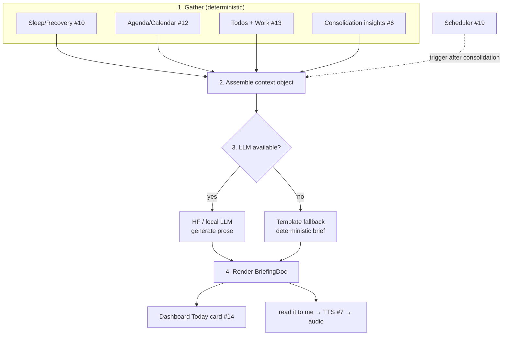

# Daily Briefing & Digest
> Priority/build order: 15  ·  Tier: light

## Summary

The Daily Briefing is the moment Jarvis stops feeling like a tool you query and starts feeling like a presence that knows your day. Every morning — right after the nightly consolidation job (feature 6) finishes — Jarvis assembles a structured snapshot of your life and asks the LLM to turn it into a short, prioritized, human brief. Think of it as the thing a great chief-of-staff would say to you over coffee: "You slept poorly, so go easy. You have three meetings, the 2pm is the one that matters. Two todos are due today. Your consolidation surfaced a pattern worth knowing."

The pipeline is deliberately split into two halves with a hard boundary between them. The **gather + assemble** half is fully deterministic: it pulls last night's sleep/recovery (10), today's calendar/agenda (12), work priorities and todos due today (13), and the insight digest from consolidation (6). Finance flags (11) are a v2 input — skipped in v1. The **generate** half is AI: the LLM (HF for quality when reachable, local fallback otherwise) takes the assembled context and writes the prose. This separation matters because it means the data is always correct even when the AI is unavailable — we can render a deterministic template brief from the exact same assembled context.

The brief is delivered as a `BriefingDoc` rendered into the dashboard's "Today" card (14), with a "read it to me" button that hands the text to TTS (feature 7) for a spoken version. Scheduling is owned by the proactive scheduler (feature 19), which triggers generation once consolidation reports done. Everything is free/OSS, TypeScript/Node, local-first.

## Data flow  *(REQUIRED)*

**Inputs:** sleep/recovery (10), today's agenda (12), todos/work priorities due today (13), consolidation insights (6). *(v2: finance flags from 11.)*
**Pipeline:** gather → assemble context → LLM generate brief → render + optional TTS.
**Outputs:** `BriefingDoc` (structured + rendered markdown) + optional spoken audio.
**Schemas:** `Briefing`.



The deterministic gather step never invents anything: it copies numbers and titles verbatim into a typed context object. The AI step only paraphrases and prioritizes that context — it must not introduce facts not present in the input. This boundary keeps the brief trustworthy and makes the fallback a true degraded mode rather than a different product.

## Frontend flow  *(REQUIRED)*

The dashboard (14) shows a **"Today" card** at the top. On load it requests the current day's briefing.

- **generating** — consolidation just finished and the LLM is mid-generation. Card shows a skeleton with "Putting together your morning brief…".
- **ready** — renders the `BriefingDoc.markdown` with a greeting header, the prioritized sections, and a **"Read it to me"** button. Pressing it streams `BriefingDoc.markdown` (or a TTS-cleaned plain-text variant) to feature 7 and plays the audio inline with play/pause.
- **error** — generation failed even after fallback (rare). Shows "Couldn't build today's brief" with a Retry button.
- **empty** — no briefing exists yet for today (e.g. before the morning run). Shows "Your brief will be ready after tonight's review" with a "Generate now" affordance that manually triggers the pipeline.

The card is read-only — it is a summary surface, not an editor. Clicking a referenced item (a meeting, a todo) deep-links into the owning feature's view.

## Edge cases & safety

- **Missing sleep data** (didn't wear device / no sync) — omit the recovery line entirely rather than guessing. Context object marks `sleep: null`; prompt instructs the LLM to skip it.
- **No events today** — agenda section becomes a single encouraging line ("Open calendar — a good day for deep work") instead of an empty heading.
- **Consolidation didn't run** — no insight digest available. Brief still generates from the other inputs; the insights section is omitted and a quiet flag notes consolidation was skipped.
- **LLM unavailable** (HF down + local model not loaded) — **template fallback** kicks in (see rule below). The user still gets a correct, useful brief built from the assembled context.
- **Stale data** — each input carries a `gatheredAt`/source timestamp. If an input is older than a threshold (e.g. agenda not refreshed today), it is included but tagged stale so the LLM can hedge ("based on yesterday's sync").
- **Too long** — enforce a max length on the generated brief (e.g. ~200 words / configurable). If the model overshoots, trim by dropping lowest-priority sections (finance < insights < todos < agenda < recovery) before render.
- **No fabrication** — prompt and post-check forbid facts absent from the context; numbers must match the inputs exactly.

### Template-fallback rule

> When the LLM is unavailable, render a **deterministic assembled brief** directly from the context object — no AI. It uses fixed sentence templates per section (recovery, agenda, todos, insights), fills slots from the typed inputs, and orders sections by the same priority used for trimming. The output sets `generatedBy: "template"` so the UI and logs can distinguish it. Because gather is deterministic, the fallback brief is always factually identical to what the AI brief would summarize — only the prose quality differs.

## Dependencies  *(REQUIRED)*

- `features/6-nightly-consolidation.md` — provides insight digest; its completion triggers generation.
- `features/10-sleep-and-recovery.md` — last night's sleep/recovery input.
- `features/12-calendar-and-agenda.md` — today's events.
- `features/13-work-priorities-and-todos.md` — priorities + todos due today.
- `features/7-voice-and-tts.md` — spoken delivery ("read it to me").
- `features/14-dashboard.md` — host surface (the "Today" card).
- `features/19-proactive-scheduler.md` — schedules the morning run after consolidation.
- `architecture/model-serving.md` — HF-vs-local routing for the generation step.

## File structure

```
features/15-daily-briefing-and-digest/
├── briefing.types.ts        # Briefing / BriefingDoc / context schemas
├── gather.ts                # deterministic input collection (10,12,13,6)
├── assemble.ts              # build typed context object + staleness tags
├── generate.ts              # LLM call (HF→local) + length trim + post-check
├── fallback.ts              # deterministic template brief
├── render.ts                # context/prose → BriefingDoc.markdown
├── briefing.service.ts      # orchestrates pipeline; called by scheduler #19
└── briefing.api.ts          # GET today / POST generate-now for dashboard
```

### `Briefing` schema (TypeScript)

```ts
type Source = { feature: string; gatheredAt: string; stale: boolean };

interface SleepInput   { score: number; hoursSlept: number; recovery: "low" | "ok" | "high"; source: Source }
interface AgendaInput  { events: { time: string; title: string; key: boolean }[]; source: Source }
interface TodoInput    { dueToday: { title: string; priority: "high" | "med" | "low" }[]; source: Source }
interface InsightInput { digest: string[]; source: Source }

interface BriefingContext {
  date: string;                 // YYYY-MM-DD
  sleep: SleepInput | null;     // null when no data
  agenda: AgendaInput | null;
  todos: TodoInput | null;
  insights: InsightInput | null;
  // finance?: FinanceInput | null;  // v2
}

interface Briefing {
  id: string;
  date: string;
  context: BriefingContext;     // the deterministic, factual layer
  generatedBy: "hf" | "local" | "template";
  status: "generating" | "ready" | "error" | "empty";
  createdAt: string;
}

interface BriefingDoc extends Briefing {
  markdown: string;             // the rendered brief shown in the Today card
  ttsText?: string;             // plain-text variant for feature 7
  audioPath?: string;           // populated once "read it to me" runs
}
```

### Example generated briefing (markdown)

```markdown
**Good morning. Monday, June 9 — take it a little easy today.**

🌙 You slept 5h 40m and recovery is **low**. Don't schedule anything demanding before noon if you can help it.

📅 Three things on the calendar:
- 10:00 — Standup
- **14:00 — Roadmap review** (this is the one that matters)
- 16:30 — 1:1 with Priya

✅ Two todos due today: finish the Q3 draft (high), reply to the vendor email.

💡 From last night's review: you've moved the "API migration" task four days running — it may be blocked, worth unblocking it first thing.

That's it. Start slow, hit the 2pm sharp.
```
