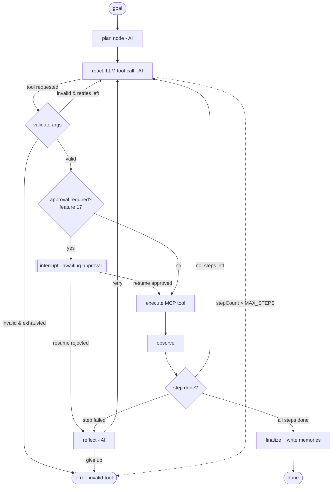
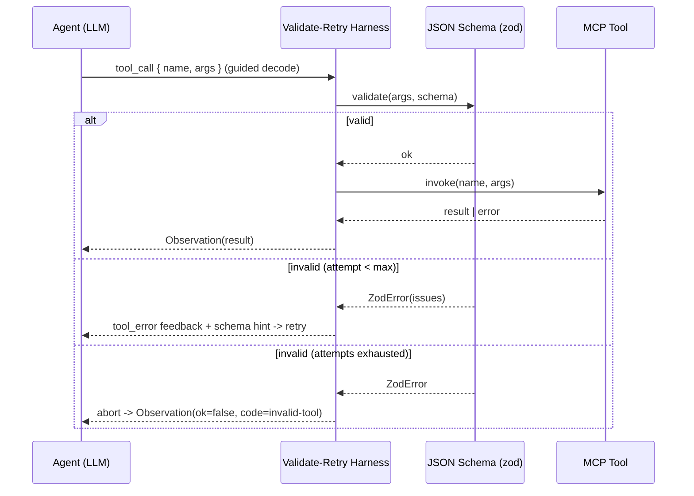

# Agent / Tool Execution Core
> Priority/build order: 16  ·  Tier: deep

## Summary
The Agent / Tool Execution Core is the engine that lets Jarvis **do** things instead of merely chatting. It is a **LangGraph.js** state machine that drives a ReAct loop (reason → tool-call → observe), augmented with plan-and-execute for multi-step goals and Reflexion-style retry on failure. Tools are exposed uniformly through **MCP** (Model Context Protocol) and bound into the graph via `langchain-mcp-adapters`, so every skill (feature 18), Gmail/Drive connector, or local capability looks identical to the agent.

Because raw local-model tool-calling is unreliable (Qwen on MLX can emit valid tool JSON <7% of the time without help, ~100% with a harness), every tool-call passes through a deterministic **validate-and-retry harness**: the LLM is steered with a hermes-style tool-call parser + guided/structured decoding, the emitted arguments are validated against the tool's JSON Schema (zod), and on failure the error is fed back for a bounded number of retries before aborting.

Execution is **durable and resumable**. A **SQLite checkpointer** persists the exact `AgentState` after every node, so a crash, a thermal pause, or an overnight human-in-the-loop approval can all resume from the precise step. Human approval is implemented with LangGraph's `interrupt()` (feature 17 owns the policy of *what* needs approval); heavy/long reasoning is routed to HF (feature 1) while voice/quick stays local. The boundary is strict: planning, tool selection, and reflection are **AI**; validation, checkpointing, loop guards, routing, and approval gating are **deterministic**.

## Data flow  *(REQUIRED)*

**Inputs**
- User or agent **goal** (free text or a structured task from feature 18/19).
- **Available MCP tools** — discovered at startup from connected MCP servers, normalized to `{name, description, jsonSchema}`.
- **Memory context** (feature 5) — retrieved hybrid memories injected into the planner/ReAct prompt.
- **Routing hints** — model tier (local vs HF), thermal state, max-step budget.

**Numbered pipeline**
1. **Ingest goal** → create `AgentRun` (status `planning`), write opening `AuditLog` entry.
2. **Retrieve context** (feature 5) → attach memories + relevant past runs to state.
3. **Plan** (AI) → LLM produces an ordered `plan: string[]` (skipped for trivially single-step goals).
4. **ReAct loop** per plan step, repeated until step is satisfied:
   1. **LLM tool-call** — model emits a tool name + args (guided decoding, hermes parser).
   2. **Validate** (deterministic) — args checked against the tool JSON Schema; on invalid → retry harness (feed error back, up to `maxValidationRetries`).
   3. **Approval gate** (feature 17) — if the tool/args trip a policy, `interrupt()` pauses the graph; state is checkpointed and the run goes `awaiting-approval`.
   4. **Execute MCP tool** — invoke via adapter; capture result, error, latency.
   5. **Observe** — wrap result as an `Observation`, append to scratchpad.
5. **Reflect / retry** (AI) — if a step errored or the observation indicates failure, a Reflexion node critiques and either retries with a corrected approach or escalates.
6. **Finalize** → synthesize the result, mark `AgentRun` `done` (or `error`), flush `AuditLog`, and write new memories (feature 5).

**Outputs**
- Final **result** payload returned to the caller (chat feature 2, scheduler feature 19, or skill feature 18).
- **AuditLog** entries for every plan, tool-call, validation failure, approval decision, and observation (architecture/privacy-and-security.md).
- **New memories** distilled from the run (feature 5).

**Schemas** — see `## Logic / rules` for `AgentRun`, `Step`, `ToolCall`, `Observation`, `AgentState`.

## Frontend flow  *(REQUIRED)*
The dashboard exposes an **Agent Activity** view backed by a live stream of the LangGraph run (LangGraph emits per-node events; the server relays them over SSE/WebSocket).

- **Run list** — recent `AgentRun`s with status chips: `planning` / `running` / `awaiting-approval` / `done` / `error`.
- **Live run trace** — a vertical timeline: each `Step` expands into its `ToolCall`(s), validation attempts, and `Observation`(s). Tool args and results are rendered as collapsible JSON; latencies and the model tier (local/HF badge) are shown per step.
- **Inline approval prompts** — when a run is `awaiting-approval`, an approval card renders inline at the current step showing the proposed tool + args (feature 17 supplies the diff/risk summary). Approve / Reject buttons resume the graph with `Command(resume=...)`.
- **Pause / resume / cancel** — Pause forces a checkpoint and halts after the current node; Resume re-enters from the checkpoint; Cancel marks the run `error` (cancelled) and runs compensation if registered.
- **States & transitions** — `planning → running → (awaiting-approval ⇄ running) → done | error`. The view reflects state transitions in real time and survives reload because state is reconstructed from the SQLite checkpointer + AuditLog, not from in-memory UI state.
- **Empty/idle** — when no run is active, the view shows the last completed run and a "new task" affordance.

## Logic / rules  *(deep tier)*

**Schemas (TS / zod-shaped)**
```ts
type RunStatus = "planning" | "running" | "awaiting-approval" | "done" | "error";

interface AgentRun {
  id: string;                 // thread_id for the checkpointer
  goal: string;
  source: "chat" | "scheduler" | "skill" | "manual";
  status: RunStatus;
  plan: string[];             // produced by the planner (may be empty for 1-step)
  currentStep: number;
  result?: unknown;
  error?: { code: string; message: string };
  createdAt: string; updatedAt: string;
}

interface Step {
  id: string; runId: string; index: number;
  description: string;        // the plan item this step works on
  status: "pending" | "running" | "done" | "failed";
  toolCalls: ToolCall[];
  reflection?: string;        // Reflexion critique if retried
}

interface ToolCall {
  id: string; stepId: string;
  toolName: string;
  args: unknown;              // post-validation, schema-conformant
  validationAttempts: number; // harness retries consumed
  approval?: { required: boolean; decision?: "approved" | "rejected"; by?: string; at?: string };
  modelTier: "local" | "hf";
  startedAt: string; finishedAt?: string;
}

interface Observation {
  id: string; toolCallId: string;
  ok: boolean;
  result?: unknown;
  error?: { code: string; message: string };
  latencyMs: number;
  truncated: boolean;        // result was clipped to fit context budget
}

// LangGraph channel state (reducers applied per node)
interface AgentState {
  goal: string;
  plan: string[];
  currentStep: number;
  messages: BaseMessage[];     // ReAct scratchpad (appended)
  pendingToolCall?: ToolCall;  // set before approval/execute
  observations: Observation[]; // appended
  stepCount: number;           // hard loop guard counter
  validationRetries: number;   // per-tool-call, reset each call
  reflections: string[];       // appended
  routeTier: "local" | "hf";
  status: RunStatus;
}
```

**Deterministic rules**
- **Loop guard**: `stepCount` increments every ReAct iteration; exceeding `MAX_STEPS` (default 25) forces `error` (`loop-guard`).
- **Validation harness**: every tool-call validated against its JSON Schema before execution; `maxValidationRetries` (default 3) then abort that tool-call.
- **Checkpointing**: SQLite checkpointer persists `AgentState` after every node — the unit of resumability.
- **Routing**: token-count estimate or thermal signal over threshold flips `routeTier` to `hf` for the next LLM node.
- **Approval gating**: the execute node consults feature 17; if required, `interrupt()` is raised (state already checkpointed).

**AI rules (model-driven, non-deterministic)**
- **Planning**: decompose goal into ordered steps.
- **Tool selection**: choose which MCP tool + arguments satisfy the current step.
- **Reflection**: critique a failed observation and propose a corrected next action.





## Edge cases & safety

| # | Case | Handling |
|---|------|----------|
| 1 | Invalid tool JSON / schema mismatch | Harness feeds zod error back, retries up to `maxValidationRetries` (3), then aborts tool-call with `invalid-tool` observation. |
| 2 | Tool execution error | Wrapped as `Observation(ok=false)`; routed to reflect node which may retry with corrected args or escalate. |
| 3 | Tool timeout | MCP call wrapped in `AbortController`/timeout; on expiry → `tool-timeout` observation, reflect node decides retry/skip. |
| 4 | Approval rejected | `interrupt()` resumes with `rejected`; run does not execute the tool, goes to reflect (alternative path) or `error`. |
| 5 | Approval timeout (overnight) | State stays checkpointed in `awaiting-approval` indefinitely; resumes when user acts. No busy-wait; no resource held. |
| 6 | Infinite loop | `stepCount > MAX_STEPS` hard-stops to `error: loop-guard`; also detects no-progress (identical tool-call repeated). |
| 7 | Context overflow | Token estimate over budget → flip `routeTier` to HF (feature 1); observations truncated (`truncated=true`) with offload to scratchpad. |
| 8 | Crash mid-run | On restart, resume from last SQLite checkpoint by `thread_id`; partially-done steps not re-executed if observation persisted. |
| 9 | Tool not available | Requested tool absent from bound MCP tools → deterministic `tool-not-found` observation fed back; agent re-selects. |
| 10 | Prompt injection from tool output | Tool outputs treated as untrusted data, never instructions; injection screening + policy enforced in feature 17 (defer detail). |
| 11 | Thermal throttle | Thermal signal over threshold → escalate next LLM node to HF; if HF unavailable, pause + checkpoint and surface to UI. |
| 12 | Partial multi-step failure | Steps register optional compensation handlers; on irrecoverable failure, run compensation in reverse order, then `error`. |
| 13 | Duplicate/replayed run | `AgentRun.id` is the checkpointer `thread_id`; re-entry resumes rather than duplicating side effects. |
| 14 | MCP server disconnect | Detected on invoke; tool marked unavailable, observation `tool-unavailable`; reflect node re-plans or run pauses. |
| 15 | Malformed planner output | Plan validated as `string[]`; on failure, fall back to single-step direct ReAct. |

## Dependencies  *(REQUIRED)*
- `features/1-local-qwen-inference-core.md` — local LLM serving (MLX/vLLM) + HF routing for heavy reasoning; hermes tool-call parser + guided decoding.
- `features/2-conversational-chat-core.md` — entry point that spawns agent runs and surfaces results in chat.
- `features/5-hybrid-memory-retrieval.md` — context injection at plan time; memory write-back at finalize.
- `features/17-action-approval-and-safety-gate.md` — owns approval policy, risk summaries, prompt-injection screening; consumed at the approval gate via `interrupt()`.
- `features/18-task-automation-and-skills.md` — concrete MCP tools/skills bound into the graph.
- `features/19-proactive-scheduling-and-triggers.md` — triggers that create agent runs (`source: "scheduler"`).
- `architecture/architecture.md` — TS/Node orchestration (LangGraph.js), SQLite as the durable store, Python only for ML.
- `architecture/privacy-and-security.md` — AuditLog requirements, local-first data handling, untrusted-tool-output handling.
- External (free/OSS): `@langchain/langgraph`, `@langchain/langgraph-checkpoint-sqlite`, `langchain-mcp-adapters` (MCP → tools), `zod` (validation).

## File structure  *(deep tier)*
```
src/agent/
  graph.ts               # LangGraph StateGraph: plan → react → validate → approve(interrupt) → execute → observe → reflect → finalize
  state.ts               # AgentState channels + reducers
  checkpointer.ts        # SqliteSaver wiring (on-disk, thread_id = AgentRun.id)
  nodes/
    plan.ts              # AI planner node
    react.ts             # AI tool-call node (guided decode, hermes parser)
    validate.ts          # deterministic zod/JSON-Schema validation
    approve.ts           # interrupt() gate -> feature 17
    execute.ts           # MCP tool invocation (timeout/abort)
    observe.ts           # Observation builder + truncation/offload
    reflect.ts           # Reflexion critique/retry node
    finalize.ts          # result synthesis + memory write-back (feature 5)
  harness/
    validateAndRetry.ts  # the validate-and-retry wrapper
    schemas.ts           # zod schemas for AgentRun/Step/ToolCall/Observation
  routing.ts             # local vs HF tier selection (tokens/thermal)
  guards.ts              # MAX_STEPS, no-progress detection
  mcp/
    registry.ts          # discover + bind MCP tools via langchain-mcp-adapters
  audit.ts               # AuditLog writer
  index.ts               # public runAgent(goal, opts) / resumeAgent(runId, command)
src/agent/__tests__/
  validateAndRetry.test.ts
  graph.resume.test.ts   # crash/resume from checkpoint
  loopGuard.test.ts
```

**Code snippet 1 — LangGraph.js graph with `interrupt()` approval node + SQLite checkpointer**
```ts
// src/agent/graph.ts
import { StateGraph, START, END, interrupt, Command } from "@langchain/langgraph";
import { SqliteSaver } from "@langchain/langgraph-checkpoint-sqlite";
import { AgentStateAnnotation } from "./state";
import { planNode } from "./nodes/plan";
import { reactNode } from "./nodes/react";
import { validateNode } from "./nodes/validate";
import { executeNode } from "./nodes/execute";
import { observeNode } from "./nodes/observe";
import { reflectNode } from "./nodes/reflect";
import { finalizeNode } from "./nodes/finalize";
import { isApprovalRequired } from "../../features17"; // feature 17 policy

const checkpointer = SqliteSaver.fromConnString("file:./data/jarvis-agent.sqlite");

// interrupt() pauses the run; state is already checkpointed, so we can resume
// after an overnight approval or a crash by re-invoking with Command(resume=...).
async function approveNode(state: typeof AgentStateAnnotation.State) {
  const call = state.pendingToolCall!;
  if (!isApprovalRequired(call)) return { status: "running" as const };
  const decision = interrupt({ kind: "approval", toolCall: call }); // <- pauses graph
  if (decision === "rejected") {
    return { status: "running" as const, pendingToolCall: undefined,
             reflections: [`User rejected ${call.toolName}; choose another path.`] };
  }
  return { status: "running" as const };
}

const graph = new StateGraph(AgentStateAnnotation)
  .addNode("plan", planNode)
  .addNode("react", reactNode)
  .addNode("validate", validateNode)
  .addNode("approve", approveNode)
  .addNode("execute", executeNode)
  .addNode("observe", observeNode)
  .addNode("reflect", reflectNode)
  .addNode("finalize", finalizeNode)
  .addEdge(START, "plan")
  .addEdge("plan", "react")
  .addConditionalEdges("react", (s) =>
    s.stepCount > 25 ? "reflect" : "validate")          // hard loop guard
  .addConditionalEdges("validate", (s) =>
    s.pendingToolCall ? "approve" : "react")            // invalid -> retry react
  .addConditionalEdges("approve", (s) =>
    s.pendingToolCall ? "execute" : "reflect")          // rejected -> reflect
  .addEdge("execute", "observe")
  .addConditionalEdges("observe", (s) =>
    s.status === "done" ? "finalize"
      : s.observations.at(-1)?.ok === false ? "reflect" : "react")
  .addConditionalEdges("reflect", (s) =>
    s.status === "error" ? END : "react")
  .addEdge("finalize", END);

export const agentApp = graph.compile({ checkpointer });

// resume after approval/crash: same thread_id reloads exact AgentState
export const resumeAgent = (runId: string, decision: "approved" | "rejected") =>
  agentApp.invoke(new Command({ resume: decision }), { configurable: { thread_id: runId } });
```

**Code snippet 2 — validate-and-retry harness (zod / JSON-Schema validate → retry with error feedback)**
```ts
// src/agent/harness/validateAndRetry.ts
import { z, ZodTypeAny } from "zod";
import type { ChatModel, AIMessage } from "../types";

const MAX_VALIDATION_RETRIES = 3;

interface ToolSpec { name: string; schema: ZodTypeAny; }

/**
 * Drives the model to produce a tool-call whose args satisfy the tool schema.
 * Deterministic: validation + bounded retry. The AI part is only the generation.
 */
export async function validateAndRetry(
  model: ChatModel,
  messages: AIMessage[],
  tools: Map<string, ToolSpec>,
): Promise<{ toolName: string; args: unknown; attempts: number } | { aborted: "invalid-tool" }> {
  let convo = [...messages];
  for (let attempt = 1; attempt <= MAX_VALIDATION_RETRIES; attempt++) {
    // guided/structured decoding + hermes parser configured on the model (feature 1)
    const resp = await model.invokeWithTools(convo, [...tools.values()]);
    const call = resp.toolCalls?.[0];

    if (!call) return { aborted: "invalid-tool" };            // no tool emitted
    const spec = tools.get(call.name);
    if (!spec) {                                              // tool-not-found
      convo.push(toolError(call.id, `Unknown tool "${call.name}". Pick from: ${[...tools.keys()].join(", ")}`));
      continue;
    }
    const parsed = spec.schema.safeParse(call.args);
    if (parsed.success) return { toolName: call.name, args: parsed.data, attempts: attempt };

    // feed the exact validation errors back so the model self-corrects
    const issues = parsed.error.issues.map((i) => `- ${i.path.join(".")}: ${i.message}`).join("\n");
    convo.push(toolError(call.id,
      `Arguments for "${call.name}" failed schema validation:\n${issues}\nReturn corrected arguments only.`));
  }
  return { aborted: "invalid-tool" };                          // retries exhausted
}

function toolError(toolCallId: string, message: string) {
  return { role: "tool" as const, tool_call_id: toolCallId, content: message };
}
```
