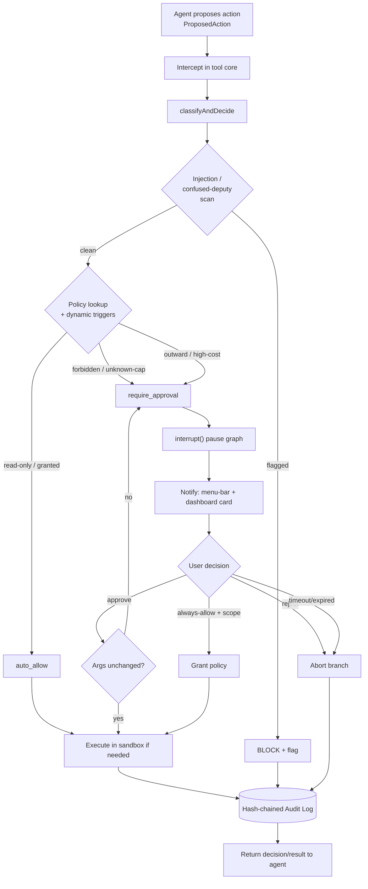

# Action Approval & Safety Gate
> Priority/build order: 17  ·  Tier: deep

## Summary

The Safety Gate is the mandatory control layer sitting between the agent's reasoning loop (feature 16) and any tool that touches the outside world or mutates durable state (feature 18 skills). Every tool call the agent wants to make is intercepted, classified by risk, and run through a deterministic policy engine that decides one of three outcomes: **auto-allow** (read-only, low-risk), **require-approval** (pause via LangGraph `interrupt()` and ask the human), or **block** (forbidden / injection-flagged). No action with side effects executes without either a default-allow policy or an explicit human approval.

Two principles are non-negotiable: (1) **default every new capability to read-only** — a tool the policy engine has never seen is treated as approval-required, never auto-allowed; (2) **immutable, hash-chained audit log** — every classification, decision, approval, execution, and abort is appended to a tamper-evident log alongside the agent's reasoning, so the whole chain is replayable after the fact.

The gate is **100% deterministic**. No AI judgment is trusted to decide whether an action is safe — the agent (an LLM that can be prompt-injected) proposes; rules dispose. This neutralizes the confused-deputy problem: even if hostile content in an email/web page/tool output convinces the agent to "send $5000 to attacker@evil.com," the gate still classifies that as a high-cost outward action and stops to ask the human.

Single user, local-first, M3 Air 16GB. Free/OSS, TypeScript/Node. Audit log is a local append-only file + SQLite index.

## Data flow  *(REQUIRED)*

**Inputs:** a `ProposedAction` emitted by the agent (feature 16) when it decides to call a side-effecting tool — contains tool name, structured args, the agent's natural-language reasoning, the run/thread id, and provenance metadata (which tool outputs / external content fed this decision).

**Numbered pipeline:**

1. **Intercept.** The agent's tool-execution core (feature 16) routes every tool call through `gate.evaluate(proposedAction)` before the tool runs. Read-only tools may be allow-listed at registration time but still pass through for logging.
2. **Classify risk.** `classifyAndDecide()` maps the action to a `RiskClass` using the decision table (tool capability flags + arg inspection: recipient new vs known, amount thresholds, delete vs read, external write target).
3. **Injection / confused-deputy scan.** Deterministic checks on provenance: did this action's args originate from untrusted external content? Are there injection markers? If flagged, force `block` (or escalate to require-approval with a red warning), regardless of class.
4. **Policy decision.** Look up the per-capability policy (read-only default, granted-allowed, or always-approve) plus dynamic triggers (new recipient, amount > threshold). Produce a `PolicyDecision`: `auto_allow` | `require_approval` | `block`.
5. **Branch:**
   - `auto_allow` → append `decided` + `executed` audit entries, run the tool, return result.
   - `block` → append `decided(blocked)` audit entry, return a structured refusal to the agent (the agent sees "blocked: reason" and must replan).
   - `require_approval` → create an `ApprovalRequest`, **pause the graph via `interrupt()`**, notify the user (menu-bar + dashboard card).
6. **Human responds.** User chooses Approve / Reject / Always-allow (with scope) from the dashboard or notification. Resolution resumes the LangGraph run with the decision payload.
7. **Re-validate before execute.** On approval, re-hash the action args and compare to the args the user saw. If changed → re-approve (never execute stale-approved args).
8. **Execute or abort.** Approved → run tool inside its sandbox if applicable, append `executed`. Rejected/expired → abort the branch, append `rejected`/`expired`, return refusal to agent.
9. **Audit-log.** Every step (classified, decided, requested, approved, rejected, executed, aborted) is appended as a hash-chained `AuditEntry`.

**Outputs:** a `PolicyDecision` returned to the agent loop, an `ApprovalDecision` when a human is involved, and a sequence of immutable `AuditEntry` records.



### Schemas

```ts
type RiskClass =
  | "read_only"        // no side effects (search inbox, read file, list events)
  | "internal_write"   // mutates local Jarvis state only (notes, tags, memory)
  | "outward_comm"     // leaves the machine to a person/service (send email, post)
  | "financial"        // spends money / moves funds
  | "destructive"      // deletes/overwrites durable data irreversibly
  | "calendar_write"   // creates/edits/deletes calendar events
  | "code_exec"        // runs code / shell
  | "browser_action";  // automated browser interaction (clicks, form submit)

interface ProposedAction {
  id: string;                 // ulid
  runId: string;              // LangGraph thread/run id
  tool: string;              // e.g. "gmail.send"
  args: Record<string, unknown>;
  reasoning: string;          // agent's stated justification
  provenance: {
    derivedFromExternal: boolean;     // args influenced by untrusted content?
    sources: string[];                // tool/message ids that fed this
    injectionFlags: string[];         // matched injection markers, if any
  };
  proposedAt: string;         // ISO
}

type Outcome = "auto_allow" | "require_approval" | "block";

interface PolicyDecision {
  actionId: string;
  riskClass: RiskClass;
  outcome: Outcome;
  reasons: string[];          // human-readable why ("new recipient", "amount>50")
  triggeredRules: string[];   // rule ids that fired
  requiresDoubleConfirm: boolean; // irreversible + high-cost
  decidedAt: string;
}

type ApprovalStatus = "pending" | "approved" | "rejected" | "expired";

interface ApprovalRequest {
  id: string;
  actionId: string;
  runId: string;
  riskClass: RiskClass;
  summary: string;            // one-line human summary
  args: Record<string, unknown>;
  reasoning: string;
  argsHash: string;           // sha256 of canonicalized args (re-validate)
  status: ApprovalStatus;
  createdAt: string;
  expiresAt: string;          // timeout window
  resolvedAt?: string;
  alwaysAllowScope?: AllowScope | null;
}

interface AllowScope {        // for "always allow"
  tool: string;
  match: "exact_args" | "same_recipient" | "any";
  bound?: Record<string, unknown>; // e.g. { to: "wife@x.com" }
  maxAmount?: number;         // financial cap on the grant
  expiresAt?: string;         // grants should expire
}

interface ApprovalDecision {
  requestId: string;
  status: Exclude<ApprovalStatus, "pending">;
  byUser: string;
  alwaysAllow?: AllowScope;
}

interface AuditEntry {
  seq: number;                // monotonic
  ts: string;                 // ISO
  kind: "classified" | "decided" | "requested" | "approved"
      | "rejected" | "expired" | "executed" | "aborted" | "blocked";
  actionId: string;
  runId: string;
  payload: Record<string, unknown>; // decision, args snapshot, tool result ref
  prevHash: string;           // hash of previous entry (chain)
  hash: string;               // sha256(seq|ts|kind|actionId|payload|prevHash)
}
```

## Frontend flow  *(REQUIRED)*

Three surfaces, all part of the dashboard app (feature 14) plus a menu-bar agent.

**1. Approval prompt (menu-bar + dashboard card).** When a `require_approval` fires, the menu-bar app shows a notification badge and a native notification ("Jarvis wants to send an email to a new recipient"). Clicking opens a **dashboard approval card** showing: the action summary, the **tool + full args** (rendered structured, not raw JSON — e.g. To / Subject / Body for email), the **agent's reasoning**, the risk class with a colored severity chip, any injection/provenance warnings (red banner if `derivedFromExternal`), and buttons: **Approve**, **Reject**, **Always allow** (opens a scope sub-menu: this recipient only / this tool / with amount cap / expires in N days). High-cost destructive actions render a **double-confirm** (type the action name or a second click on a held button).

**2. Audit Log viewer.** A reverse-chronological, filterable table of `AuditEntry` records: timestamp, kind, tool, risk class, outcome, run link. Each row expands to the full args snapshot, reasoning, and decision reasons. A **"Verify chain integrity"** button re-walks the hash chain and shows a green check or flags the first broken link. Read-only; entries cannot be edited or deleted from the UI.

**3. Permissions / Policy settings.** A per-capability grid listing every registered tool with its current policy: **Read-only (default)** | **Allowed** | **Always-approve**. Toggling a tool from read-only to allowed requires a confirmation. Dynamic triggers are configurable here too: financial threshold ($), "approve all new recipients" on/off, grant list (active `AllowScope`s) with revoke buttons and expiry display.

**States:** each approval card reflects `pending` (actionable), `approved` / `rejected` (resolved, greyed), `expired` (timed out, shown with a "re-run?" affordance). The dashboard subscribes to gate events over a local socket so cards update live.

## Logic / rules  *(deep tier)*

### Risk classification + policy engine

Classification is a pure function of (a) the tool's declared capability flags (set at registration in feature 18) and (b) inspection of the concrete args. Tools declare `{ sideEffects: RiskClass, reversible: boolean }`. Args inspection refines this: e.g. a `gmail.send` to a recipient already in the contacts/history is lower-friction than a brand-new external address.

### Policy DECISION TABLE

| Action class | Examples | Default policy | Requires approval? |
|---|---|---|---|
| `read_only` | search inbox, read note, list calendar, web fetch (read) | **auto-allow** | No |
| `internal_write` | add/edit note, tag item, write memory | **auto-allow** (own data, reversible) | No, unless bulk (>N items) |
| `outward_comm` | send email, send message, post | **require approval** | **Yes** — always; new recipient = extra warning |
| `financial` | make payment, subscribe, transfer | **require approval** | **Yes** — > threshold ⇒ double-confirm |
| `destructive` | delete file/notes, empty trash, overwrite | **require approval** | **Yes** — irreversible ⇒ double-confirm |
| `calendar_write` | create/edit/delete event, send invite | **require approval** | **Yes** (delete-event = double-confirm) |
| `code_exec` | run script/shell | **require approval + sandbox** | **Yes**, always in sandbox |
| `browser_action` | click, submit form, login | **require approval + sandbox** | **Yes**, always in sandbox |
| *unknown / new capability* | any tool not in registry | **require approval (treated as outward)** | **Yes** — read-only default fail-safe |

**Read-only default:** the policy lookup returns `require_approval` for any tool whose policy is unset. A capability is only `auto_allow` if it is explicitly registered `read_only` OR explicitly granted by the user in settings. This guarantees a newly added skill can never silently take outward actions.

**Approval-required triggers (dynamic, deterministic):**
- `outward_comm` to a recipient not seen before → approval + "new recipient" warning.
- `financial` amount > configured threshold (default $50) → approval + double-confirm.
- `destructive` and `reversible === false` → approval + double-confirm.
- Batch: any class operating on > `batchThreshold` items (default 5) → approval even if class is auto-allow, with item list shown.
- `derivedFromExternal === true` on any non-read action → escalate (require approval if it was auto-allow; show red provenance banner).

### Prompt-injection / confused-deputy mitigations

1. **Rules govern, not the LLM.** The gate decision never asks the model; the agent only proposes. An injected agent still hits the same deterministic wall.
2. **Provenance tainting.** Tool outputs and external content (email bodies, web pages) are tagged untrusted. If an action's args trace to tainted sources (`derivedFromExternal`), the action is escalated and flagged red.
3. **Injection marker scan.** Deterministic detectors over the reasoning + args for known patterns ("ignore previous instructions", base64 blobs in recipient fields, hidden unicode, instructions inside fetched content). Matches → `injectionFlags` → block or hard-escalate.
4. **Recipient/target allow-listing.** Outward targets are checked against a known set; novel targets always surface to the human.
5. **No self-granting.** The agent has no tool to change policy, approve its own actions, or write the audit log. Those APIs are not exposed to the model.

### Sandbox rules

- `code_exec` runs inside a Docker container (or microVM): no host network by default, no host FS mounts except a scoped scratch dir, CPU/mem/time limits, killed on timeout.
- `browser_action` runs a headless browser inside the sandbox with an egress allow-list; downloads land in scratch only.
- Every sandboxed network/shell/file action is itself logged to the audit chain (immutable record of what the sandbox did).
- Sandbox results returning to the agent are treated as **untrusted external content** (tainted), closing the loop on injection from tool output.

### Deterministic vs AI

| Concern | How |
|---|---|
| Risk classification | **Deterministic** (capability flags + arg rules) |
| Policy decision | **Deterministic** (decision table + triggers) |
| Audit logging / hashing | **Deterministic** (append-only, sha256 chain) |
| Approval | **Human** in the loop |
| Anything in the gate decided by AI | **None** — the LLM is untrusted here |

## Edge cases & safety

| # | Edge case | Handling |
|---|---|---|
| 1 | **Approval timeout** | `ApprovalRequest.expiresAt` reached with no response → status `expired`, branch aborts, agent gets refusal, audit `expired`. Configurable window (default 10 min for outward, 30 min for code). |
| 2 | **User offline / asleep** | No auto-execute. Request stays `pending` until expiry; menu-bar queues it. Long-running tasks (feature 18) park and resume when approved. |
| 3 | **Injection-driven action** | Provenance taint + marker scan → `block` (or hard require-approval with red banner). Audit `blocked` with matched flags. Agent must replan. |
| 4 | **Args changed after approval** | Re-hash args at execute; if `argsHash` differs from what user approved → discard approval, re-issue `require_approval`. Never execute stale args. |
| 5 | **Batch actions** | > `batchThreshold` items in one call → forced approval showing full item list; partial approval allowed (approve subset). No "approve once, fan out to 200." |
| 6 | **"Always allow" scope creep** | Grants are narrow by default (`exact_args` / `same_recipient`), carry optional `maxAmount`, and **expire**. Settings shows all active grants with revoke. No "always allow everything." |
| 7 | **Irreversible + high-cost** | `requiresDoubleConfirm` → second explicit confirmation (typed action name or held button). Logged distinctly. |
| 8 | **Sandbox escape attempt** | Resource/egress violations kill the container, mark the run failed, audit `blocked` with the violation, surface alert. Sandbox output stays tainted. |
| 9 | **Audit log tamper** | Hash chain: any edited/removed entry breaks `prevHash` linkage. "Verify chain" detects the first broken link; file is append-only + periodic external hash anchor. |
| 10 | **Replay attack** (re-submit an old approved action) | Each approval is single-use, bound to `actionId` + `runId` + `argsHash`; consumed approvals can't be reused. New action = new request. |
| 11 | **Duplicate / re-proposed action** | Idempotency by `actionId`; re-proposing an already-resolved action returns the recorded decision, not a new prompt. |
| 12 | **Agent floods approvals** | Rate-limit pending requests per run; beyond cap, pause the run and surface one "agent is requesting many actions" alert instead of N notifications. |
| 13 | **Unknown / newly added capability** | Read-only default → `require_approval` (treated as outward). Never auto-allowed on first sight. |
| 14 | **Gate crash mid-decision** | On restart, any `executed` not present but `decided` present is treated as not-run; in-flight approvals reload from store as `pending`. Fail-closed: ambiguity never executes. |
| 15 | **Conflicting grant + dynamic trigger** | Dynamic safety triggers (financial threshold, injection flag) **override** an `always-allow` grant — a grant cannot bypass double-confirm on a flagged/over-cap action. |

## Dependencies  *(REQUIRED)*

- `features/16-agent-tool-execution-core.md` — the agent loop and LangGraph `interrupt()` mechanism; routes all side-effecting tool calls through the gate.
- `features/18-task-automation-and-skills.md` — skills register tools with capability flags (`sideEffects`, `reversible`) the gate classifies on; long-running tasks park on pending approvals.
- `features/12-calendar-integration.md` — calendar writes are a gated `calendar_write` class.
- `features/14-metrics-dashboard-ui.md` — hosts the approval cards, audit viewer, and permissions settings; subscribes to gate events.
- `architecture/privacy-and-security.md` — sandboxing, audit immutability, and threat model (prompt injection, confused deputy) this feature implements.
- `architecture/architecture.md` — local-first runtime, SQLite, process layout the gate plugs into.

## File structure  *(deep tier)*

```
src/safety/
  gate.ts                 # evaluate(): orchestrates classify→decide→interrupt→execute
  classify.ts             # classifyAndDecide(): risk class + policy decision (deterministic)
  policy/
    table.ts              # the decision table (class → default outcome)
    triggers.ts           # dynamic rules: new recipient, amount, batch, taint
    grants.ts             # AllowScope storage, matching, expiry, revoke
  injection/
    provenance.ts         # taint tracking, derivedFromExternal resolution
    detectors.ts          # deterministic injection-marker scanners
  approval/
    request.ts            # create/resolve ApprovalRequest, expiry timers
    interrupt.ts          # LangGraph interrupt() bridge (pause/resume)
  audit/
    log.ts                # append-only hash-chained writer + verifyChain()
    store.ts              # SQLite index over the append-only file
  sandbox/
    docker.ts             # code_exec container runner (limits, egress)
    browser.ts            # sandboxed headless browser
  schemas.ts              # ProposedAction, RiskClass, PolicyDecision, ApprovalRequest, AuditEntry
  index.ts

src/ui/safety/            # in dashboard app (feature 14)
  ApprovalCard.tsx
  AuditLogViewer.tsx
  PermissionsSettings.tsx

data/
  audit.log               # append-only, hash-chained
  audit.sqlite            # index
tests/safety/
  classify.test.ts  policy.test.ts  injection.test.ts  audit-chain.test.ts
```

### Code snippet 1 — `classifyAndDecide()` engine

```ts
// src/safety/classify.ts
import { DECISION_TABLE } from "./policy/table";
import { evalTriggers } from "./policy/triggers";
import { matchGrant } from "./policy/grants";
import { scanInjection, isTainted } from "./injection/detectors";
import type { ProposedAction, PolicyDecision, RiskClass } from "./schemas";

export function classifyAndDecide(
  action: ProposedAction,
  toolMeta: { sideEffects?: RiskClass; reversible: boolean } | undefined,
): PolicyDecision {
  const reasons: string[] = [];
  const triggeredRules: string[] = [];

  // 1. Unknown capability => read-only default fail-safe (treat as outward).
  const riskClass: RiskClass = toolMeta?.sideEffects ?? "outward_comm";
  if (!toolMeta) reasons.push("unknown capability: read-only default");

  const base = DECISION_TABLE[riskClass]; // { default, requiresApproval }
  let outcome = base.default;

  // 2. Injection / confused-deputy scan — overrides everything.
  const injection = scanInjection(action);
  if (injection.length) {
    triggeredRules.push("injection_marker");
    return finalize("block", ["injection markers detected", ...injection]);
  }
  if (action.provenance.derivedFromExternal && riskClass !== "read_only") {
    reasons.push("args derived from untrusted external content");
    triggeredRules.push("taint_escalation");
    outcome = "require_approval";
  }

  // 3. Explicit grant can lower friction (but not bypass safety triggers).
  const grant = matchGrant(action);
  if (grant && outcome !== "block") {
    outcome = "auto_allow";
    reasons.push(`covered by grant ${grant.id}`);
  }

  // 4. Dynamic triggers can only RAISE friction.
  const dyn = evalTriggers(action, riskClass, grant); // new recipient, amount, batch
  if (dyn.escalate) {
    outcome = "require_approval";
    reasons.push(...dyn.reasons);
    triggeredRules.push(...dyn.rules);
  }

  // 5. Base class requires approval and nothing granted it.
  if (base.requiresApproval && outcome !== "auto_allow" && outcome !== "block") {
    outcome = "require_approval";
  }

  const requiresDoubleConfirm =
    (riskClass === "destructive" && !toolMeta?.reversible) ||
    (riskClass === "financial" && dyn.overThreshold) ||
    (riskClass === "calendar_write" && action.tool.endsWith("delete"));

  function finalize(o: typeof outcome, rs: string[]): PolicyDecision {
    return {
      actionId: action.id,
      riskClass,
      outcome: o,
      reasons: [...reasons, ...rs],
      triggeredRules,
      requiresDoubleConfirm,
      decidedAt: new Date().toISOString(),
    };
  }
  return finalize(outcome, reasons.length ? [] : ["policy default"]);
}
```

### Code snippet 2 — immutable hash-chained audit writer

```ts
// src/safety/audit/log.ts
import { createHash } from "node:crypto";
import { appendFileSync, readFileSync, existsSync } from "node:fs";
import type { AuditEntry } from "../schemas";

const PATH = "data/audit.log";
const GENESIS = "0".repeat(64);

function hashEntry(e: Omit<AuditEntry, "hash">): string {
  const canonical = `${e.seq}|${e.ts}|${e.kind}|${e.actionId}|${e.runId}|` +
    JSON.stringify(e.payload) + `|${e.prevHash}`;
  return createHash("sha256").update(canonical).digest("hex");
}

function tail(): { seq: number; hash: string } {
  if (!existsSync(PATH)) return { seq: -1, hash: GENESIS };
  const lines = readFileSync(PATH, "utf8").trim().split("\n").filter(Boolean);
  if (!lines.length) return { seq: -1, hash: GENESIS };
  const last = JSON.parse(lines[lines.length - 1]) as AuditEntry;
  return { seq: last.seq, hash: last.hash };
}

export function appendAudit(
  e: Pick<AuditEntry, "kind" | "actionId" | "runId" | "payload">,
): AuditEntry {
  const prev = tail();
  const base = {
    seq: prev.seq + 1,
    ts: new Date().toISOString(),
    prevHash: prev.hash,
    ...e,
  };
  const entry: AuditEntry = { ...base, hash: hashEntry(base) };
  appendFileSync(PATH, JSON.stringify(entry) + "\n"); // append-only, never rewrite
  return entry;
}

export function verifyChain(): { ok: boolean; brokenAt?: number } {
  if (!existsSync(PATH)) return { ok: true };
  const lines = readFileSync(PATH, "utf8").trim().split("\n").filter(Boolean);
  let prevHash = GENESIS;
  for (const line of lines) {
    const e = JSON.parse(line) as AuditEntry;
    const { hash, ...rest } = e;
    if (e.prevHash !== prevHash || hashEntry(rest) !== hash) {
      return { ok: false, brokenAt: e.seq };
    }
    prevHash = hash;
  }
  return { ok: true };
}
```
