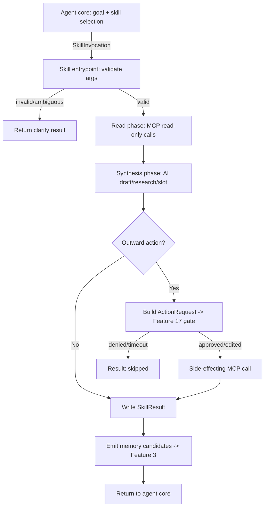

# Task Automation & Skills
> Priority/build order: 18  ·  Tier: deep

## Summary
Skills are the concrete, reusable **things Jarvis can DO** — the verbs of the system. Each skill is a registered tool (or sub-graph) that the agent core (feature 16) can select and invoke to accomplish a goal. Where feature 16 is the *engine* (planning, tool loop, memory) and feature 17 is the *brake* (approval gate), feature 18 is the *transmission*: it maps high-level intent ("reply to Sarah about Friday", "find me 30 min with Alex next week", "research vendor X", "remind me to renew insurance") onto deterministic pipelines that call MCP servers and built-in stores.

v1 ships **four skills**: (1) **Email triage + drafting/sending** via Google Workspace MCP / Gmail, (2) **Calendar management** (schedule / move / find-time) via feature 12, (3) **Web research / browsing** via Playwright MCP + browser-use, (4) **Reminders & to-dos** via the built-in todo store (feature 13). Every outward, side-effecting action (send email, write calendar event, fill a web form) is routed through feature 17's approval gate before execution. Read-only operations (summarize inbox, search calendar, fetch a page) run freely.

Skills are local-first and free/OSS: TypeScript/Node orchestration with `langchain-mcp-adapters`-style MCP clients; Python only where a tool (browser-use) requires it. The boundary is strict: **skill wiring and MCP calls are deterministic code**; only **drafting, research synthesis, and tool/skill selection** are model-driven.

## Data flow  *(REQUIRED)*
**Inputs:** an agent goal (from feature 16's planner) + a skill selection decision (which skill + args). Skills may also be triggered proactively by feature 19.

**Numbered pipeline (per skill):**
1. Agent core resolves goal → selects a skill from the registry (AI: tool selection) and binds arguments → emits a `SkillInvocation`.
2. Skill entrypoint validates args against the skill's `inputSchema` (deterministic). On invalid/ambiguous args → returns a `clarify` result instead of acting.
3. Skill executes its **read phase**: calls MCP tools / built-in stores to gather context (inbox threads, free/busy, search results). No approval needed — read-only.
4. Skill runs its **synthesis phase** where applicable (AI: draft an email body, synthesize research, propose a meeting slot).
5. For any **outward action**, the skill constructs an `ActionRequest` and submits it to the feature-17 gate. Gate returns `approved` / `denied` / `edited` / `timeout`.
6. On approval, skill performs the side-effecting MCP call (send email, insert event, submit form).
7. Skill writes a `SkillResult` (status, summary, artifacts, citations) and emits memory candidates to feature 3 (e.g., "drafted reply to Sarah", "researched vendor X — chose Acme").
8. Result streams back to the agent core, which decides whether the overall goal is complete or another skill is needed.

**Outputs:** `SkillResult` objects (summaries, drafts, research cards, todo entries) + executed actions (gated) + memory candidates (feature 3).

**Schemas:** `Skill` (static registry entry: id, name, inputSchema, mcpTools, outward flag, approvalPolicy), `SkillResult` (runtime output: status, summary, artifacts, citations, actions). See Logic section for full TS definitions.

## Frontend flow  *(REQUIRED)*
Skills are surfaced inside the **agent activity view** (feature 16's timeline). Each invocation renders as a step card: skill icon + name, a one-line "what it's doing" status, and a live phase indicator (gathering → drafting → awaiting approval → done).

- **Email triage:** an inbox-summary card (categorized counts: needs-reply / FYI / newsletters), then per-thread draft-review cards. Each draft shows recipient, subject, body in an editable textarea, with `Send` / `Edit` / `Discard` — `Send` triggers the inline feature-17 approval prompt.
- **Research:** result cards with a synthesized answer at top, then a list of **source chips** (title + domain + favicon) each linking to the fetched URL. A "sources" disclosure shows the exact quotes used, so the user can audit for hallucination.
- **Calendar:** a proposed-slot card (date, time, attendees, conflicts highlighted) with `Confirm` / `Pick another` — confirm routes through approval.
- **Reminders/todos:** lightweight toast + an entry appended to the todo list (feature 13 surface); no approval needed.

All outward actions render the **feature-17 approval prompt inline** within the relevant card (diff/preview of the exact payload, Approve / Edit / Deny, with optional "remember this choice"). Denied/timed-out actions collapse to a muted "skipped" state with a re-run affordance.

## Logic / rules  *(deep tier)*

### Skill registry
| Skill | MCP tools used | Outward? | Approval? |
|---|---|---|---|
| `email.triage` | Gmail MCP: `search_threads`, `get_thread`, `list_labels`, `label_thread`, `create_draft` | No (read + draft only) | No (labeling is reversible; drafts are not sent) |
| `email.send` | Gmail MCP: `create_draft` → send; `get_thread` for context | **Yes** (sends mail) | **Yes** — always; stricter for new recipients |
| `calendar.manage` | Google Workspace MCP / feature 12: free/busy query, `events.insert`, `events.patch`, `events.delete` | **Yes** (writes events) | **Yes** for create/move/delete; No for find-time/read |
| `web.research` | Playwright MCP (`navigate`, `extract`), browser-use (LLM-driven), `WebSearch`/`WebFetch` | No (read-only browsing) | No (unless a task requires form submit/login → Yes) |
| `reminders.todo` | built-in todo store (feature 13) | No (local store) | No |

### Per-skill logic (v1)

**1. `email.triage`** — *summarize → categorize → draft.*
- Read phase: `search_threads` with `newer_than:1d in:inbox -category:promotions`; for the top N threads (default 20), `get_thread` to pull bodies.
- Synthesis (AI): for each thread emit `{category ∈ [needs_reply, fyi, newsletter, spam], summary, suggestedReply?}`. Categorization uses a constrained prompt; output validated against an enum (deterministic guard rejects out-of-vocab labels).
- Side effects: `label_thread` to apply Jarvis labels (reversible → no approval). Draft replies are created via `create_draft` (drafts are NOT sent → no approval) OR held in memory until the user opts to send via `email.send`.

**2. `email.send`** — *the only outward email path.*
- Always submits an `ActionRequest{type:'email.send'}` to feature 17. Policy escalation: if any recipient is **not** in the known-contacts set (derived from prior sent mail / feature 3 memory), mark `risk:'new_recipient'` so the gate forces explicit confirmation (no "remember" auto-approve).
- Guards: refuse bulk send (>5 distinct recipients in one action) without a hard confirm; strip/flag external links the user didn't author.

**3. `calendar.manage`** — *find-time → propose → write.*
- Find-time: query free/busy across the user's calendars (feature 12) within the requested window; rank candidate slots by working-hours fit and minimal fragmentation. **Timezone-aware**: all candidate slots computed in the user's primary TZ, with attendee TZ shown when known. Find-time is read-only → no approval.
- Write (create/move/delete): construct event payload, submit `ActionRequest{type:'calendar.write'}` to feature 17. On approval, `events.insert/patch/delete`.

**4. `web.research`** — *search → fetch → synthesize (cited).*
- Deterministic 80% path: `WebSearch` → pick top sources → Playwright MCP `navigate` + `extract` (or `WebFetch`) to get clean text.
- LLM-driven 20% path (browser-use): only for tasks requiring interaction (click-through, pagination, JS-gated content). browser-use runs in a sandboxed headless browser.
- Synthesis (AI): produce an answer **with inline citations** mapping every claim to a fetched source. A deterministic post-check rejects any synthesis whose citations don't resolve to fetched URLs (anti-hallucination guard).
- If a task needs login/form submit → that becomes an outward action → approval (feature 17).

**5. `reminders.todo`** — *parse → dedupe → store.* Natural-language reminder parsed into `{title, due?, recurrence?}`; dedupe against existing open todos (fuzzy title + same due date) before inserting into feature 13's store. Local → no approval.

### Deterministic vs AI boundary
- **Deterministic:** skill registration/wiring, arg validation, all MCP/store calls, approval submission, citation resolution, dedupe, timezone math.
- **AI:** tool/skill selection (feature 16), email draft & categorization, research synthesis, meeting-slot ranking rationale.

### Mermaid: a skill executing end-to-end


### Code: MCP tool registration / consumption (TS, langchain-mcp-adapters style)
```ts
import { MultiServerMCPClient } from "@langchain/mcp-adapters";

// Connect to the MCP servers that back our skills.
export const mcp = new MultiServerMCPClient({
  mcpServers: {
    google: {                       // Gmail + Calendar (official Google Workspace MCP)
      command: "uvx",
      args: ["workspace-mcp", "--tools", "gmail", "calendar"],
      env: { GOOGLE_OAUTH_CLIENT: process.env.GOOGLE_OAUTH_CLIENT! },
    },
    fs: { command: "npx", args: ["-y", "@modelcontextprotocol/server-filesystem", JARVIS_ROOT] },
    playwright: { command: "npx", args: ["-y", "@playwright/mcp@latest", "--headless"] },
  },
});

// Tools become callable functions the agent core can bind.
export async function loadSkillTools() {
  const tools = await mcp.getTools();           // flattened, namespaced by server
  return tools.filter(t => SKILL_TOOL_ALLOWLIST.has(t.name)); // never expose raw destructive tools directly
}

// Registry entry binds a skill to the subset of MCP tools it may use.
export interface Skill {
  id: string;                       // e.g. "email.triage"
  name: string;
  inputSchema: ZodType;             // validated before run
  mcpTools: string[];               // allowlisted tool names
  outward: boolean;                 // does it cause side effects?
  approvalPolicy: "never" | "always" | "conditional";
  run(args: unknown, ctx: SkillCtx): Promise<SkillResult>;
}
```

### Code: the email-triage skill (summarize → draft → request approval → send)
```ts
export const emailTriage: Skill = {
  id: "email.triage", name: "Email Triage", inputSchema: TriageArgs,
  mcpTools: ["google.search_threads", "google.get_thread", "google.label_thread", "google.create_draft"],
  outward: false, approvalPolicy: "never",

  async run(rawArgs, ctx): Promise<SkillResult> {
    const { window = "newer_than:1d" } = TriageArgs.parse(rawArgs);

    // 1. READ — fetch recent inbox threads (no approval; read-only).
    const ids = await ctx.tool("google.search_threads", { q: `in:inbox ${window} -category:promotions` });
    const threads = await Promise.all(ids.slice(0, 20).map(id => ctx.tool("google.get_thread", { id })));

    // 2. SYNTHESIZE — categorize + draft (AI), validated against an enum.
    const triaged = await ctx.ai.categorizeAndDraft(threads, CATEGORY_ENUM); // {threadId, category, summary, draft?}

    const actions: SkillAction[] = [];
    for (const t of triaged) {
      await ctx.tool("google.label_thread", { id: t.threadId, label: `Jarvis/${t.category}` }); // reversible

      if (t.category === "needs_reply" && t.draft) {
        // 3. REQUEST APPROVAL — sending is outward; route through feature 17.
        const req = ctx.buildActionRequest("email.send", {
          to: t.draft.to, subject: t.draft.subject, body: t.draft.body, threadId: t.threadId,
          risk: ctx.isKnownContact(t.draft.to) ? "normal" : "new_recipient",
        });
        const decision = await ctx.approvalGate.submit(req);           // feature 17

        // 4. SEND — only on approval; honor user edits.
        if (decision.status === "approved" || decision.status === "edited") {
          await ctx.tool("google.create_draft", { ...decision.payload, send: true });
          actions.push({ type: "email.send", status: "done", target: t.draft.to });
        } else {
          actions.push({ type: "email.send", status: "skipped", reason: decision.status });
        }
      }
    }

    const result: SkillResult = {
      skillId: "email.triage", status: "ok",
      summary: `Triaged ${threads.length} threads; ${actions.filter(a=>a.status==="done").length} replies sent.`,
      artifacts: triaged, actions, citations: [],
    };
    ctx.memory.emit(result);                                            // feature 3
    return result;
  },
};
```

### Schemas (TS)
```ts
interface SkillInvocation { skillId: string; args: unknown; goalId: string; source: "agent" | "proactive"; }

interface SkillResult {
  skillId: string;
  status: "ok" | "clarify" | "skipped" | "error";
  summary: string;
  artifacts: unknown[];                 // drafts, research cards, slots, todos
  actions: SkillAction[];               // outward actions attempted + their gate outcomes
  citations: { url: string; title: string; quote: string }[];
  clarifyQuestion?: string;             // set when status === "clarify"
}

interface EmailDraft { to: string[]; cc?: string[]; subject: string; body: string; threadId?: string; risk: "normal" | "new_recipient"; }

interface ResearchResult {
  query: string;
  answer: string;                       // synthesized, with inline [n] markers
  sources: { url: string; title: string; fetchedAt: string; quotes: string[] }[];
  unresolved?: boolean;                 // true on dead-end / low-confidence
}
```

## Edge cases & safety
| # | Case | Handling |
|---|---|---|
| 1 | Email to a **new recipient** | `risk:'new_recipient'` forces explicit feature-17 confirm; "remember choice" auto-approve disabled for this action. |
| 2 | **Ambiguous request** (who? when? which thread?) | Skill returns `status:'clarify'` with a single targeted question; no action taken. |
| 3 | **Browser task fails / anti-bot** (captcha, bot wall) | Playwright path retries once with backoff; if blocked, fall back to `WebSearch` snippet or surface "couldn't access — site blocked automation". Never auto-solve captchas. |
| 4 | **Research dead-end** (no good sources) | `ResearchResult.unresolved=true`; answer states uncertainty, cites what was found, suggests next query. No fabricated facts. |
| 5 | **Hallucination risk** in synthesis | Deterministic citation-resolution guard rejects synthesis whose `[n]` markers don't map to fetched URLs; offending output regenerated or flagged. |
| 6 | **MCP server down** (Google/Playwright unreachable) | Skill catches connection error → `status:'error'` with retry affordance; agent core does not loop infinitely (bounded retries). |
| 7 | **Partial multi-step skill failure** (3 of 5 sends approved) | Each action recorded independently in `actions[]`; result is `ok` with per-item status; no rollback of completed sends, but a summary lists skipped items. |
| 8 | **Duplicate reminders** | Fuzzy dedupe (title + due date) before insert; on match, update existing instead of creating a second. |
| 9 | **Timezone in scheduling** | All slots computed in user's primary TZ; cross-TZ attendees shown with their local time; DST boundaries respected via tz library, never naive offsets. |
| 10 | **Rate limits** (Gmail/Calendar API 429) | Exponential backoff + jitter; respect `Retry-After`; if exhausted, defer and report rather than spamming. |
| 11 | **Destructive action blocked by feature 17** (delete event, mass-archive) | Gate denial/timeout → action `skipped`; skill never bypasses the gate; user sees the blocked action with reason. |
| 12 | **Skill picks wrong tool / arg mismatch** | Arg validation against `inputSchema` rejects before any MCP call; mismatch surfaces as `clarify`, not a failed side effect. |
| 13 | **Login/credential prompt mid-browser-task** | Treated as outward action → approval; if denied, task ends gracefully with partial findings. |
| 14 | **Long-running research stalls** | Per-skill wall-clock budget; on timeout, return best-effort partial `ResearchResult` with `unresolved`. |
| 15 | **Reply-all / large recipient list** | >5 distinct recipients requires a hard confirm beyond normal approval; prevents accidental blasts. |

## Dependencies  *(REQUIRED)*
- `features/16-agent-tool-execution-core.md` — selects and invokes skills; runs the tool loop; provides `SkillCtx`.
- `features/17-action-approval-and-safety-gate.md` — gates every outward action (`email.send`, `calendar.write`, web form submit).
- `features/12-calendar-integration.md` — free/busy + event read/write primitives behind `calendar.manage`.
- `features/13-work-and-productivity-metrics.md` — the built-in todo/reminder store behind `reminders.todo`.
- `features/3-memory-capture-and-ingestion.md` — consumes memory candidates emitted by skills (known-contacts, decisions).
- `features/19-proactive-scheduling-and-triggers.md` — can invoke skills proactively (e.g., morning triage).
- `architecture/privacy-and-security.md` — local-first execution, sandboxing for browser-use, secrets handling.
- `architecture/auth-and-integrations.md` — Google OAuth + MCP server credentials, scopes, token storage.

## File structure  *(deep tier)*
```
src/skills/
  registry.ts                 # Skill[] registry + SKILL_TOOL_ALLOWLIST
  ctx.ts                      # SkillCtx: tool(), ai, approvalGate, memory, isKnownContact
  types.ts                    # Skill, SkillInvocation, SkillResult, EmailDraft, ResearchResult
  mcp/
    client.ts                 # MultiServerMCPClient setup (Gmail, Calendar, fs, Playwright)
    allowlist.ts              # which raw MCP tools each skill may touch
  email/
    triage.ts                 # email.triage skill
    send.ts                   # email.send skill (the only outward email path)
    categorize.ts             # AI categorize + draft helper (enum-guarded)
  calendar/
    manage.ts                 # find-time / schedule / move / delete
    findtime.ts               # slot ranking + timezone math
  research/
    research.ts               # search -> fetch -> synthesize skill
    browser.ts                # Playwright deterministic + browser-use LLM fallback
    cite.ts                   # citation resolution / anti-hallucination guard
  reminders/
    todo.ts                   # reminders.todo skill (parse + dedupe + store)
  __tests__/
    triage.test.ts            # mocked MCP: triage -> draft -> gate -> send
    findtime.test.ts          # timezone + conflict ranking
    cite.test.ts              # rejects unresolved citations
```
