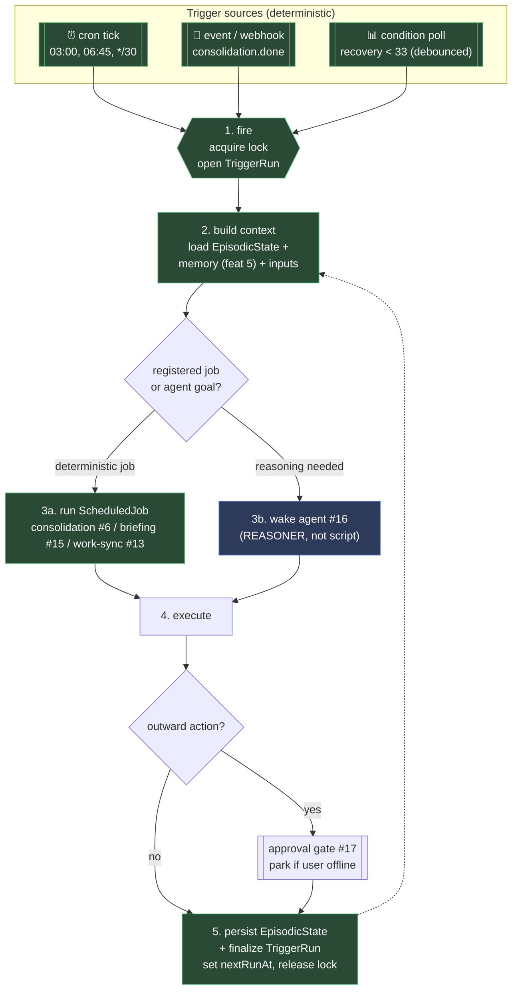

# Proactive Scheduling & Triggers
> Priority/build order: 19  ·  Tier: deep

## Summary

This is the layer that lets Jarvis **act when no human is asking**. Everything else in the system is reactive — you talk, it answers; you wake it, it serves. The scheduler is the opposite: it is the heartbeat that gives the agent CPU on a clock, on an event, or when a condition crosses a line. Without it, the nightly consolidation (feature 6) never runs, the morning briefing (feature 15) never appears, reminders never fire, and "tell me if my recovery tanks" is just a wish. The schedule is part of the cognitive architecture, not a cron file bolted on the side.

The locked design principle is: **wake the agent as a REASONER, not a dumb script.** A trigger does not call a fixed function and exit. It builds *context* — loads the trigger's persistent **episodic state** (what happened last time this fired, what it decided, what's still open) plus relevant long-term memory (feature 5) — and then either runs a registered deterministic **job** (consolidation, briefing, metric sync) or **wakes the agent** (feature 16) with a goal and that context. The agent reasons over the situation the way a chief-of-staff would ("recovery is low *again*, third day this week — last time I suggested a rest day and they ignored it, so this time flag it differently"). This is why episodic state is load-bearing: proactive actions without memory are nagging; proactive actions with memory are help.

There are exactly **three trigger types**: **time/cron** (03:00 consolidation, 06:45 briefing, every-30-min work sync), **event** (a webhook or internal bus event — "consolidation finished" → fire briefing), and **condition** (a metric threshold evaluated on a poll — "recovery < 33% → suggest rest day"). All three converge on the same loop: *fire → build context → wake job/agent → execute → persist*. 

The hard architectural line is **deterministic scheduling vs AI reasoning**. The trigger layer itself — when things fire, catch-up after the laptop was asleep, locks against overlapping runs, debounce on flapping conditions, DST math, retry/backoff — is 100% deterministic TS/Node. The *only* AI in this feature is the agent that gets woken; its reasoning is non-deterministic and lives behind feature 16. And every outward action the woken agent wants to take still passes through the approval gate (feature 17) — proactivity never buys a bypass on safety. On macOS the whole thing runs as a single long-lived daemon supervised by **launchd**; the heavy model is loaded on demand (feature 1) only when a fired job actually needs it, and heavy batch work (consolidation) routes to HF.

## Data flow  *(REQUIRED)*

**Inputs**
- **Schedules** — `Trigger` rows of kind `cron` (a cron expression + timezone) for time-based jobs.
- **Events** — internal bus events (`emit('consolidation.done')`) or inbound webhooks (feature 9 connectors) matched against `Trigger` rows of kind `event`.
- **Conditions** — `Trigger` rows of kind `condition`: a metric source (feature 13/10/11) + predicate (`recovery < 33`) evaluated on a poll tick, with debounce.
- **Episodic state** — per-trigger `EpisodicState` blob: prior runs' decisions, open follow-ups, last-fired time, cooldown markers.
- **Run config** — `config/triggers.yaml` (built-in jobs, timezone, catch-up policy, poll cadence, lock TTLs).

**Numbered pipeline**
1. **Trigger fires** *(deterministic)* — the cron tick, event match, or condition crossing selects a due `Trigger`. The scheduler acquires a per-trigger advisory lock (no overlapping runs) and opens a `TriggerRun` (status `running`).
2. **Build context** *(deterministic)* — load this trigger's `EpisodicState` + pull relevant memory (feature 5 retrieval scoped by the trigger's tags) + the fresh inputs that fired it (e.g. the metric value, the event payload). Assemble a typed `TriggerContext`.
3. **Wake agent / run job** — if the trigger maps to a registered deterministic `ScheduledJob` (consolidation, briefing, work-sync), invoke it directly with context. If it maps to an agent goal, call `runAgent(goal, { source: 'scheduler', context })` (feature 16) — the agent is the reasoner.
4. **Execute (approval-gated)** — the job/agent does its work. Any outward/side-effecting action goes through feature 17's gate; if approval is needed and the user is offline, the agent run parks in `awaiting-approval` (checkpointed) and the `TriggerRun` reflects `awaiting-approval` — it does not block the scheduler.
5. **Persist state + result** *(deterministic)* — write the new `EpisodicState` (decisions made, follow-ups opened, cooldown set), finalize the `TriggerRun` (status, duration, output ref, error), update the trigger's `nextRunAt`/`lastRunAt`, release the lock.

**Outputs**
- **Scheduled job runs** — consolidation, briefing, metric syncs executed on time.
- **Reminders** — fired notifications (feature 15 / menu-bar / dashboard).
- **Briefings** — the morning brief, triggered after consolidation reports done.
- **Agent runs** — `AgentRun`s with `source: 'scheduler'` carrying proactive goals.
- **Persisted episodic state + `TriggerRun` history** for the Automations UI.

**Schemas** — `Trigger`, `ScheduledJob`, `TriggerRun`, `EpisodicState` (see `## Logic / rules`).



## Frontend flow  *(REQUIRED)*

The dashboard exposes an **"Automations"** screen — the single place to see and control everything Jarvis does on its own.

- **Trigger list** — one row per `Trigger`, grouped/filterable by kind (`cron` / `event` / `condition`). Each row shows: name, kind badge, human-readable schedule ("daily 03:00", "when consolidation finishes", "recovery < 33%"), an **enable/disable** toggle, **next-run** (for cron; "—" for event/condition), and **last-run** with a result chip.
- **Status chips** — `scheduled` (idle, armed) / `running` / `done` / `failed` / `awaiting-approval` / `disabled`. Condition triggers also show `armed` vs `cooling-down` (in debounce/cooldown).
- **Add reminder** — a lightweight form (text + when: one-shot datetime or recurring cron) that creates a `cron` (or one-shot) `Trigger` whose job is "fire reminder". This is the user's main self-service entry point; richer automations are config/built-in.
- **Run detail drawer** — clicking a run opens the `TriggerRun`: fired-at, context summary, whether it ran a job or woke the agent (deep-links to the feature 16 Agent Activity trace), output/result, and the `EpisodicState` diff (what this run remembered → what it now remembers).
- **Catch-up banner** — if the daemon detects missed runs after the machine was asleep/off, a banner summarizes "3 triggers caught up on wake" with links.
- **States & transitions** — `scheduled → running → (awaiting-approval ⇄ running) → done | failed`, back to `scheduled` with a fresh `nextRunAt`. A disabled trigger leaves the rotation entirely (`disabled`). Conditions add `running → cooling-down → scheduled`. The UI is read-mostly and reconstructs state from `TriggerRun` rows + the live scheduler stream (SSE), never from in-memory UI state.

## Logic / rules  *(deep tier)*

**Deterministic vs AI boundary (hard line):** Everything about *whether/when/once* a trigger fires is deterministic TS/Node — cron parsing, timezone/DST math, catch-up detection, advisory locking, overlap prevention, condition evaluation + debounce + cooldown, retry/backoff, `nextRunAt` computation, episodic-state read/write, and `TriggerRun` lifecycle. The **only** AI is the agent woken in step 3b (feature 16): its planning, tool selection, and reflection over the `TriggerContext`. The scheduler never makes a judgment call; it hands a well-formed situation to the reasoner and records what came back.

**Schemas (TS / zod-shaped)**
```ts
type TriggerKind = "cron" | "event" | "condition";
type TriggerStatus = "scheduled" | "running" | "awaiting-approval" | "cooling-down" | "disabled";

interface Trigger {
  id: string;
  name: string;
  kind: TriggerKind;
  enabled: boolean;
  // discriminated by kind:
  cron?: { expr: string; timezone: string; oneShot?: boolean };        // kind=cron
  event?: { topic: string; filter?: Record<string, unknown> };          // kind=event
  condition?: {                                                          // kind=condition
    metric: string;                  // e.g. "health.recovery"
    predicate: string;               // e.g. "< 33"
    pollEverySec: number;            // evaluation cadence
    debounceSec: number;             // must hold this long before firing
    cooldownSec: number;             // min gap between fires (anti-flap)
  };
  action: { job: string } | { agentGoal: string };  // registered ScheduledJob OR an agent goal
  tags: string[];                    // scope for memory retrieval at context-build
  catchUp: "run-once" | "skip" | "run-all";          // missed-run policy
  status: TriggerStatus;
  nextRunAt?: string;                // cron only
  lastRunAt?: string;
  lastRunId?: string;
  createdAt: string; updatedAt: string;
}

interface ScheduledJob {                // a registered deterministic handler
  name: string;                         // "consolidation" | "briefing" | "work.sync" | "reminder.fire"
  description: string;
  handler: (ctx: TriggerContext) => Promise<JobResult>;
  needsModel: "none" | "local" | "hf"; // drives on-demand load (feature 1)
  maxDurationSec: number;               // watchdog
  singleton: boolean;                   // overlap forbidden (lock)
}

interface TriggerRun {
  id: string;
  triggerId: string;
  firedAt: string;
  firedBy: "cron" | "event" | "condition" | "catch-up" | "manual";
  status: "running" | "done" | "failed" | "awaiting-approval";
  ranAs: { job: string } | { agentRunId: string };  // which path executed
  contextSummary: string;               // what was loaded into TriggerContext
  result?: unknown;
  error?: { code: string; message: string };
  startedAt: string; finishedAt?: string;
  scheduledFor?: string;                // intended time (differs from firedAt on catch-up)
}

interface EpisodicState {               // persistent memory BETWEEN runs of one trigger
  triggerId: string;
  lastFiredAt?: string;
  lastDecision?: string;                // "suggested rest day"
  openFollowUps: { id: string; text: string; sinceRunId: string }[];
  conditionState?: { lastValue?: number; crossedAt?: string; cooldownUntil?: string };
  runHistoryRefs: string[];             // recent TriggerRun ids (bounded)
  updatedAt: string;
}
```

**Cron / time rules.** Cron expressions are parsed with `cron-parser` against the trigger's IANA timezone; `nextRunAt` is recomputed after every run. One-shot triggers (`oneShot: true`, used by reminders) auto-disable after firing once.

**Event rules.** Event triggers subscribe to internal bus topics (and webhook routes from feature 9). On match, the optional `filter` is applied deterministically before firing. The canonical chain is `consolidation.done` → fire the `briefing` job (feature 15 explicitly triggers "once consolidation reports done").

**Condition rules.** A poller evaluates `metric predicate` every `pollEverySec`. The condition must hold continuously for `debounceSec` (anti-flap) before firing; after firing, it enters `cooldownSec` cooldown (`cooling-down`) during which it cannot refire. `conditionState` in episodic memory tracks `crossedAt` and `cooldownUntil`, so debounce/cooldown survive a restart.

**Locking & overlap.** Every `singleton` job/trigger takes a per-trigger advisory lock with a TTL. A second fire while one is in-flight no-ops (logged). A lock older than its TTL (crashed run) is force-broken and the stale `TriggerRun` marked `failed`.

**Catch-up.** On daemon start (and on macOS wake-from-sleep), the scheduler computes, per cron trigger, the missed occurrences since `lastRunAt`. Policy `run-once` fires a single catch-up run (the common case — you don't want 8 hours of briefings), `run-all` replays each, `skip` just realigns `nextRunAt`. Nightly consolidation uses `run-once`.

## Edge cases & safety

| # | Case | Handling |
|---|------|----------|
| 1 | Machine asleep/off at scheduled time | On wake/boot, deterministic **catch-up**: compute missed occurrences since `lastRunAt`; fire per `catchUp` policy (consolidation `run-once`). `TriggerRun.firedBy='catch-up'`, `scheduledFor` ≠ `firedAt`; UI shows catch-up banner. |
| 2 | Overlapping runs (slow run still going when next fires) | Per-trigger advisory **lock** with TTL; second fire no-ops + logs. `singleton` jobs never run concurrently. |
| 3 | Missed nightly consolidation (laptop off all night) | Catch-up `run-once` next time machine is awake; consolidation is idempotent + windowed (feature 6) so it processes the backlog oldest-first across nights — no data loss, no double-processing. |
| 4 | Condition flapping (recovery oscillates around 33) | **Debounce** (`debounceSec` must hold) + **cooldown** (`cooldownSec` after a fire); `conditionState` persisted so flap suppression survives restart. One suggestion, not a storm. |
| 5 | Model cold-start needed for a job | `ScheduledJob.needsModel` triggers `ensureReady()` (feature 1) before invoking; cold start (~2–6s) is absorbed inside the run, surfaced as "waking up"; job watchdog accounts for it. |
| 6 | HF down for consolidation | Consolidation job degrades per feature 6 (skip failing units, mark run `partial`, leave records pending); `TriggerRun` records `partial`/`failed`; retried next night. Scheduler never crashes on a job failure. |
| 7 | Daylight-saving transition | Cron evaluated in IANA tz via `cron-parser` (DST-aware): a 02:30 job is skipped or run-once on spring-forward, not double-fired on fall-back. Catch-up de-dupes by `scheduledFor`. |
| 8 | Reminder fires while user away | Notification is queued/persisted (not lost); delivered to dashboard + menu-bar; if it needs an outward action it parks at the approval gate; reminder text is non-destructive so it's safe to surface late. |
| 9 | Runaway recurring trigger (mis-set every-second cron) | Per-trigger **min-interval floor** + max-fires-per-window rate limit; exceeding it auto-disables the trigger and raises a UI alert rather than spinning the CPU. |
| 10 | Approval needed but user offline | Woken agent's outward action hits feature 17 → `interrupt()`, state checkpointed; `TriggerRun` → `awaiting-approval`; scheduler moves on (no busy-wait, no held lock beyond the run's own). Resumes when the user acts. |
| 11 | Trigger handler throws / hangs | `maxDurationSec` watchdog aborts via `AbortController`; run marked `failed` with `code`; bounded retry/backoff for transient codes; lock released regardless. |
| 12 | Daemon crash mid-run | `TriggerRun` left `running` past lock TTL is force-broken on restart and marked `failed`; underlying jobs (consolidation, agent) resume from their own checkpoints (features 6/16), so no work is lost or duplicated. |
| 13 | Clock skew / time jumps backward (NTP correction) | Scheduler keys off monotonic ticks for cadence and wall-clock only for `nextRunAt`; a backward jump cannot retrigger a just-run cron (de-dupe by `lastRunAt` ≥ `scheduledFor`). |
| 14 | Disabled / deleted trigger mid-flight | In-flight run completes and persists; disable takes effect for *future* fires only; deletion soft-deletes the `Trigger` but retains `TriggerRun` history for audit. |
| 15 | Two triggers want the heavy model at once | `needsModel:'local'` jobs serialize through the single local model (feature 1 lifecycle); `hf` jobs run in parallel (cloud). Scheduler does not over-subscribe the 16GB machine. |

## Dependencies  *(REQUIRED)*

- [features/6-nightly-memory-consolidation.md](./6-nightly-memory-consolidation.md) — the 03:00 cron job; consumes `trigger='scheduler'`, exposes the manual/resume path.
- [features/15-daily-briefing-and-digest.md](./15-daily-briefing-and-digest.md) — fired by the `consolidation.done` event (and a 06:45 cron fallback); the canonical event→job chain.
- [features/16-agent-tool-execution-core.md](./16-agent-tool-execution-core.md) — the reasoner woken in step 3b; receives `runAgent(goal, { source:'scheduler', context })`, returns an `AgentRun`.
- [features/17-action-approval-and-safety-gate.md](./17-action-approval-and-safety-gate.md) — every outward action from a woken agent passes the gate; offline → `awaiting-approval` park.
- [features/13-work-and-productivity-metrics.md](./13-work-and-productivity-metrics.md) — `work.sync` cron job (every 30 min, 06:30 pre-warm) and a source of condition metrics + todo-due reminders.
- [features/1-local-qwen-inference-core.md](./1-local-qwen-inference-core.md) — on-demand model load (`ensureReady`) for jobs that need it; HF routing for heavy batch.
- [architecture/deployment.md](../architecture/deployment.md) — launchd daemon supervision, wake-from-sleep hook, on-disk paths, restart policy. *(to be authored)*
- [architecture/architecture.md](../architecture/architecture.md) — local-first principle, on-demand lifecycle, "own the storage, rent the intelligence", SQLite as durable store.
- External (free/OSS): `cron-parser` (DST-aware cron), `node-cron`/internal tick loop, `better-sqlite3` (Trigger/Run/EpisodicState persistence), Node `EventEmitter` bus.

## File structure  *(deep tier)*
```
src/scheduler/
  index.ts                 # daemon entrypoint: start(), wake handler, graceful shutdown
  scheduler.ts             # core loop: cron tick + event subscribe + condition poll → fire()
  fire.ts                  # step 1: lock acquire, open TriggerRun, route to job/agent
  context.ts               # step 2: build TriggerContext (EpisodicState + memory #5 + inputs)
  catchup.ts               # missed-occurrence computation + run-once/run-all/skip policy
  conditions/
    poller.ts              # evaluate metric predicate on cadence
    debounce.ts            # debounce + cooldown (anti-flap), conditionState persistence
  jobs/
    registry.ts            # register ScheduledJob handlers (needsModel, singleton, watchdog)
    consolidation.ts       # thin wrapper → feature 6 runConsolidation('scheduler')
    briefing.ts            # thin wrapper → feature 15 generateBriefing()
    workSync.ts            # thin wrapper → feature 13 work.sync
    reminder.ts            # fire a reminder notification (one-shot triggers)
  wakeAgent.ts             # step 3b: runAgent(goal, {source:'scheduler', context})
  locks.ts                 # per-trigger advisory locks + TTL force-break
  ratelimit.ts             # min-interval floor + runaway auto-disable
  episodic.ts              # EpisodicState read/write/diff
  store.ts                 # SQLite: Trigger / TriggerRun / EpisodicState tables
  schemas.ts               # zod: Trigger, ScheduledJob, TriggerRun, EpisodicState
  config.ts                # load config/triggers.yaml, built-in trigger seeds
deploy/
  com.jarvis.scheduler.plist  # launchd daemon (KeepAlive, wake hook)
config/triggers.yaml          # built-in jobs + user reminders
dashboard/views/Automations.tsx
src/scheduler/__tests__/
  catchup.test.ts          # asleep/off → missed-occurrence policy
  debounce.test.ts         # condition flap suppression
  locks.test.ts            # overlap prevention + stale lock break
  dst.test.ts              # spring-forward/fall-back cron correctness
```

**Built-in trigger table**

| Name | Kind | Schedule / Trigger | Action | needsModel | catchUp | Notes |
|------|------|--------------------|--------|-----------|---------|-------|
| `nightly-consolidation` | cron | `0 3 * * *` (local tz) | job `consolidation` (#6) | hf | run-once | REM-sleep batch; idempotent + windowed |
| `morning-briefing` | event | `consolidation.done` | job `briefing` (#15) | hf→local | run-once | event chain; 06:45 cron is the fallback |
| `briefing-fallback` | cron | `45 6 * * *` | job `briefing` (#15) | hf→local | run-once | fires only if event chain didn't already today |
| `work-sync` | cron | `*/30 * * * *` | job `work.sync` (#13) | none | skip | GitHub/Gmail ETL; 06:30 pre-warm before briefing |
| `low-recovery-restday` | condition | `health.recovery < 33`, debounce 15m, cooldown 12h | agent goal: "recovery is low — given history, decide how to suggest rest" | local | n/a | wakes the reasoner, not a fixed message |
| `overdue-todos` | condition | `todos.overdue > 0`, poll 1h, cooldown 6h | agent goal: "surface overdue todos, prioritized" | local | n/a | reads feature 13 todo store |
| `inbox-followups` | condition | `work.followups_owed > 0`, poll 2h, cooldown 24h | agent goal: "draft follow-up reminders (approval-gated)" | local | n/a | outward action → feature 17 gate |
| `user-reminder-*` | cron | one-shot or recurring (from Add-reminder UI) | job `reminder.fire` | none | run-once | user's self-service entry point |

**Code snippet 1 — scheduler registering cron + condition triggers (and the launchd note)**
```ts
// src/scheduler/scheduler.ts
import parser from "cron-parser";
import { bus } from "../bus";
import { fire } from "./fire";
import { evaluateCondition } from "./conditions/poller";
import { store } from "./store";
import { catchUpOnStart } from "./catchup";

const MIN_INTERVAL_SEC = 5; // runaway floor (edge case 9)

export async function start() {
  await catchUpOnStart();                 // edge cases 1 & 3: replay missed cron per policy

  for (const t of await store.enabledTriggers()) {
    switch (t.kind) {
      case "cron": {
        // DST-aware next-fire computed in the trigger's IANA timezone
        const it = parser.parseExpression(t.cron!.expr, { tz: t.cron!.timezone });
        scheduleNext(t.id, it.next().toDate());          // arms a single timer per occurrence
        break;
      }
      case "event":
        bus.on(t.event!.topic, (payload) =>
          matchesFilter(payload, t.event!.filter) && fire(t, { firedBy: "event", payload }));
        break;
      case "condition": {
        const interval = Math.max(t.condition!.pollEverySec, MIN_INTERVAL_SEC) * 1000;
        setInterval(async () => {
          const r = await evaluateCondition(t);          // debounce + cooldown live here
          if (r.shouldFire) fire(t, { firedBy: "condition", value: r.value });
        }, interval);
        break;
      }
    }
  }
}

function scheduleNext(triggerId: string, when: Date) {
  const delay = Math.max(0, when.getTime() - Date.now());
  setTimeout(async () => {
    const t = await store.getTrigger(triggerId);
    if (t?.enabled) await fire(t, { firedBy: "cron", scheduledFor: when.toISOString() });
    // re-arm the next occurrence (recomputed → DST-correct, edge case 7)
    if (t?.kind === "cron" && !t.cron?.oneShot) {
      const it = parser.parseExpression(t.cron!.expr, { tz: t.cron!.timezone });
      scheduleNext(triggerId, it.next().toDate());
    }
  }, delay);
}

// deploy/com.jarvis.scheduler.plist (launchd):
//   <key>KeepAlive</key><true/>            keep the daemon alive (restart on crash)
//   <key>RunAtLoad</key><true/>            start at login → triggers catchUpOnStart()
//   <key>ProgramArguments</key> → node dist/scheduler/index.js
// A wake-from-sleep observer (NSWorkspace.didWakeNotification via a tiny helper)
// re-invokes catchUpOnStart() so missed cron jobs fire after the lid was closed.
```

**Code snippet 2 — trigger handler: load episodic state + wake the agent (feature 16)**
```ts
// src/scheduler/fire.ts  — DETERMINISTIC orchestration; the AI is only runAgent()
import { acquireLock, releaseLock } from "./locks";
import { buildContext } from "./context";
import { readEpisodic, writeEpisodic } from "./episodic";
import { jobs } from "./jobs/registry";
import { runAgent } from "../agent";          // feature 16
import { ensureReady } from "../inference";    // feature 1 on-demand model load
import { store } from "./store";

export async function fire(t: Trigger, opts: FireOpts) {
  const lock = await acquireLock(t.id);                 // edge case 2: no overlap
  if (!lock) return;                                     // already running → no-op

  const run = await store.openRun(t, opts);              // TriggerRun status=running
  try {
    const episodic = await readEpisodic(t.id);           // persistent state BETWEEN runs
    const ctx = await buildContext(t, episodic, opts);   // + memory (#5) + fired inputs

    let result, episodicUpdate;
    if ("job" in t.action) {
      const job = jobs.get(t.action.job)!;
      if (job.needsModel !== "none") await ensureReady(job.needsModel); // cold-start (edge 5)
      ({ result, episodicUpdate } = await withWatchdog(job.maxDurationSec,
        () => job.handler(ctx)));
    } else {
      // wake the agent as a REASONER, not a dumb script — it gets the full situation
      const agentRun = await runAgent(t.action.agentGoal, {
        source: "scheduler",
        context: ctx,            // episodic memory + what fired + relevant long-term memory
      });
      // outward actions inside the agent already passed feature 17's gate; if approval
      // was needed and the user is offline, agentRun parks awaiting-approval (edge 10).
      if (agentRun.status === "awaiting-approval")
        await store.markRun(run.id, "awaiting-approval", { agentRunId: agentRun.id });
      result = agentRun.result;
      episodicUpdate = { lastDecision: summarize(agentRun) };
    }

    await writeEpisodic(t.id, {                           // persist what this run learned
      ...episodic, ...episodicUpdate, lastFiredAt: opts.scheduledFor ?? new Date().toISOString(),
    });
    await store.finalizeRun(run.id, "done", result);
  } catch (e) {
    await store.finalizeRun(run.id, "failed", undefined, asError(e)); // never crashes daemon
  } finally {
    await store.bumpNextRun(t.id);                        // recompute nextRunAt
    await releaseLock(t.id);
  }
}
```

The deterministic core owns the clock, the locks, the catch-up, and the debounce — it can be reasoned about and tested without a model in the loop. The agent it wakes owns the judgment. That split is what makes proactivity safe: Jarvis decides *when* to think on a clock you can audit, but *what to do* when it thinks is the same approval-gated reasoning as any other agent run — never a hidden script with side effects.
