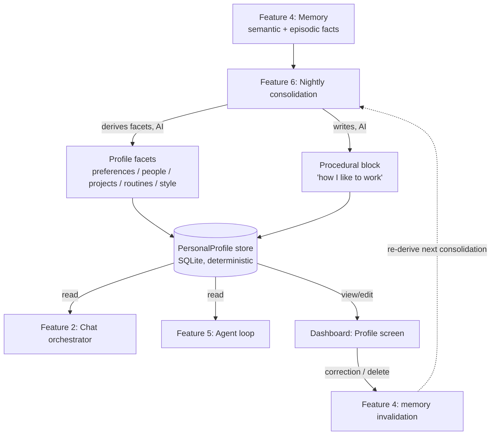

# Personal Profile & Preference Learning
> Priority/build order: 20  ·  Tier: light

## Summary

The Personal Profile is Jarvis's evolving, user-inspectable model of **who you are**: your preferences, the people in your life, your active projects, your routines, and your communication style. It is the durable "self" that Jarvis reads from to personalize every interaction — so that answers, drafts, summaries, and agent actions reflect your actual context instead of generic defaults.

Critically, this profile is built by **memory-based continual learning, not fine-tuning**. The 2026 research consensus is clear: for *facts about a person*, memory beats fine-tuning. Memory gives instant correction (change a fact, it takes effect immediately), no catastrophic forgetting, and full inspectability. Fine-tuning a model with personal facts bakes them into opaque weights that are slow to update, easy to corrupt, and impossible to audit. So the profile is **structured data** (the facets below) plus a **procedural "how I like to work" block** — a short natural-language behavior block that nightly consolidation (feature 6) writes and the chat orchestrator (feature 2) reads.

A persona/style LoRA is mentioned only as an **optional future** (see below), and even then it would carry *style only, never facts*.

## Data flow  *(REQUIRED)*

**Inputs:** consolidated facts/insights from nightly consolidation (feature 6), semantic + episodic memory (feature 4).

**Pipeline:** derive profile facets from semantic memory → maintain a structured `PersonalProfile` + a procedural "how I work" block → expose both to chat (feature 2) and the agent loop (feature 5).

**Outputs:** `PersonalProfile` (structured facets) + the procedural "how I work" block (markdown string).

**Schemas:** `PersonalProfile`.



**Deterministic vs AI boundary.**
- *Deterministic:* storing the profile, reading it, applying user edits/corrections, deleting facets, versioning, and propagating a correction to memory invalidation. These are plain CRUD operations with no model in the loop — they must be exact and instant.
- *AI:* deriving facets from raw memory (clustering related facts into "preferences" vs "routines", phrasing the procedural block, deciding what's salient). This is done by feature 6 during nightly consolidation, never inline during a chat turn.

This split matters: a user edit is **authoritative and immediate** (deterministic write), while AI derivation is **eventually-consistent and overrideable** (runs nightly, always loses to an explicit user correction).

## Frontend flow  *(REQUIRED)*

A dashboard **"Profile"** screen lets you see and steer everything Jarvis believes about you.

- **Sections:** Preferences, People, Projects, Routines, Communication Style, and a read-mostly "How I like to work" procedural block.
- **Per-fact controls:** each derived fact shows its value, a confidence indicator, and provenance ("learned from 3 conversations, last seen May 2026"). Each fact can be **edited**, **confirmed** (pin it so consolidation won't overwrite), or **deleted**.
- **Correction flow:** editing or deleting a fact writes the correction deterministically and emits an invalidation event to feature 4, so the underlying memories that produced the wrong inference are marked stale and won't re-derive the same mistake.
- **States:**
  - *Empty (cold start):* "Jarvis is still getting to know you" with a prompt to chat more or seed a few facts manually.
  - *Learning:* sparse facets shown with low-confidence badges; clearly labeled as tentative.
  - *Populated:* full facets with confidence + provenance, edit affordances everywhere.
- The procedural block is shown as rendered markdown with a "view raw / suggest edit" affordance — edits here go straight into what feature 2 injects into the system prompt.

## Edge cases & safety

- **Wrong inferred facts:** the primary failure mode. User correction is authoritative and propagates to memory invalidation (feature 4) so the bad inference doesn't regenerate. Pinned/confirmed facts are never silently overwritten by consolidation.
- **Contradictory traits:** when consolidation derives a facet that conflicts with an existing one, keep both with timestamps and surface the conflict in the UI rather than silently picking; the more recent + higher-confidence wins for injection, but the user can resolve.
- **Over-personalization:** cap how much profile context is injected per turn (top-N salient facets relevant to the query, not the whole profile) so Jarvis stays adaptable and doesn't lock into a stale self-image. The procedural block stays short.
- **Privacy:** not a concern here (single user, fully local on the M3 Air). **Accuracy is the real bar** — a confidently wrong profile is worse than an empty one, so prefer "I'm not sure" / low-confidence labeling over guessing.
- **Cold start:** with little data, show the empty/learning states, lean on explicit user-seeded facts, and never fabricate facets to look populated.

## Dependencies  *(REQUIRED)*

- `features/4` — Memory (source of facts; target of correction/invalidation)
- `features/6` — Nightly consolidation (derives facets + writes the procedural block)
- `features/2` — Chat orchestrator (reads profile + procedural block for personalization)
- `features/5` — Agent loop (reads profile for personalized actions)
- `architecture/model-serving.md` — local model used by consolidation for facet derivation

## Optional future: persona/style LoRA (NOT v1)

If memory-based persona proves insufficient for *matching your voice* (tone, phrasing, formatting habits), a small periodic **style LoRA** could be trained — **monthly**, on your own outgoing text, carrying **style only, never facts**. Facts always stay in memory/profile where they can be corrected instantly. This is explicitly **out of v1 scope**, requires the Python toolchain, and should only be revisited if the memory-based procedural block demonstrably fails to capture style.

## File structure

```
src/profile/
  schema.ts          # PersonalProfile + facet types (below)
  store.ts           # deterministic CRUD over SQLite (read/write/edit/delete/pin)
  derive.ts          # invoked by feature 6: memory → facets + procedural block
  inject.ts          # select top-N salient facets + procedural block for feature 2/5
  invalidate.ts      # emit correction events to feature 4
ui/profile/
  ProfileScreen.tsx  # sections, states (empty/learning/populated)
  FactCard.tsx       # value + confidence + provenance + edit/confirm/delete
  ProceduralBlock.tsx
test/profile/
  store.test.ts
  derive.test.ts
```

### `PersonalProfile` TS schema

```ts
interface ProfileFact<T = string> {
  id: string;
  value: T;
  confidence: number;        // 0..1, from consolidation
  pinned: boolean;           // user-confirmed; never auto-overwritten
  source: "derived" | "user";
  provenance?: string;       // e.g. "3 conversations, last seen 2026-05"
  updatedAt: string;         // ISO timestamp
}

interface Person {
  name: string;
  relationship?: string;     // "spouse", "colleague", "manager"
  notes?: string;            // salient context Jarvis should remember
}

interface Project {
  name: string;
  status: "active" | "paused" | "done";
  description?: string;
}

interface Routine {
  description: string;       // "deep work mornings", "gym Tue/Thu"
  cadence?: string;          // "daily", "weekdays", "weekly"
}

interface PersonalProfile {
  preferences: ProfileFact[];          // tools, formats, defaults you like
  people: ProfileFact<Person>[];
  projects: ProfileFact<Project>[];
  routines: ProfileFact<Routine>[];
  communicationStyle: ProfileFact;     // tone/verbosity descriptors
  proceduralBlock: string;             // markdown "how I like to work",
                                       // written by feature 6, read by feature 2
  version: number;                     // bumped on every write
  updatedAt: string;
}
```
