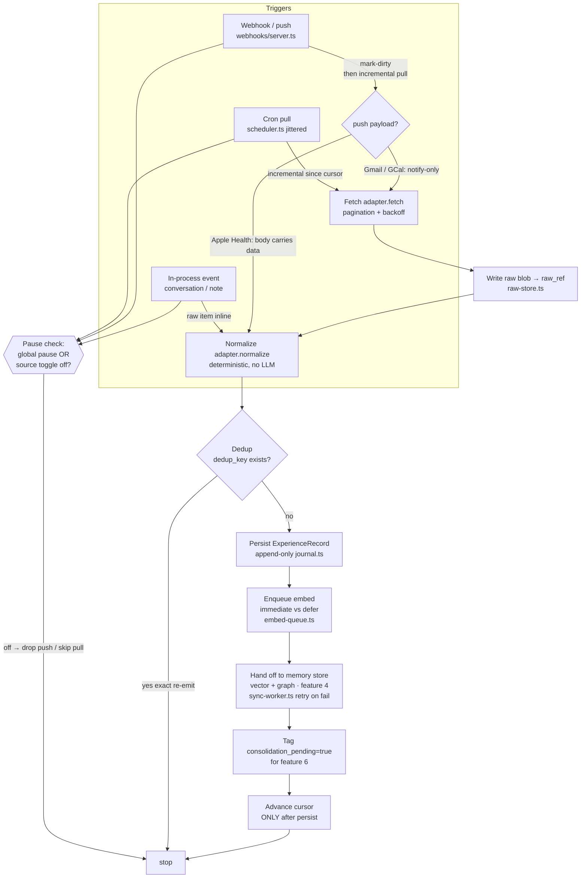

# Memory Capture & Ingestion

> Priority/build order: 3  ·  Tier: deep

## Summary

The **capture layer**: the always-on intake pipeline that ingests "everything you do" and normalizes it into a single common `ExperienceRecord` shape for the long-term memory store (feature 4). It is **capture-everything by default** — single-user, privacy is not a concern, so every source ships ON. Per-source toggles and a global pause exist for convenience only.

Sources in v1: (a) **conversations** with Jarvis (chat/voice), (b) **quick-capture notes**, and (c) **connector-ingested data** — Gmail, Google Calendar, GitHub, Apple Health (push-from-device via Health Auto Export), and Whoop. Finance is deferred to v2.

Capture follows the **HPI (Human Programming Interface) adapter pattern**: one typed `SourceAdapter` per source emitting normalized records to a unified interface. Capture's job is **faithful, normalized ingestion + obvious-duplicate dedup** — it is deterministic and does NOT decide importance. All heavy extraction, semantic dedup, and forgetting happen later in nightly consolidation (feature 6).

Architecture reality drives the design: most personal data is **daily-batch (T+1)** — wearables land the morning after, Whoop after a sleep cycle, Apple Health only when the device is unlocked. Webhooks (Calendar push, Gmail) are a **freshness bonus layered on top of batch**, never the primary path. Must stay lightweight on the MacBook Air M3 / 16GB: streaming ingestion, no big model in RAM — only the small `Qwen3-Embedding-0.6B` for embedding, or embedding deferred to a nightly batch.

## Pipeline diagram  *(deep tier)*

The pipeline is one linear orchestration (`pipeline.ts`) fed by **three trigger paths**. All three converge at the same Fetch/Normalize stages; only the entry differs. The cursor advances **last**, after persist, so any crash re-pulls rather than skips.



## Data flow  *(REQUIRED)*

- **Inputs:**
  - Conversation turns from the chat/voice runtime (in-process events).
  - Quick-capture notes from the UI / global hotkey / API.
  - Pulled connector data: Gmail messages, Calendar events, GitHub events, Whoop cycles/sleep/recovery.
  - Pushed connector data: Apple Health JSON (Health Auto Export → local REST endpoint), Calendar push notifications, Gmail watch notifications.

- **Processing / pipeline:** (numbered)
  1. **Trigger.** A source fires via one of three paths: (a) **cron pull** on the source's schedule, (b) **webhook/push** to a local endpoint, or (c) **in-process event** (conversations, notes). Webhook delivery for Gmail/Calendar never carries the payload directly — it only marks the source dirty and triggers an incremental pull; Apple Health push is the one exception where the body carries data. The global pause and the per-source toggle are checked first; if off, the trigger is dropped (push) or skipped (pull).
  2. **Fetch (adapter).** The `SourceAdapter` pulls new items since its stored `cursor` (Gmail `historyId`, Calendar `syncToken`, GitHub `since`/ETag, Whoop `start`/`nextToken`). Pagination + rate-limit backoff handled here. Raw responses are written to the raw blob store first (`raw_ref`).
  3. **Normalize.** Each raw item is mapped to one or more `ExperienceRecord`s via the adapter's `normalize()`. Purely deterministic: field mapping, timestamp → UTC ISO, light entity extraction (regex/heuristic only — emails, @handles, repo names, calendar attendees). No LLM.
  4. **Dedup (obvious only).** Compute a deterministic `dedup_key` (source + stable source id + content hash). Drop exact re-emits (webhook+batch overlap, re-runs). Semantic/near-dup dedup is explicitly NOT done here — deferred to consolidation.
  5. **Persist raw record.** Insert the `ExperienceRecord` into the capture journal (append-only). This is the durable source of truth even if downstream is unavailable.
  6. **Enqueue for embedding.** Push the record id onto the embed queue. Short text (conversations, notes, calendar titles) is embedded immediately with `Qwen3-Embedding-0.6B`; large/low-priority bodies (full emails, long GitHub diffs) are flagged `embed_defer` for the nightly batch to keep RAM/CPU low.
  7. **Hand off to memory store.** Embedded records are written to the vector store + temporal graph (feature 4). If the store is unavailable, records stay in the journal with `sync_state=pending` and a retry worker drains them.
  8. **Tag for consolidation.** Mark the record `consolidation_pending=true`. Nightly consolidation (feature 6) scans this flag to do fact extraction, semantic dedup, and forgetting.
  9. **Advance cursor.** Only after successful persist (step 5) is the adapter's cursor advanced, so a crash re-pulls rather than skips. Cursors are stored per-source.

- **Outputs:**
  - `ExperienceRecord`s in the append-only capture journal.
  - Embed-queue entries (immediate or deferred).
  - Records written to feature 4 (vector + graph).
  - `consolidation_pending` flags consumed by feature 6.
  - Live capture-feed events for the dashboard.

- **Schemas:**

```typescript
type SourceId =
  | "conversation" | "note"
  | "gmail" | "gcal" | "github" | "apple_health" | "whoop";

type ExperienceType =
  | "message" | "note" | "email" | "calendar_event"
  | "code_activity" | "health_metric" | "sleep" | "recovery" | "workout";

interface ExperienceRecord {
  id: string;                    // ULID, time-sortable
  source: SourceId;
  type: ExperienceType;
  timestamp: string;             // event time, UTC ISO-8601
  ingested_at: string;           // capture time, UTC ISO-8601
  actor: string;                 // "user" | "jarvis" | external id (sender email, gh login)
  text: string;                  // human-readable content used for embedding
  payload: Record<string, unknown>; // structured, source-specific fields
  entities: Entity[];            // deterministic extraction only
  provenance: Provenance;
  raw_ref: string;               // pointer to raw blob (path / object key)
  dedup_key: string;             // source + stable id + content hash
  embed_state: "pending" | "deferred" | "done";
  sync_state: "pending" | "synced" | "error";
  consolidation_pending: boolean;
}

interface Entity { kind: "person" | "repo" | "email" | "org" | "place" | "tag"; value: string; }

interface Provenance {
  adapter: SourceId;
  adapter_version: string;
  via: "pull" | "webhook" | "in_process";
  source_id: string;             // native id (gmail msg id, gcal event id, whoop cycle id)
  cursor_at: string;             // cursor value when fetched
}

interface SourceAdapter<Raw = unknown> {
  id: SourceId;
  auth: "none" | "oauth2" | "pat" | "push";
  defaultEnabled: true;                          // capture-everything: always true in v1
  schedule?: string;                             // cron; absent for push/in-process sources
  supportsWebhook: boolean;
  fetch(cursor: Cursor | null): AsyncIterable<Raw>;   // incremental pull
  ingestPush?(body: unknown): AsyncIterable<Raw>;     // for push sources (Apple Health)
  normalize(raw: Raw): ExperienceRecord[];            // deterministic, no LLM
  nextCursor(raw: Raw, prev: Cursor | null): Cursor;
}

interface Cursor { value: string; updated_at: string; }
```

**Example adapter — Whoop (`adapters/whoop.ts`):** OAuth2 with a **rotating refresh token** — every refresh invalidates the previous refresh token, so all refreshes funnel through one serialized lock (`whoop-refresh-lock.ts`). Embeds short summaries immediately.

```typescript
import { withWhoopRefreshLock } from "../auth/whoop-refresh-lock";
import { getWhoopToken, persistWhoopTokens } from "../auth/keychain";

interface WhoopRecovery {
  cycle_id: string; sleep_id: string;
  score: { recovery_score: number; hrv_rmssd_milli: number; resting_heart_rate: number };
  updated_at: string; sleep_performance_pct: number;
}

export const whoopAdapter: SourceAdapter<WhoopRecovery> = {
  id: "whoop",
  auth: "oauth2",
  defaultEnabled: true,
  schedule: "0 * * * *",          // hourly; scheduler also forces a guaranteed ~08:00 local run
  supportsWebhook: false,

  async *fetch(cursor) {
    // Rotating-refresh: serialize so concurrent runs never burn the refresh token.
    const access = await withWhoopRefreshLock(async () => {
      const tok = await getWhoopToken();
      if (tok.expiresAt > Date.now() + 60_000) return tok.accessToken;
      const next = await refreshWhoop(tok.refreshToken);   // returns NEW refresh token
      await persistWhoopTokens(next);                       // atomic write BEFORE any API call
      return next.accessToken;
    });

    const since = cursor?.value ?? new Date(Date.now() - 7 * 864e5).toISOString();
    let nextToken: string | undefined;
    do {
      const page = await whoopGet("/v1/recovery", { start: since, nextToken }, access);
      for (const rec of page.records) yield rec;           // streamed, never buffered whole
      nextToken = page.next_token;
    } while (nextToken);
  },

  normalize(r) {
    const s = r.score;
    return [{
      id: ulid(),
      source: "whoop",
      type: "recovery",
      timestamp: r.updated_at,
      ingested_at: new Date().toISOString(),
      actor: "user",
      text: `Whoop recovery ${s.recovery_score}% · HRV ${s.hrv_rmssd_milli}ms · ` +
            `RHR ${s.resting_heart_rate}bpm · sleep ${r.sleep_performance_pct}% performance`,
      payload: {
        recovery_score: s.recovery_score, hrv_ms: s.hrv_rmssd_milli,
        rhr_bpm: s.resting_heart_rate, cycle_id: r.cycle_id,
        sleep_id: r.sleep_id, sleep_perf_pct: r.sleep_performance_pct,
      },
      entities: [],
      provenance: {
        adapter: "whoop", adapter_version: "1.0.0", via: "pull",
        source_id: r.cycle_id, cursor_at: r.updated_at,
      },
      raw_ref: `raw/whoop/${r.cycle_id}.json`,
      dedup_key: computeDedupKey("whoop", r.cycle_id, r),   // see dedup.ts below
      embed_state: "pending",      // short summary → embed immediately
      sync_state: "pending",
      consolidation_pending: true,
    }];
  },

  nextCursor(r, prev) {
    // Advance only to the newest event time seen; pipeline calls this AFTER persist.
    const v = prev && prev.value > r.updated_at ? prev.value : r.updated_at;
    return { value: v, updated_at: new Date().toISOString() };
  },
};
```

**Dedup key computation + exact-dup check (`dedup.ts`):** deterministic `source + native_id + sha256(canonicalized_content)`; insert is a no-op if the key already exists.

```typescript
import { createHash } from "node:crypto";

/** Stable JSON: sorted keys, no whitespace — so re-emits hash identically. */
function canonicalize(obj: unknown): string {
  if (obj === null || typeof obj !== "object") return JSON.stringify(obj);
  if (Array.isArray(obj)) return `[${obj.map(canonicalize).join(",")}]`;
  const keys = Object.keys(obj as Record<string, unknown>).sort();
  return `{${keys.map(k => `${JSON.stringify(k)}:` +
    canonicalize((obj as Record<string, unknown>)[k])).join(",")}}`;
}

export function computeDedupKey(source: SourceId, nativeId: string, content: unknown): string {
  const hash = createHash("sha256").update(canonicalize(content)).digest("hex");
  return `${source}:${nativeId}:sha256:${hash}`;
}

/** Returns true if the record is a new (non-duplicate) insert. */
export async function insertIfNew(db: Journal, rec: ExperienceRecord): Promise<boolean> {
  // Unique index on dedup_key in the journal makes this atomic + crash-safe.
  const res = await db.run(
    `INSERT INTO journal (id, dedup_key, doc) VALUES (?, ?, ?)
     ON CONFLICT(dedup_key) DO NOTHING`,
    rec.id, rec.dedup_key, JSON.stringify(rec),
  );
  return res.changes === 1;   // 0 → exact re-emit (webhook+batch overlap / re-run), drop silently
}
```

**Example — normalized Gmail record:**

```json
{
  "id": "01J9Z3...","source": "gmail","type": "email",
  "timestamp": "2026-06-08T14:21:09Z","ingested_at": "2026-06-08T14:25:00Z",
  "actor": "alice@example.com",
  "text": "From: Alice <alice@example.com>\nSubject: Q3 roadmap\n\nHere's the draft roadmap for Q3...",
  "payload": { "thread_id": "t_4af","subject": "Q3 roadmap","to": ["you@example.com"],
               "labels": ["INBOX","IMPORTANT"],"body_bytes": 18422,"truncated": false },
  "entities": [ {"kind":"person","value":"alice@example.com"},{"kind":"tag","value":"roadmap"} ],
  "provenance": { "adapter":"gmail","adapter_version":"1.0.0","via":"pull",
                  "source_id":"msg_18f2c","cursor_at":"historyId:998123" },
  "raw_ref": "raw/gmail/msg_18f2c.json",
  "dedup_key": "gmail:msg_18f2c:sha256:9c1a...","embed_state": "deferred",
  "sync_state": "synced","consolidation_pending": true
}
```

**Example — normalized Whoop record (recovery):**

```json
{
  "id": "01J9ZB...","source": "whoop","type": "recovery",
  "timestamp": "2026-06-09T06:02:00Z","ingested_at": "2026-06-09T08:10:00Z",
  "actor": "user",
  "text": "Whoop recovery 71% · HRV 84ms · RHR 51bpm · sleep 7h12m (88% performance)",
  "payload": { "recovery_score": 71,"hrv_ms": 84,"rhr_bpm": 51,
               "cycle_id": "cyc_5521","sleep_id": "slp_8830","sleep_perf_pct": 88 },
  "entities": [],
  "provenance": { "adapter":"whoop","adapter_version":"1.0.0","via":"pull",
                  "source_id":"cyc_5521","cursor_at":"2026-06-09T07:00:00Z" },
  "raw_ref": "raw/whoop/cyc_5521.json",
  "dedup_key": "whoop:cyc_5521:sha256:2bd0...","embed_state": "pending",
  "sync_state": "synced","consolidation_pending": true
}
```

**v1 source table:**

| Source | Auth | Freshness | What's captured | Key gotcha |
|---|---|---|---|---|
| Conversation | none (in-process) | realtime | Chat + voice turns with Jarvis, role-tagged | High volume; embed immediately, batch the rest |
| Note | none (in-process) | realtime | Quick-capture text, tags | Tiny; always embed immediately |
| Gmail | OAuth2 | batch (~15m) + webhook (`users.watch`) | Full email bodies, headers, labels, threads | Quota-unit model; large bodies → defer embed/truncate `text` |
| Google Calendar | OAuth2 (mandatory) | webhook (push) + batch (hourly) | Events, attendees, times, descriptions | `syncToken` expires (410) → full resync |
| GitHub | PAT | batch (~30m) | Commits, PRs, issues, reviews, comments | 5000 req/hr; use ETag + `since` to save quota |
| Apple Health | push (device) | push-only, T+1 typical | Steps, HR, workouts, sleep, body metrics | **No cloud API**; device pushes only while unlocked |
| Whoop | OAuth2 (**rotating refresh**) | batch (after sleep cycle, AM) | Recovery, sleep, strain/cycles, workouts | Refresh token rotates each use → **serialize refreshes** |

## Frontend flow  *(REQUIRED)*

- **Screens / states:** A **Memory → Sources** settings screen in the dashboard. Each source is a row/card showing: name + icon, on/off toggle (default ON), connection state badge, last-sync time, item count, and a **Sync now** button. Per-source states: `connected`, `syncing`, `error`, `paused`, `needs-reauth`. A page-level **Pause Capture** master switch sits at the top. Below the source list, a **live capture feed**: a streaming log of recent `ExperienceRecord`s (source, type, timestamp, one-line text), filterable by source.

- **Key controls:**
  - **Global Pause Capture** toggle — halts all triggers (pull skipped, push dropped) without disconnecting.
  - **Per-source on/off** toggle — default ON; off pauses just that source, keeps auth.
  - **Sync now** — forces an immediate incremental pull (disabled for push-only Apple Health; instead shows "waiting for device push" + last-received time).
  - **Connect / Reconnect** — launches OAuth/PAT flow; surfaces the `needs-reauth` state when a token is revoked/expired.
  - **Capture feed filters** — by source/type; click a row to inspect the full record + raw payload.

- **User journey:** On first run the user opens Memory → Sources, sees every source listed with defaults ON, and walks through connecting OAuth sources (Gmail, Calendar, Whoop) and pasting the GitHub PAT. Apple Health shows setup instructions (point Health Auto Export at the local endpoint URL + token). Once connected, rows flip to `connected` with a last-sync time and the live feed begins streaming. The user rarely returns — only to hit Pause Capture during sensitive work, to re-auth when a badge turns red (`needs-reauth`), or to glance at the feed to confirm capture is alive.

## Logic / rules  *(deep tier)*

- **Scheduling (cron per source):** conversations/notes are in-process (no cron). Gmail ~every 15m, Calendar hourly (webhook handles freshness), GitHub ~30m, Whoop hourly with a guaranteed run ~08:00 local (after typical sleep cycle). Apple Health is push-only — no cron; a daily 12:00 "staleness check" warns if no push arrived in 24h. Jitter each schedule to avoid thundering-herd at boot.
- **OAuth token lifecycle:** access tokens refreshed on 401 or pre-expiry. **Whoop refresh tokens ROTATE** — every refresh returns a new refresh token that invalidates the old one. All Whoop refreshes go through a **single serialized critical section (mutex/lock)** (`withWhoopRefreshLock`, shown above); concurrent refreshes would burn the rotating token and force full re-consent. Persist the new refresh token atomically before any further request. Tokens stored in the OS keychain (see architecture/auth-and-integrations.md).
- **Dedup rule:** `dedup_key = source + native_source_id + sha256(canonicalized_content)`. On insert, if `dedup_key` exists, drop (enforced by a unique index + `ON CONFLICT DO NOTHING`, see `dedup.ts`). This kills webhook+batch overlap and re-run duplicates. Content-only changes (same id, new body) hash differently → stored as a new record (history preserved); consolidation reconciles versions.
- **Embed immediate vs deferred:** immediate (`embed_state=pending` → embedded inline) for short text — conversation turns, notes, calendar titles, Whoop summaries. Deferred (`embed_state=deferred`) for large/low-signal bodies — full emails, long GitHub diffs/comments — processed in the nightly embed batch to protect the 16GB machine. Threshold: ~512 tokens of `text` or explicit per-source flag.
- **Normalization rules per type:** all timestamps → UTC ISO-8601 with original tz kept in `payload`. `text` is the embedding surface — for emails it's `From/Subject/body` (truncated to N KB with `truncated:true`), for health/whoop it's a generated one-line summary, for code activity it's `<action> <repo>#<num>: <title>`. Entity extraction is deterministic (regex/dictionary): emails, @handles, `org/repo`, attendee addresses, #tags. Never LLM at capture time.
- **Deterministic vs AI boundary:** capture is **100% deterministic** — fetch, map, hash, dedup-exact, embed (a fixed model, not generative), persist. Anything requiring judgement — importance scoring, semantic dedup, fact/relationship extraction, summarization, forgetting — is **out of scope here** and tagged via `consolidation_pending` for feature 6.

## Edge cases & safety

| Case | Trigger | Behavior |
|---|---|---|
| Auth expiry / `invalid_grant` | cron pull / webhook pull | Set source `needs-reauth`, stop polling, surface red badge. Cursor preserved; resumes on reconnect with no data loss. |
| Whoop refresh-token race | two cron runs overlap | All refreshes serialized through `withWhoopRefreshLock`; second waits, reuses the freshly persisted token. No token burned, no re-consent. |
| Whoop refresh persist crash | cron pull mid-refresh | New refresh token written atomically to keychain **before** any API call; if crash after write, next run uses the new token; if before, old token still valid. |
| Calendar `syncToken` expired (410) | cron pull / webhook pull | Adapter catches 410, discards token, performs a full resync; dedup absorbs the re-pulled events so no duplicates surface. |
| Gmail `historyId` too old (404) | cron pull | Fall back to a bounded full-list sync from the last known timestamp; dedup collapses overlap. |
| Apple Health silent >24h | daily staleness check (no cron pull) | Treated as normal (device locked); staleness check warns in UI only. Endpoint idempotent — re-POSTed overlapping windows deduped by metric+timestamp. |
| Exact duplicate item | webhook+batch overlap / re-run | `insertIfNew` returns false on `dedup_key` conflict; record dropped silently, cursor still advances. |
| Partial page (rate-limited mid-pagination) | cron pull | Cursor advances only after full successful persist; worst case re-pulls already-seen items, absorbed by dedup. No gap, no skip. |
| Rate limit 429 / 403 | cron pull | Per-adapter token-bucket + exponential backoff. GitHub uses ETag/`since`, Gmail uses `historyId` to avoid spending quota on unchanged data. |
| Large email body | cron pull (Gmail) | Raw stored in full at `raw_ref`; `text` truncated for embedding with `truncated:true` + `body_bytes`; `embed_state=deferred` to the nightly batch. |
| Global pause active | any trigger | Pull skipped, push dropped (re-pulled on resume via cursor). Never disconnects, never loses cursor. |
| Per-source toggle off | that source's trigger | Same as pause but scoped to one source; auth + cursor retained. |
| Memory store (feature 4) unavailable | hand-off step | Record stays in journal with `sync_state=pending`; retry worker drains with backoff. Capture never blocks on feature 4. |
| Crash mid-pipeline | any trigger | Raw blob written before normalize; cursor advances only post-persist → re-pull on restart, nothing unrecoverable. |
| In-process burst (long voice session) | in-process event | Short turns embedded immediately; if embed queue saturates, overflow flips to `deferred` to protect the 16GB machine. |

## Dependencies  *(REQUIRED)*

- [features/4-long-term-memory-store.md](4-long-term-memory-store.md) — destination store (Graphiti temporal graph + LanceDB/Chroma vectors); capture enqueues + writes here.
- [features/5-hybrid-memory-retrieval.md](5-hybrid-memory-retrieval.md) — downstream consumer of the records capture produces.
- [features/6-nightly-memory-consolidation.md](6-nightly-memory-consolidation.md) — consumes `consolidation_pending`; owns extraction, semantic dedup, forgetting, and the deferred embed batch.
- [features/9-data-integration-framework.md](9-data-integration-framework.md) — **shared-connector relationship:** feature 9 is the parallel framework that pulls the *same* connectors for METRICS; feature 3 pulls them for MEMORY. Both reuse one connector/auth layer — adapters and OAuth clients are shared, outputs diverge (ExperienceRecord vs metric series).
- [features/10-health-and-sleep-metrics.md](10-health-and-sleep-metrics.md) — Apple Health + Whoop sources also feed health metrics via the shared connectors.
- [features/12-calendar-integration.md](12-calendar-integration.md) — Google Calendar source / push setup.
- [features/13-work-and-productivity-metrics.md](13-work-and-productivity-metrics.md) — GitHub activity source.
- [architecture/auth-and-integrations.md](../architecture/auth-and-integrations.md) — OAuth/PAT storage (keychain), Whoop rotating-refresh handling, webhook endpoints.
- [architecture/architecture.md](../architecture/architecture.md) — local-first runtime, queues, journal, embedding model placement.

## File structure  *(deep tier)*

```
src/capture/
  index.ts                  // capture service bootstrap, scheduler + webhook wiring
  pipeline.ts               // fetch→normalize→dedup→persist→enqueue→tag orchestration
  types.ts                  // ExperienceRecord, SourceAdapter, Cursor, Provenance, Entity
  registry.ts               // adapter registry; default-ON config, toggles, global pause
  scheduler.ts              // cron per source (jittered), staleness checks
  dedup.ts                  // dedup_key computation (canonicalize + sha256) + exact-dup check
  journal.ts                // append-only ExperienceRecord store (source of truth, unique dedup_key)
  embed-queue.ts            // immediate vs deferred embed routing (Qwen3-Embedding-0.6B)
  sync-worker.ts            // drains pending records → memory store (feature 4) w/ retry
  raw-store.ts              // raw blob persistence (raw_ref)
  adapters/
    conversation.ts         // in-process: chat/voice turns
    note.ts                 // in-process: quick-capture
    gmail.ts                // OAuth2, historyId incremental, users.watch webhook
    gcal.ts                 // OAuth2, syncToken, push channel
    github.ts               // PAT, ETag + since
    apple-health.ts         // push: ingestPush() from local REST endpoint
    whoop.ts                // OAuth2 rotating-refresh (serialized), cycle/sleep/recovery
  auth/
    oauth-client.ts         // shared OAuth2 (with feature 9), token refresh
    whoop-refresh-lock.ts   // serialized rotating-refresh critical section (withWhoopRefreshLock)
    keychain.ts             // OS keychain token storage (atomic persistWhoopTokens)
  webhooks/
    server.ts               // local HTTP: /webhook/gmail, /webhook/gcal, /push/apple-health
    verify.ts               // signature/token validation
config/
  sources.default.json      // capture-everything defaults (all ON)
test/capture/
  pipeline.test.ts  dedup.test.ts  adapters/*.test.ts  whoop-refresh-lock.test.ts
```
