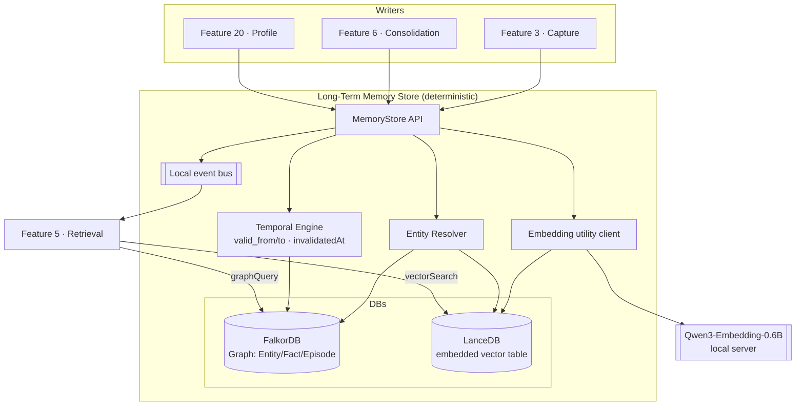

# Long-Term Memory Store
> Priority/build order: 4  ·  Tier: deep

## Summary

The Long-Term Memory Store is the durable, queryable substrate of Jarvis's second brain. It is the single source of truth that **feature 3 (capture & ingestion)** writes to, **feature 5 (hybrid retrieval)** reads from, and **feature 6 (nightly consolidation)** maintains. Everything Jarvis ever observes — chat turns, notes, files, browser events, calendar items — eventually lands here as structured, time-stamped memory.

The store is a **temporal knowledge graph** (modeled on [Graphiti](https://github.com/getzep/graphiti), MIT, self-hostable) backed by a **local graph database** ([FalkorDB](https://www.falkordb.com/) as the default lightweight choice, [Neo4j Community](https://neo4j.com/) as the heavier fallback) **plus an embedded vector store** ([LanceDB](https://lancedb.com/) default, [Chroma](https://www.trychroma.com/) fallback) for fuzzy semantic recall. The graph answers "who/what/when/how-related"; the vectors answer "feels relevant". Together they give sub-second hybrid recall on a MacBook Air M3 (16GB).

Memory is organized into three tiers:
- **Episodic** — raw, time-stamped events ("on 2026-06-08 at 14:02 the user said X").
- **Semantic** — distilled facts & preferences ("the user prefers TypeScript over Python", "Alex's manager is Priya").
- **Procedural** — a single curated "how I like to work" block, rewritten by feature 6.

The store's defining responsibility is **bi-temporal fact validity**: every fact and edge carries `valid_from`/`valid_to` (event time) and `ingested_at`/`invalidated_at` (system time). **Facts are never overwritten — they are versioned and invalidated.** This is how Jarvis defeats the #1 unsolved memory problem: stale facts. The store *enforces* and *records* invalidation intervals; it does **not** decide *which* fact wins — that conflict-resolution policy (newest-wins / source-trust) lives in feature 6.

**Deterministic-vs-AI boundary:** the store is **100% deterministic**. Given the same write calls it produces the same graph + vectors. All AI/LLM work — entity extraction, fact distillation, conflict adjudication, embedding *generation orchestration* — happens upstream (feature 3) or in the maintainer (feature 6). The store accepts embeddings as input and runs the embedding model only as a passive utility on behalf of callers.

## Data flow  *(REQUIRED)*

### Inputs
1. **Episode writes** from feature 3: an `EpisodeInput` (raw text/payload + source + occurredAt + optional pre-extracted entities/facts).
2. **Fact & entity writes** from feature 3 and feature 6: extracted `Entity` and `Fact` records with proposed validity intervals.
3. **Invalidation commands** from feature 6: "fact F is no longer true as of T, superseded by F'".
4. **Procedural-block writes** from feature 6 (and feature 20): a full replacement of the procedural memory document.
5. **Read queries** from feature 5: `vectorSearch`, `graphQuery`, `getFactHistory`, `getProceduralBlock`.

### Processing pipeline (numbered)
1. **Validate & normalize.** Reject malformed records (Zod schemas). Normalize timestamps to UTC ISO-8601, coerce IDs, default `ingestedAt = now()`.
2. **Entity resolution.** For each incoming entity, run the deterministic merge rule (see Logic) to find an existing canonical node or create a new one. Returns a stable `entityId`.
3. **Embed (utility).** If the caller did not supply an embedding, call the local **Qwen3-Embedding-0.6B** server (see `architecture/model-serving.md`) to produce a 1024-d vector for the episode/fact text. Caller-supplied vectors are trusted as-is.
4. **Graph upsert.** Write/merge nodes (`Episode`, `Entity`, `Fact`) and edges (`MENTIONS`, `ABOUT`, `RELATES_TO`, `DERIVED_FROM`) into FalkorDB inside a single transaction.
5. **Temporal stamping.** Set `validFrom`/`validTo` from input event time (default `validTo = null` = "currently true"). Set `ingestedAt`. New facts start non-invalidated.
6. **Invalidation handling.** On an invalidate command, set the old fact's `validTo` (event time of supersession) and `invalidatedAt = now()` and `invalidatedBy = newFactId`; never delete.
7. **Vector index write.** Upsert the embedding + metadata (`nodeId`, `tier`, `validTo`, `entityIds`) into LanceDB so retrieval can filter out invalidated rows cheaply.
8. **Hot-index maintenance.** Keep the LanceDB table memory-mapped/in-process and the FalkorDB connection pooled so reads stay sub-second.
9. **Emit change event.** Publish a lightweight `MemoryChanged` event (NodeId, op) on the local event bus so feature 5 caches and the Memory Explorer UI can invalidate.

### Outputs
- Stable IDs (`episodeId`, `entityId`, `factId`) returned to callers.
- For reads: ranked `MemoryNode[]` (vector), `GraphResult` (Cypher rows), `Fact[]` history (bi-temporal), and the current `ProceduralBlock`.
- `MemoryChanged` events on the bus.

### Schemas (TS-style)
```ts
// ── Common ───────────────────────────────────────────────
type ISO = string;                       // UTC ISO-8601
type MemoryTier = 'episodic' | 'semantic' | 'procedural';
type EntityType = 'person' | 'project' | 'org' | 'place' | 'topic' | 'tool' | 'event' | 'other';
type SourceKind = 'chat' | 'note' | 'file' | 'browser' | 'calendar' | 'email' | 'system' | 'consolidation';

interface Provenance {
  source: SourceKind;
  sourceId: string;                      // e.g. chat message id / file path
  capturedBy: 'feature-3' | 'feature-6' | 'feature-20';
  confidence: number;                    // 0..1 (extractor's confidence; store does not judge)
}

// ── Core node ────────────────────────────────────────────
interface MemoryNode {
  id: string;                            // ULID
  tier: MemoryTier;
  kind: 'episode' | 'entity' | 'fact';
  text: string;                          // human-readable + the text that was embedded
  embedding?: number[];                  // 1024-d Qwen3-Embedding-0.6B (may live only in LanceDB)
  ingestedAt: ISO;                       // system/transaction time (immutable)
  provenance: Provenance;
}

// ── Episodic ─────────────────────────────────────────────
interface Episode extends MemoryNode {
  kind: 'episode';
  tier: 'episodic';
  occurredAt: ISO;                       // when the event happened (event time)
  payload?: Record<string, unknown>;     // structured extras (urls, attendees…)
  entityIds: string[];                   // entities mentioned
  derivedFactIds: string[];              // facts distilled from this episode (by f3/f6)
}

// ── Entities ─────────────────────────────────────────────
interface Entity extends MemoryNode {
  kind: 'entity';
  tier: 'semantic';
  name: string;                          // canonical display name
  entityType: EntityType;
  aliases: string[];                     // merged surface forms (entity resolution)
  mergedFrom: string[];                  // ids absorbed by this canonical node
  summary?: string;                      // rolling summary maintained by feature 6
}

// ── Facts (bi-temporal, versioned) ───────────────────────
interface Fact extends MemoryNode {
  kind: 'fact';
  tier: 'semantic';
  subjectId: string;                     // entityId
  predicate: string;                     // e.g. 'prefers', 'works_at', 'manager_is'
  objectId?: string;                     // entityId if object is an entity…
  objectLiteral?: string;                // …or a literal value
  // ── BI-TEMPORAL MODEL ──
  validFrom: ISO;                        // event time: when fact became true
  validTo: ISO | null;                   // event time: when it stopped being true (null = still true)
  ingestedAt: ISO;                       // system time: when first learned (from MemoryNode)
  invalidatedAt: ISO | null;            // system time: when store recorded supersession (null = live)
  invalidatedBy: string | null;          // factId that supersedes this one
  supersedes: string | null;             // factId this one replaced
}

// ── Procedural block (singleton document) ────────────────
interface ProceduralBlock {
  id: 'procedural:singleton';
  version: number;                       // bumped by feature 6 each rewrite
  markdown: string;                      // "how I like to work" — injected into chat system prompt
  updatedAt: ISO;
  updatedBy: 'feature-6' | 'feature-20';
  sourceFactIds: string[];               // facts this block was distilled from (traceability)
}
```

## Frontend flow  *(REQUIRED)*

A **Memory Explorer** lives in the Jarvis dashboard (feature 2's shell). It is a *read-mostly* lens onto the store — the only writes it allows are manual corrections (which are themselves routed through `invalidateFact`, never raw edits).

### Screens / states
1. **Timeline view** — reverse-chronological episodes (infinite scroll, grouped by day). States: loading, empty ("nothing captured yet"), populated, error.
2. **Entity browser** — searchable list of canonical entities with type filters; clicking opens the **Entity detail** (summary, aliases, related entities graph mini-map, all facts where the entity is subject/object).
3. **Fact validity history** — for a selected fact, a horizontal **bi-temporal lane chart**: each version is a bar spanning `validFrom→validTo`; invalidated versions are greyed with a tooltip ("superseded by … on `invalidatedAt`"). This is the headline UX of the store.
4. **Semantic search** — a search box that runs `vectorSearch`; results show node text, tier badge, occurredAt, and a "live/stale" pill.
5. **Memory node inspector** — a side panel showing raw JSON: ids, provenance, embedding presence, all temporal fields, and a "View source" link back to the originating chat/file.
6. **Procedural block view** — renders the current "how I like to work" markdown + version + last-updated, with a diff-against-previous toggle.

### Key controls
- Tier filter chips (Episodic / Semantic / Procedural).
- "Show invalidated" toggle (default off → only live facts).
- Time-travel control ("as of <date>") that re-queries with a bi-temporal `asOf` parameter — see what Jarvis *believed* on a past date.
- Manual "mark wrong" on a fact → opens a confirm dialog → calls `invalidateFact` with `source='system'`.

### User journey
User notices Jarvis used a stale fact in chat → opens Memory Explorer → searches the entity → opens its facts → sees two versions on the validity lane chart → confirms the new one is correct → if not, clicks "mark wrong" on the live version → store invalidates it → feature 5 stops returning it.

## Logic / rules  *(deep tier)*

### Architecture (Mermaid)


### Entity-relationship sketch (Mermaid)
```mermaid
erDiagram
  EPISODE ||--o{ MENTIONS : has
  EPISODE ||--o{ DERIVED_FROM : produces
  ENTITY  ||--o{ MENTIONS : "is mentioned in"
  ENTITY  ||--o{ FACT : "is subject of"
  FACT    }o--|| ENTITY : "object (optional)"
  FACT    ||--o| FACT : supersedes
  PROCEDURAL ||--o{ FACT : "distilled from"

  EPISODE { string id PK; string text; ISO occurredAt; ISO ingestedAt }
  ENTITY  { string id PK; string name; string entityType; string[] aliases }
  FACT    { string id PK; string predicate; ISO validFrom; ISO validTo; ISO invalidatedAt; string invalidatedBy }
  PROCEDURAL { string id PK; int version; string markdown }
```

### Bi-temporal model (spelled out)
Two independent time axes, both stored on every fact/edge:
- **Event time** (`validFrom`, `validTo`): the real-world interval during which the fact is true. `validTo = null` means "true until further notice".
- **System time** (`ingestedAt`, `invalidatedAt`): when Jarvis *learned* and *unlearned* it. `invalidatedAt = null` means "still believed".

This separation lets the store answer two distinct questions deterministically:
- *"What was true on date D?"* → `validFrom <= D AND (validTo IS NULL OR validTo > D)`.
- *"What did Jarvis believe on date D?"* → `ingestedAt <= D AND (invalidatedAt IS NULL OR invalidatedAt > D)`.

A fact can be *true in the past* but *only learned now* (back-dated capture) — the two axes diverge, which is exactly why both are kept. **Nothing is ever mutated except: setting `validTo`, `invalidatedAt`, `invalidatedBy` on supersession, and appending `aliases`/`mergedFrom` on entity merge.** No physical deletes (except hard GDPR/forget — see edge cases).

### Entity-resolution / merge rule (deterministic)
On entity write, resolve in this fixed order; first match wins:
1. **Exact id** match (caller passed a known `entityId`).
2. **Exact normalized-name + same `entityType`** match (case-folded, trimmed, diacritics-stripped).
3. **Alias hit**: incoming name ∈ an existing entity's `aliases`.
4. **High-similarity vector match**: cosine(incoming name+context embedding, candidate) ≥ **0.92** *and* same `entityType`. (Threshold is a config constant, deterministic given embeddings.)
5. Otherwise → **create new** canonical entity.

When 2–4 match an existing node, the incoming surface form is appended to `aliases`, the absorbed id (if any) recorded in `mergedFrom`, and inbound edges/facts are repointed to the canonical id in the same transaction. **Merges are additive and reversible via `mergedFrom`** (feature 6 can split if it later disagrees). The store never *invents* merges from fuzzy reasoning beyond rule 4 — anything ambiguous is left as a separate node for feature 6 to adjudicate.

### Procedural-memory block storage
Stored as a **singleton** node (`procedural:singleton`) in the graph with `version`, `markdown`, `updatedAt`, `sourceFactIds`. Previous versions are retained as immutable `ProceduralBlockVersion` nodes linked via `PREV_VERSION` so the Explorer can diff. Only feature 6 (or feature 20 for explicit preferences) may write it; feature 2 reads the latest version to inject into the chat system prompt.

### Code snippet — MemoryStore API surface
```ts
interface MemoryStore {
  // writes (deterministic; embeddings auto-generated if omitted)
  upsertEpisode(input: EpisodeInput): Promise<Episode>;
  upsertEntity(input: EntityInput): Promise<Entity>;        // runs entity-resolution merge rule
  upsertFact(input: FactInput): Promise<Fact>;              // sets validFrom/validTo, ingestedAt
  invalidateFact(args: {
    factId: string;
    validTo: ISO;            // event time the fact stopped being true
    invalidatedBy?: string;  // superseding factId (set by feature 6)
    reason?: string;
  }): Promise<Fact>;
  writeProceduralBlock(markdown: string, sourceFactIds: string[], by: 'feature-6' | 'feature-20'): Promise<ProceduralBlock>;

  // reads (feature 5)
  vectorSearch(args: {
    query: string | number[];        // text (auto-embedded) or raw vector
    k: number;
    tier?: MemoryTier;
    includeInvalidated?: boolean;     // default false
    asOf?: ISO;                       // bi-temporal: filter by event time
  }): Promise<Array<{ node: MemoryNode; score: number }>>;
  graphQuery(cypher: string, params?: Record<string, unknown>): Promise<GraphResult>;
  getFactHistory(subjectId: string, predicate?: string): Promise<Fact[]>;  // all versions, ordered
  getProceduralBlock(): Promise<ProceduralBlock>;
}
```

### Code snippet — fact write + temporal invalidation
```ts
// Feature 3 learns a new manager fact; the old one must be invalidated (not deleted).
async function recordManagerChange(store: MemoryStore, alexId: string, priyaId: string, when: ISO) {
  // 1. Find the currently-believed manager fact (live only).
  const [current] = await store.getFactHistory(alexId, 'manager_is');
  const live = current && current.validTo === null && current.invalidatedAt === null ? current : undefined;

  // 2. Write the new fact (store stamps validFrom=when, validTo=null, ingestedAt=now).
  const next = await store.upsertFact({
    subjectId: alexId, predicate: 'manager_is', objectId: priyaId,
    validFrom: when, text: 'Alex\'s manager is Priya',
    provenance: { source: 'chat', sourceId: 'msg_8842', capturedBy: 'feature-3', confidence: 0.91 },
    supersedes: live?.id ?? null,
  });

  // 3. Close out the old fact bi-temporally: validTo=event time, invalidatedAt=now (store-set).
  if (live) {
    await store.invalidateFact({ factId: live.id, validTo: when, invalidatedBy: next.id, reason: 'superseded' });
  }
  // Result: getFactHistory returns BOTH versions; vectorSearch (default) returns only `next`.
}
```

### Determinism guarantees
- No call into the store performs LLM reasoning to *decide* truth. Embedding generation is a pure function of input text + pinned model weights.
- Conflict policy (newest-wins vs source-trust) is **not** here — `invalidateFact` only executes a decision already made by feature 6.
- All writes are single-transaction (FalkorDB MULTI/EXEC) so the graph and the vector table never diverge; on vector-write failure the graph txn rolls back.

## Edge cases & safety

| # | Case | Handling |
|---|------|----------|
| 1 | Duplicate episode (same `sourceId`) re-captured | Idempotent upsert keyed on `(source, sourceId)`; second write is a no-op returning the existing id. |
| 2 | Back-dated fact (`validFrom` < an existing live fact's `validFrom`) | Allowed; store inserts a historical version. Overlap reconciliation deferred to feature 6, not the store. |
| 3 | Conflicting live facts (two `validTo=null` for same subject+predicate) | Store *permits* it (capture-everything) and flags via a `CONFLICT` edge; feature 6 resolves nightly. Retrieval can dedupe by `confidence`. |
| 4 | Invalidate a fact that's already invalidated | No-op if `invalidatedAt` already set; warns. Idempotent. |
| 5 | Entity-resolution false merge | `mergedFrom` retained → feature 6 can split; merges never destroy source ids. |
| 6 | Embedding server (Qwen3) down | Write proceeds to graph; embedding queued in a `pending_embeddings` table; backfilled when server returns. Vector search degrades to graph-only until backfilled. |
| 7 | Vector write succeeds but graph txn fails (or vice-versa) | Two-phase: graph txn commits first, vector write is replayable from a write-ahead log keyed by `nodeId`; reconciler at startup heals orphans. |
| 8 | Clock skew / future `occurredAt` | Reject `occurredAt` > now()+5min as likely error; clamp + log; never silently store far-future events that poison time-travel. |
| 9 | Huge episode payload (e.g. full file) | Store text up to a cap (e.g. 32KB) inline; spill full blob to filesystem (`architecture/architecture.md` storage dir) and keep a `blobRef`. Embed a truncated/representative chunk. |
| 10 | LanceDB table grows beyond memory budget (16GB box) | Embedded table is memory-mapped, not fully RAM-resident; cold rows page from disk. Feature 6 prunes/archives low-value episodic vectors; semantic+procedural always hot. |
| 11 | Manual "mark wrong" in Explorer on a derived fact | Routed through `invalidateFact` (source=system, confidence=1.0); the source episode is untouched (capture is immutable). |
| 12 | GDPR / "forget this entity" hard delete | Dedicated `forget(entityId)` does physical delete across graph + vector + blobs in one txn (the only true-delete path), recorded in an audit log. |
| 13 | Concurrent writes from feature 3 and feature 6 | Per-entity advisory lock (in-process mutex keyed by canonical entityId) serializes resolution/merge to avoid duplicate canonical nodes. |
| 14 | Corrupt/missing embedding dimension (≠1024) | Validation rejects; vector write skipped, node still stored, queued for re-embed. |
| 15 | `asOf` query before any data existed | Returns empty set deterministically (no error). |

**Safety:** the store is local-only (no network egress except localhost model server); all data at rest on disk under the user's home, optionally OS-FileVault-encrypted. No telemetry. Immutability of episodic capture means corrections are always *additive*, so history can never be silently rewritten.

## Dependencies  *(REQUIRED)*

**Internal (Jarvis features):**
- [`features/3-memory-capture-and-ingestion.md`](./3-memory-capture-and-ingestion.md) — **upstream writer**: extracts entities/facts and calls `upsertEpisode`/`upsertEntity`/`upsertFact`.
- [`features/5-hybrid-memory-retrieval.md`](./5-hybrid-memory-retrieval.md) — **downstream reader**: consumes `vectorSearch`/`graphQuery`/`getFactHistory`; uses Qwen3-Reranker-0.6B on top.
- [`features/6-nightly-memory-consolidation.md`](./6-nightly-memory-consolidation.md) — **maintainer**: runs conflict policy, calls `invalidateFact`, rewrites the procedural block, prunes vectors.
- [`features/2-conversational-chat-core.md`](./2-conversational-chat-core.md) — reads `getProceduralBlock` to inject "how I like to work" into the system prompt; surfaces retrieved memories.
- [`features/20-personal-profile-and-preference-learning.md`](./20-personal-profile-and-preference-learning.md) — writes explicit preference facts and may update the procedural block.

**Architecture / infra:**
- [`architecture/architecture.md`](../architecture/architecture.md) — TS/Node orchestration, local event bus, storage layout, process model.
- [`architecture/model-serving.md`](../architecture/model-serving.md) — local Qwen3-Embedding-0.6B (and Qwen3-Reranker-0.6B) serving; Python-only ML boundary.

**External libraries / tools:**
- **Graphiti** (MIT) — temporal-knowledge-graph patterns / reference design.
- **FalkorDB** (default) or **Neo4j Community** (fallback) — local graph DB, Cypher, single-txn writes.
- **LanceDB** (default, embedded, in-process) or **Chroma** (fallback) — vector store.
- **Qwen3-Embedding-0.6B** — 1024-d local embeddings.
- **Zod** — schema validation. **ulid** — sortable ids. TS/Node runtime.

## File structure  *(deep tier)*

```
src/memory/store/
├── index.ts                  # MemoryStore factory + public API export
├── MemoryStore.ts            # orchestrator implementing the MemoryStore interface
├── schemas.ts                # Zod schemas + TS types (MemoryNode, Entity, Fact, Episode, ProceduralBlock)
├── graph/
│   ├── FalkorClient.ts       # connection pool, MULTI/EXEC txn helpers
│   ├── cypher.ts             # parameterized Cypher templates (upserts, history, asOf)
│   └── migrations/           # graph schema/index migrations (entity name, validTo indexes)
├── vector/
│   ├── LanceStore.ts         # embedded table open/upsert/search, memory-map config
│   └── wal.ts                # write-ahead log for graph↔vector reconciliation
├── temporal/
│   ├── TemporalEngine.ts     # validFrom/validTo + invalidatedAt logic, asOf filters
│   └── invalidation.ts       # invalidateFact + supersession bookkeeping
├── entities/
│   └── EntityResolver.ts     # deterministic 5-step merge rule, per-entity locks
├── embedding/
│   └── EmbedClient.ts        # localhost Qwen3-Embedding-0.6B client + pending-embeddings queue
├── procedural/
│   └── ProceduralBlock.ts    # singleton read/write + version history
├── events/
│   └── bus.ts                # MemoryChanged event emitter
├── forget.ts                 # GDPR hard-delete path (audited)
└── reconcile.ts              # startup reconciler: heal orphaned vectors/graph, backfill embeddings

src/memory/store/__tests__/    # determinism, bi-temporal, merge-rule, idempotency tests
ui/dashboard/memory-explorer/  # Timeline, EntityBrowser, FactValidityChart, NodeInspector, ProceduralView
scripts/seed-memory.ts         # dev seed for Explorer
```

**Build order note:** ship the deterministic core (schemas → graph → temporal → vector → API) before the Explorer UI. Feature 3 can integrate against the API as soon as `upsertEpisode`/`upsertFact` land; feature 5 needs `vectorSearch`/`graphQuery`; feature 6 needs `invalidateFact` + procedural writes.
