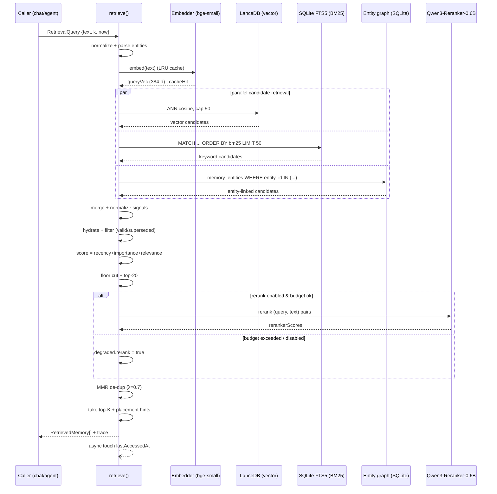

# Hybrid Memory Retrieval
> Priority/build order: 5  ·  Tier: deep

## Summary

This feature is the **read path** for Jarvis's memory. Given a query (a user turn, an agent sub-goal, or an explicit lookup), it finds the most useful memories from the long-term store ([feature 4](./4-long-term-memory-store.md)) and returns them **ranked, scored, and de-duplicated** so the chat core ([feature 2](./2-conversational-chat-core.md)) and the agent runtime ([feature 16](./16-agent-tool-execution-core.md)) can splice them into the model context.

Retrieval is **hybrid multi-signal**, the 2026 default. Pure vector search loses to fusion, so we run three retrievers in parallel and combine them:

1. **Semantic** — vector cosine similarity (LanceDB, embedded, ANN over `bge-small` 384-d vectors).
2. **Keyword** — BM25 over memory text (SQLite **FTS5**, same DB as feature 4).
3. **Entity** — graph match: boost memories tied to people/projects/topics the query mentions (the entity tables from feature 4).

Candidates are fused into a single **Generative-Agents-style score** = `recency + importance + relevance` (each weight ~1.0, tunable), where recency is exponential decay since last access, importance is the stored 1–10 salience set by [feature 6](./6-nightly-memory-consolidation.md), and relevance is the fused retrieval signal. Then an **optional rerank** with `Qwen3-Reranker-0.6B` ([architecture/model-serving.md](../architecture/model-serving.md)) reorders the top candidates, **MMR** removes near-duplicates, and we take **top-K**.

The whole thing must be **sub-second** on an M3 Air / 16GB. We hit that with an embedded vector store, hard caps on candidate counts, a query-embedding LRU cache, and a latency budget that **degrades gracefully** (drop reranker → drop entity → vector-only) rather than blowing the deadline.

Retrieval returns ranked memories **plus placement hints** so feature 2 can defeat *lost-in-the-middle* by placing the strongest memories at the **edges** of the assembled prompt. This feature does NOT assemble the prompt; it only ranks and hints.

**Determinism:** the entire fusion/scoring path is **deterministic** given the store snapshot — same query + same store + same clock → same scores, byte-for-byte. The only model in the loop is the reranker, which is a **fixed, pinned, temperature-0 cross-encoder**; it reorders but never invents. No generative/LLM step lives in retrieval.

## Data flow  *(REQUIRED)*

### Inputs
- **`RetrievalQuery`** from feature 2 (per user turn) or feature 16 (per sub-goal / tool plan step).
- Read access to feature 4's store: LanceDB table `memories_vec`, SQLite tables `memories`, `memories_fts` (FTS5), `entities`, `memory_entities`.
- A monotonic `now` clock (injected, for deterministic recency decay).
- Config: weights, thresholds, caps, latency budget (`config/retrieval.json`).

### Processing pipeline
1. **Normalize & parse query.** Trim, lowercase a copy for FTS, extract candidate entity mentions via the feature-4 entity resolver (dictionary + alias match — *deterministic, no NER model in the hot path*). Produce `{ text, ftsText, entityIds[] }`.
2. **Embed query (cached).** Look up `sha256(text)` in the query-embedding LRU (cap 512, in-process). On hit, reuse. On miss, call the embedder ([model-serving](../architecture/model-serving.md), `bge-small-en-v1.5`, 384-d), store result. Record `cacheHit`.
3. **Fan out three retrievers in parallel** (`Promise.all`, each with its own sub-deadline):
   - **Vector:** LanceDB ANN, cosine, `limit = candidateCap.vector` (default 50).
   - **BM25:** `SELECT ... FROM memories_fts WHERE memories_fts MATCH ? ORDER BY rank LIMIT ?` (`candidateCap.bm25` = 50). FTS5 `bm25()` ranking function.
   - **Entity:** if `entityIds` non-empty, `SELECT memory_id FROM memory_entities WHERE entity_id IN (...) LIMIT candidateCap.entity` (default 30). Empty set if no entities → entity signal contributes 0.
4. **Merge candidate pools** by `memoryId` into a `Map<id, Candidate>`, recording which signals fired and each raw score (`vecCosine`, `bm25Raw`, `entityHits`). Cap total distinct candidates at `candidateCap.total` (default 80); if exceeded, keep the union ranked by best single normalized signal.
5. **Normalize signals to [0,1].** Vector cosine → `(cos+1)/2`. BM25 → min-max over the returned page (guard divide-by-zero). Entity → `min(entityHits / queryEntityCount, 1)`.
6. **Hydrate** each candidate from SQLite `memories`: `text`, `importance` (1–10), `lastAccessedAt`, `validFrom`, `validTo`, `supersededBy`, `kind`, `createdAt`. Skip rows where `validTo < now` or `supersededBy IS NOT NULL` unless `opts.includeStale`.
7. **Score (deterministic fusion).** `finalScore = wRecency*recency + wImportance*importance + wRelevance*relevance` (see [scoring snippet](#scoring-function-deterministic)). `relevance` is itself a weighted blend of the three normalized signals.
8. **Apply relevance floor.** Drop candidates with `relevance < opts.minRelevance` (default 0.15). If everything is dropped → empty-result path (see edge cases).
9. **Pre-rerank cut.** Sort by `finalScore` desc, keep top `rerankCandidateCap` (default 20).
10. **Optional rerank** (`opts.rerank && budgetRemaining > rerankCostEstimate`): send `(query, memory.text)` pairs to `Qwen3-Reranker-0.6B`; blend `0.5*finalScore + 0.5*rerankerScoreNorm` into `fusedScore`. On timeout/error → keep `finalScore`, set `degraded.rerank=true`.
11. **MMR de-dup.** Greedy Maximal Marginal Relevance over candidate embeddings: `mmr = λ*relevanceToQuery − (1−λ)*maxSimToSelected`, `λ=0.7`. Iteratively select until `K` chosen or pool empty. Drops near-duplicate paraphrases.
12. **Take top-K** (`opts.k`, default 8). Attach **placement hints**: rank-0 → `"edge_top"`, rank-1 → `"edge_bottom"`, rest → `"middle"` (so feature 2 brackets the prompt with the two strongest items).
13. **Touch access** (fire-and-forget, off the response path): `UPDATE memories SET lastAccessedAt=?, accessCount=accessCount+1 WHERE id IN (...)` for returned items — this feeds future recency decay.
14. **Emit trace** to `retrieval_traces` (for the "why did you remember this?" view) and return `RetrievedMemory[]`.

### Outputs
- `RetrievedMemory[]` (top-K, scored, with per-signal breakdown + placement hint).
- `RetrievalTrace` (full candidate set, timings, degradation flags) persisted for the debug view.
- Side effect: `lastAccessedAt` / `accessCount` bumped on returned memories.

### Schemas

```ts
// config/retrieval.json shape
interface RetrievalConfig {
  weights: { recency: number; importance: number; relevance: number };   // ~1.0 each
  relevanceBlend: { vector: number; bm25: number; entity: number };       // sums ~1.0
  recencyHalfLifeHours: number;        // default 72
  candidateCap: { vector: number; bm25: number; entity: number; total: number };
  rerankCandidateCap: number;          // default 20
  latencyBudgetMs: number;             // default 800
  minRelevance: number;                // default 0.15
  mmrLambda: number;                   // default 0.7
}

interface RetrievalQuery {
  text: string;
  k?: number;                          // default 8
  now?: number;                        // injected epoch ms (deterministic clock)
  filters?: { kind?: MemoryKind[]; entityIds?: string[]; since?: number };
  includeStale?: boolean;              // default false
  rerank?: boolean;                    // default true if budget allows
  minRelevance?: number;
  source: "chat" | "agent" | "manual";
}

interface Candidate {
  memoryId: string;
  signals: { vector?: number; bm25?: number; entity?: number }; // normalized [0,1]
  raw: { vecCosine?: number; bm25Raw?: number; entityHits?: number };
  // hydrated:
  text: string;
  importance: number;          // 1..10
  lastAccessedAt: number;      // epoch ms
  validFrom: number;
  validTo: number | null;
  supersededBy: string | null;
  kind: MemoryKind;
  embedding?: Float32Array;     // for MMR
}

interface RetrievedMemory {
  memoryId: string;
  text: string;
  kind: MemoryKind;
  fusedScore: number;
  scoreBreakdown: {
    recency: number;           // [0,1] decayed
    importance: number;        // [0,1] = stored/10
    relevance: number;         // [0,1] blended
    signals: { vector: number; bm25: number; entity: number };
    rerankerScore?: number;    // [0,1], present iff reranked
  };
  placementHint: "edge_top" | "edge_bottom" | "middle";
  validFrom: number;
  rank: number;
}

interface RetrievalTrace {
  traceId: string;
  query: RetrievalQuery;
  candidatesConsidered: number;
  returned: RetrievedMemory[];
  droppedBelowFloor: { memoryId: string; relevance: number }[];
  timings: { embedMs: number; vectorMs: number; bm25Ms: number; entityMs: number; rerankMs: number; mmrMs: number; totalMs: number };
  degraded: { rerank: boolean; entity: boolean; vectorOnly: boolean };
  cacheHit: boolean;
  createdAt: number;
}
```

## Frontend flow  *(REQUIRED)*

Two surfaces, both read-only, both backed by `RetrievalTrace`.

**A. "Why did you remember this?" — dashboard inspector** (`/dashboard/memory/retrieval`)
- A trace list (most recent first): query text, source badge (chat/agent/manual), total latency, degradation chips (`vector-only`, `no-rerank`).
- Click a trace → **scored candidate table**: every candidate (not just returned top-K), with columns: memory snippet, `recency`, `importance`, `relevance`, per-signal bars (vector / BM25 / entity), reranker score, final `fusedScore`, and a **status** tag (`returned` / `dropped: below floor` / `dropped: MMR dup` / `superseded`).
- A small **stacked-bar viz** per returned item showing how `recency + importance + relevance` summed to the score — makes the fusion math legible.
- Timing waterfall (embed → parallel retrievers → rerank → MMR) so you can see where the budget went.
- A **"re-run with weights"** slider panel (recency / importance / relevance) that re-scores the *same cached candidate set* client-side — instant what-if tuning before committing config changes. (Deterministic, so re-scoring needs no backend round trip.)

**B. In-chat "memory peek"** (feature 2 chat UI, opt-in)
- A collapsible chip under each assistant turn: *"Used N memories ▸"*. Expanding shows the top-K snippets with their placement hint (edge/middle) and `fusedScore`. Clicking a snippet deep-links to its full record in the store viewer (feature 4) and to the originating trace in inspector A.

State: both surfaces are pure read views over `retrieval_traces`; no mutation. The weight slider in A writes to `config/retrieval.json` only via an explicit "Save weights" action (with a confirm), never implicitly.

## Logic / rules  *(deep tier)*

### Pipeline (Mermaid sequence)



### Scoring & fusion rules
- **Recency:** exponential decay on `lastAccessedAt` (Generative Agents): `recency = exp(-ln(2) * ageHours / halfLife)`, `halfLife = 72h` default. Range (0,1].
- **Importance:** `stored / 10`. Set by feature 6's salience pass; defaults to 5 for un-scored memories. Range [0.1,1].
- **Relevance:** blended normalized signals: `relevance = bv*vector + bb*bm25 + be*entity` with `relevanceBlend` summing to 1. A candidate found by only one retriever still scores on that signal alone (others = 0).
- **Final:** `wR*recency + wI*importance + wRel*relevance`, weights ~1.0 each. Reranker (if used) blends 50/50 into `fusedScore`.
- **Determinism:** every step above is pure arithmetic over store + injected `now`. Two runs with identical inputs produce identical `fusedScore` to the bit. The reranker is the **only** model and is pinned (fixed weights, temperature 0, deterministic kernels) so it is reproducible but treated as the one non-arithmetic component — it **reorders**, never generates or alters memory text.

### Caps & budget rules
- Hard caps everywhere (50/50/30 → 80 total → 20 pre-rerank → K=8). No unbounded scans.
- A running `budgetRemaining = latencyBudgetMs − elapsed`. Before each optional stage check cost estimate; if over, skip and flag degradation. Order of sacrifice: **reranker first**, then **entity retriever**, then collapse to **vector-only**.
- Query-embedding LRU (512 entries) keyed by `sha256(normalizedText)`; survives within process lifetime only.

### Code

#### `retrieve(query, opts)` — returns scored `RetrievedMemory[]`

```ts
export async function retrieve(
  query: RetrievalQuery,
  deps: { store: MemoryStore; embedder: Embedder; reranker: Reranker; cfg: RetrievalConfig; now: () => number },
): Promise<{ results: RetrievedMemory[]; trace: RetrievalTrace }> {
  const t0 = deps.now();
  const k = query.k ?? 8;
  const now = query.now ?? deps.now();
  const deadline = t0 + deps.cfg.latencyBudgetMs;
  const degraded = { rerank: false, entity: false, vectorOnly: false };

  const { text, ftsText, entityIds } = deps.store.parseQuery(query.text, query.filters?.entityIds);
  const { vec, cacheHit } = await deps.embedder.embedCached(text);

  // 1. parallel candidate retrieval (each with its own bounded limit)
  const [vectorC, bm25C, entityC] = await Promise.all([
    deps.store.annSearch(vec, deps.cfg.candidateCap.vector),
    deps.store.bm25Search(ftsText, deps.cfg.candidateCap.bm25),
    entityIds.length ? deps.store.entitySearch(entityIds, deps.cfg.candidateCap.entity) : Promise.resolve([]),
  ]);
  if (!entityIds.length) degraded.entity = true;

  // 2. merge + normalize + hydrate + filter
  const merged = mergeCandidates(vectorC, bm25C, entityC, deps.cfg.candidateCap.total);
  normalizeSignals(merged);                       // mutates .signals into [0,1]
  const hydrated = deps.store
    .hydrate([...merged.keys()])
    .filter(c => query.includeStale || (c.supersededBy == null && (c.validTo == null || c.validTo >= now)));

  // 3. deterministic fusion score
  for (const c of hydrated) c.fusedScore = scoreMemory(c, now, deps.cfg);
  const floor = query.minRelevance ?? deps.cfg.minRelevance;
  const kept = hydrated.filter(c => c.relevance >= floor)
                       .sort((a, b) => b.fusedScore - a.fusedScore)
                       .slice(0, deps.cfg.rerankCandidateCap);
  if (!kept.length) return emptyResult(query, now, degraded, cacheHit, t0, deps);

  // 4. optional rerank within budget
  let ranked = kept;
  if ((query.rerank ?? true) && deps.now() < deadline - deps.reranker.costMs(kept.length)) {
    try {
      const rr = await deps.reranker.score(text, kept.map(c => c.text));
      ranked = blendReranker(kept, rr); // fusedScore = 0.5*fused + 0.5*norm(rr)
    } catch { degraded.rerank = true; }
  } else degraded.rerank = true;

  // 5. MMR de-dup → top-K → placement hints
  const selected = mmr(ranked, vec, k, deps.cfg.mmrLambda);
  const results = selected.map((c, i) => toRetrieved(c, i, placementHint(i)));

  deps.store.touchAccess(results.map(r => r.memoryId), now);     // fire-and-forget
  const trace = buildTrace(query, merged, hydrated, results, degraded, cacheHit, t0, deps.now());
  deps.store.saveTrace(trace);
  return { results, trace };
}

const placementHint = (i: number) =>
  i === 0 ? "edge_top" : i === 1 ? "edge_bottom" : "middle";
```

#### Scoring function (deterministic)

```ts
// Pure: same (candidate, now, cfg) -> same number. No I/O, no randomness.
export function scoreMemory(c: Candidate, now: number, cfg: RetrievalConfig): number {
  const { recency: wR, importance: wI, relevance: wRel } = cfg.weights;

  // recency: exponential decay since last access (Generative Agents)
  const ageHours = Math.max(0, (now - c.lastAccessedAt) / 3_600_000);
  const recency = Math.exp((-Math.LN2 * ageHours) / cfg.recencyHalfLifeHours); // (0,1]

  // importance: stored 1..10 salience, normalized
  const importance = clamp01((c.importance ?? 5) / 10); // [0.1,1]

  // relevance: blended, normalized retrieval signals (each already in [0,1])
  const b = cfg.relevanceBlend;
  const relevance = clamp01(
    b.vector * (c.signals.vector ?? 0) +
    b.bm25   * (c.signals.bm25   ?? 0) +
    b.entity * (c.signals.entity ?? 0),
  );
  c.relevance = relevance; // cached on candidate for floor + trace

  // final fusion: recency + importance + relevance (weights ~1.0 each, tunable)
  return wR * recency + wI * importance + wRel * relevance;
}

const clamp01 = (x: number) => (x < 0 ? 0 : x > 1 ? 1 : x);
```

## Edge cases & safety

| # | Case | Handling |
|---|------|----------|
| 1 | **Empty store** (no memories yet) | All retrievers return `[]`; `retrieve` returns `{ results: [], trace }` with `candidatesConsidered=0`. Caller proceeds with no memory context. |
| 2 | **No matches above threshold** | All candidates below `minRelevance` → empty results, `trace.droppedBelowFloor` lists them. UI shows "no relevant memories". |
| 3 | **Contradictory facts** | Both versions may be candidates; filter drops any `supersededBy != null`; among remaining, scoring favors the one with newer `validFrom` via recency. Surface the **freshest by `valid_from`**; never return both unless `includeStale`. |
| 4 | **Stale-but-similar facts** (high cosine, expired `validTo`) | Filtered out at step 6 unless `includeStale`. With `includeStale`, returned but ordered after fresh facts and tagged `superseded`/`expired` in the trace. |
| 5 | **Latency budget exceeded** | Sacrifice order: skip reranker → skip entity retriever → vector-only. Each sets a `degraded.*` flag; results still returned within budget. Never hang past `latencyBudgetMs`. |
| 6 | **Query embedding cache miss** | Compute embedding on the spot, store in LRU, set `trace.cacheHit=false`. Adds ~embed latency; counted against budget. |
| 7 | **Huge candidate set** (popular entity, broad query) | Per-retriever caps (50/50/30) + total cap (80) + pre-rerank cap (20) bound work regardless of store size. Union beyond cap pruned by best single normalized signal. |
| 8 | **Embedder unavailable** (model server down) | Vector retriever skipped; fall back to BM25 + entity only; `degraded.vectorOnly=false` but log `embedFailed`. If BM25 also empty → empty results. Never throw to caller. |
| 9 | **Reranker timeout / error** | Caught; keep deterministic `fusedScore`; `degraded.rerank=true`. |
| 10 | **MMR collapses to <K** (all near-duplicates) | Return fewer than K (deduped set); correct behavior — caller must not assume exactly K. |
| 11 | **Malformed / empty query text** | After normalize, if `text` is empty → return empty results immediately (no embed, no scan). |
| 12 | **FTS5 syntax injection** (query has `"` `*` `:` operators) | Sanitize/escape `ftsText` (wrap terms as quoted phrases) before `MATCH`; never pass raw user text into the FTS query grammar. |
| 13 | **Clock skew / future `lastAccessedAt`** | `ageHours = max(0, …)` clamps negatives → recency caps at 1.0, no NaN. |
| 14 | **BM25 single-result page** | min-max normalization guards `max==min` (→ assign 1.0) to avoid divide-by-zero. |
| 15 | **Concurrent `touchAccess` write during read** | Access bump is fire-and-forget and idempotent-ish (`accessCount+1`); reads use the store snapshot taken at hydrate time, so a concurrent bump cannot change the current result. |

**Safety:** read-only with respect to memory content (only `lastAccessedAt`/`accessCount` mutate). No user text is interpolated into SQL except via parameterized queries; FTS `MATCH` text is escaped. No network calls except local model server. Traces may contain memory snippets → stored in the same local-only DB, never exported.

## Dependencies  *(REQUIRED)*

- **[features/4-long-term-memory-store.md](./4-long-term-memory-store.md)** — owns the data: LanceDB `memories_vec`, SQLite `memories` + `memories_fts` (FTS5) + `entities` + `memory_entities`, the entity resolver, and the `validFrom/validTo/supersededBy` temporal model this feature reads.
- **[features/2-conversational-chat-core.md](./2-conversational-chat-core.md)** — primary consumer; calls `retrieve` per turn, consumes `placementHint` to bracket the prompt (edges) and defeat lost-in-the-middle; renders the in-chat "memory peek".
- **[features/6-nightly-memory-consolidation.md](./6-nightly-memory-consolidation.md)** — sets the `importance` (1–10) salience and maintains supersession links that scoring/filtering depend on.
- **[features/16-agent-tool-execution-core.md](./16-agent-tool-execution-core.md)** — secondary consumer; calls `retrieve` with `source:"agent"` per sub-goal/tool step to ground tool plans in known facts.
- **[architecture/model-serving.md](../architecture/model-serving.md)** — serves the `bge-small-en-v1.5` embedder and the `Qwen3-Reranker-0.6B` cross-encoder; defines local endpoints, warm-up, and timeouts this feature budgets against.
- **[architecture/architecture.md](../architecture/architecture.md)** — local-first single-user constraints (M3 Air / 16GB), the sub-second latency contract, and the TS/Node core (Python only for ML serving) this feature is built within.

## File structure  *(deep tier)*

```
src/memory/retrieval/
  retrieve.ts              # retrieve(query, opts) orchestration (entry point)
  scoring.ts               # scoreMemory() deterministic fusion + clamp helpers
  signals.ts               # mergeCandidates(), normalizeSignals()
  retrievers/
    vector.ts              # LanceDB ANN cosine search (wraps feature-4 client)
    bm25.ts                # SQLite FTS5 MATCH + bm25() + query escaping
    entity.ts              # memory_entities graph lookup
  rerank.ts                # Qwen3-Reranker-0.6B client + blendReranker()
  mmr.ts                   # maximal marginal relevance de-dup
  budget.ts               # latency budget tracker + degradation ladder
  embedCache.ts            # query-embedding LRU (sha256 keyed)
  trace.ts                 # buildTrace(), saveTrace(), RetrievalTrace I/O
  placement.ts             # placementHint() edge/middle logic
  types.ts                 # RetrievalQuery, Candidate, RetrievedMemory, RetrievalTrace
config/
  retrieval.json           # weights, blend, caps, half-life, budget, mmrLambda
src/dashboard/memory/
  RetrievalInspector.tsx   # "why did you remember this?" view + weight what-if slider
  MemoryPeek.tsx           # in-chat collapsible "used N memories" chip
test/memory/retrieval/
  scoring.test.ts          # determinism: same input -> identical scores
  fusion.test.ts           # signal merge/normalize correctness
  degradation.test.ts      # budget-exceeded sacrifice ladder
  edgecases.test.ts        # empty store, contradictory, stale, FTS escaping
```
