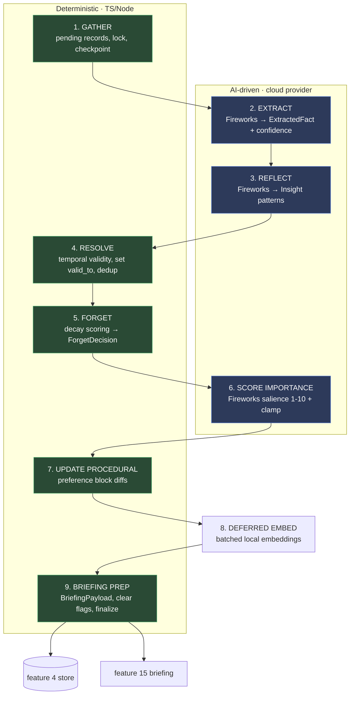

# Nightly Memory Consolidation ("Sleep-Time" Job)
> Priority/build order: 6  ·  Tier: deep

## Summary
Jarvis captures *everything* during the day (feature 3): raw journal entries, chat turns, clipped articles, voice notes, file drops. Capture is intentionally cheap and lossy-on-extraction — it stores the raw body and flags the record `consolidation_pending=true`, but does **not** mine it for facts. This nightly job is where Jarvis actually *learns with you*. It is the system's REM sleep.

Modeled on Letta-style "sleep-time compute" and the Generative Agents *reflection* pattern, the job runs unattended at ~03:00 local (scheduled by feature 19). It walks the day's pending records through a 9-stage pipeline that converts **episodic** memory (what happened) into **semantic** memory (durable facts), **procedural** memory (how the user likes to work), and **reflective** insights (higher-order patterns). Along the way it resolves contradictions using temporal validity, decays and forgets low-value entries, recalibrates importance scores, runs the deferred embedding batch, and stages material for the morning briefing (feature 15).

Because capture is everything-in, consolidation is **load-bearing for correctness**: the retrieval quality of feature 5 is bounded by how well this job extracts, dedups, and invalidates. The two highest-value correctness wins are (a) **contradiction resolution** (newest-wins / source-trust, invalidate via `valid_to`) and (b) **stale-fact handling** — without them the store accretes mutually-contradictory facts and retrieval degrades over weeks.

Heavy LLM work (extraction, reflection, importance rating) routes to **Fireworks AI** (serverless, OpenAI-compatible, `accounts/fireworks/models/qwen3p7-plus`) — cost is no concern, it runs overnight, and the M3 Air would thermal-throttle on a multi-hundred-record batch. Orchestration, temporal math, and dedup are deterministic TS/Node; only ML steps touch the cloud provider (or the local Python/MLX sidecar for embeddings). The whole run is **idempotent and resumable**: each stage commits a checkpoint so a crash at 03:17 resumes cleanly the next invocation rather than re-processing or corrupting the store.

## Data flow  *(REQUIRED)*

### Inputs
- **Pending records** — feature 3 rows where `consolidation_pending=true AND captured_at < run_window_end`. Each carries `id, kind, body, source, created_at, metadata, embed_deferred`.
- **Existing fact graph** — feature 4 store (facts with `valid_from/valid_to`, `importance`, `source_trust`, embeddings).
- **Procedural block** — feature 20's "how I like to work" preference object.
- **Run config** — model endpoints (architecture/model-serving.md), decay params, safety floors, batch sizes.
- **Last `ConsolidationRun`** — for resume (stage checkpoint) and incremental windowing.

### Processing pipeline (the 9 stages)
1. **GATHER** *(deterministic)* — select pending records in window; create/resume a `ConsolidationRun`; take an advisory lock; snapshot input ids for idempotency. Order records oldest-first.
2. **EXTRACT** *(AI)* — for each record, call the Fireworks extraction model → discrete updateable `ExtractedFact[]` (subject-predicate-object-ish units, not blob summaries) with `confidence`. Validation/confidence gate drops hallucinated/low-confidence units. **Assistant chat turns are skipped entirely** (marked processed, zero facts minted): the assistant's output either restates what the user/memory already provided (redundant) or was hallucinated — extracting from it poisons the graph with the model's own confabulations, which later retrieve as "grounded" memories.
3. **REFLECT** *(AI)* — over the day's facts + recent window, synthesize higher-level `Insight[]` ("mentioned job stress 4× this week"; "prefers morning deep work"). Reflection reads aggregates, not single records.
4. **RESOLVE** *(deterministic temporal + AI tie-break)* — for each new fact, find candidate prior facts (same entity/predicate via embedding + key match). Apply newest-wins / source-trust; set `valid_to` on superseded facts; merge near-duplicates. Genuine same-day conflicts escalate to an AI tie-break only when deterministic rules tie.
5. **FORGET** *(deterministic scoring)* — FadeMem-style decay over all facts; produce `ForgetDecision[]` (evict / compress / keep). Safety floor: never evict below a per-entity minimum; **never delete the raw journal** (only derived facts).
6. **SCORE IMPORTANCE** *(AI + deterministic clamp)* — rate salience 1–10 for new/changed facts (used by feature 5 retrieval scoring). Deterministic guardrails clamp drift vs prior importance.
7. **UPDATE PROCEDURAL BLOCK** *(AI propose / deterministic apply)* — fold new procedural signals into feature 20's preference block via small diffs; conflicting prefs use the same temporal-validity rule.
8. **DEFERRED EMBED** *(deterministic batch, local Python/MLX)* — embed all `embed_deferred` bodies + new facts in one batched call; write vectors to feature 4; clear flags.
9. **BRIEFING PREP** *(deterministic)* — assemble morning-briefing material (top insights, new facts, unresolved conflicts, "what changed") into a `BriefingPayload` for feature 15; mark records `consolidation_pending=false`; finalize `ConsolidationRun` with counts; release lock.



### Outputs
- New/updated **facts** in feature 4 (with `valid_from`, `valid_to`, `importance`, embeddings).
- **Insights** persisted and tagged for retrieval + briefing.
- Invalidated facts (`valid_to` set, not deleted) — auditable history.
- Forget actions (evict/compress) applied; raw journal untouched.
- Updated **procedural block** (feature 20).
- **BriefingPayload** for feature 15.
- A finalized **ConsolidationRun** record (status, counts, durations, errors) for the dashboard.

### Schemas
```ts
interface ConsolidationRun {
  id: string;
  startedAt: string;            // ISO
  finishedAt?: string;
  status: 'running' | 'completed' | 'failed' | 'partial';
  stage: 1|2|3|4|5|6|7|8|9;     // last committed stage (resume point)
  windowStart: string;          // captured_at range processed
  windowEnd: string;
  inputRecordIds: string[];     // frozen at GATHER for idempotency
  counts: {
    recordsProcessed: number;
    factsExtracted: number;
    factsMerged: number;
    factsInvalidated: number;   // valid_to set
    factsForgotten: number;     // evicted
    factsCompressed: number;
    insightsGenerated: number;
    embeddingsWritten: number;
  };
  errors: { stage: number; message: string; recordId?: string }[];
  trigger: 'scheduler' | 'manual';
}

interface ExtractedFact {
  id: string;
  runId: string;
  sourceRecordId: string;
  entity: string;               // canonical subject key
  predicate: string;            // normalized relation
  object: string;               // value
  text: string;                 // human-readable rendering
  confidence: number;           // 0-1, from extractor; gates persistence
  importance?: number;          // 1-10, set in stage 6
  validFrom: string;            // = source record time
  validTo?: string | null;      // null = currently true
  sourceTrust: number;          // 0-1, by source kind (journal>chat>clip)
  embedding?: number[];
  supersedesFactId?: string;    // set during RESOLVE
}

interface Insight {
  id: string;
  runId: string;
  text: string;                 // "mentioned job stress 4x this week"
  kind: 'pattern'|'trend'|'preference'|'anomaly';
  evidenceFactIds: string[];
  windowDays: number;
  importance: number;           // 1-10
  surfacedInBriefing: boolean;
  createdAt: string;
}

interface ForgetDecision {
  factId: string;
  action: 'keep' | 'evict' | 'compress';
  decayScore: number;           // FadeMem-style
  lastAccessedAt?: string;
  accessCount: number;
  importance: number;
  protectedByFloor: boolean;    // true => forced keep
  reason: string;
}
```

## Frontend flow  *(REQUIRED)*
A **Consolidation** view in the Jarvis dashboard (read-mostly, one user):

- **Last run header** — status badge (completed / partial / failed), start/finish time, duration, trigger (scheduler vs manual). If `partial`/`failed`, shows the stage it stopped at and a "Resume" button.
- **Counts panel** — cards for facts *extracted / merged / invalidated / forgotten / compressed*, *insights generated*, *embeddings written*. Sparkline of these counts across the last ~14 runs to spot drift (e.g. extraction suddenly spiking = possible hallucination).
- **Insights feed** — the night's `Insight[]` with evidence-fact drill-down.
- **Change diff / review** — a per-stage diff of what changed: new facts (green), invalidated facts with old→new value and the supersession edge (amber), forgotten/compressed facts (struck-through), procedural-block diff. Each row links to source record. Optional **undo** per change within a retention window (reverts `valid_to`, restores evicted fact from soft-delete tombstone).
- **Run now** — manual trigger button (runs the same pipeline on the current pending window, `trigger='manual'`), with a live stage progress bar streaming stage transitions.
- **Errors / skips** — list of records skipped (cloud provider down, low confidence, validation fail) with retry-next-run note.

State: dashboard polls `ConsolidationRun` + a stage-progress stream. No editing of facts here beyond undo; full fact editing lives in feature 4's store view.

## Logic / rules  *(deep tier)*

**Deterministic vs AI boundary (hard line):**
- **Deterministic (TS/Node):** record selection & windowing, run/checkpoint lifecycle, locking, idempotency (frozen input ids), candidate-fact matching, **all temporal math** (`valid_from/valid_to`, newest-wins, source-trust ordering), dedup/merge, decay scoring & forget eviction, importance clamping, embedding batch orchestration, briefing assembly, flag clearing.
- **AI-driven (cloud provider):** fact extraction from raw bodies, reflection/insight synthesis, importance *suggestion*, procedural-signal *proposal*, and a narrow conflict tie-break only when deterministic rules tie. Every AI output passes a deterministic gate before it touches the store.

**Temporal validity:** a fact is "current" iff `valid_to IS NULL`. Superseding sets the old fact's `valid_to = new fact's valid_from` (never deletes). Retrieval (feature 5) filters to current facts by default but can time-travel via `valid_at`.

**Resolution precedence (deterministic):** (1) higher `sourceTrust` wins on conflict; (2) on equal trust, newer `valid_from` wins; (3) on same-day equal-trust conflict, escalate to AI tie-break → if still ambiguous, keep both with a `conflict` flag and surface in briefing (never silently pick).

**Forgetting (FadeMem-style):** `decayScore = importance_weight * recency(lastAccessed) * frequency(accessCount)`. Below `evictThreshold` → evict; mid-band → compress (merge into a summary fact). **Safety floors:** never evict a fact whose `importance >= 7`; never drop below `minFactsPerEntity` for any entity; **raw journal records are never deleted by this job** — only derived facts are ever forgotten.

**Idempotency & resume:** GATHER freezes `inputRecordIds`. Each stage writes a checkpoint (`stage` field) inside a transaction. Re-running a completed stage is a no-op (stages are keyed by `runId`). A crashed run resumes from `stage+1` on next invocation; if a run older than `maxRunAge` is still `running`, the lock is force-broken and the run marked `partial`.

**Backpressure:** records are processed oldest-first so a huge backlog (post-offline) drains chronologically; per-run record cap (`maxRecordsPerRun`) splits oversize backlogs across consecutive nights without losing ordering.

## Edge cases & safety

| # | Case | Handling |
|---|------|----------|
| 1 | Cloud provider down / 5xx | Exponential-backoff retry (bounded). On exhaustion: **skip** the affected stage's failing units, mark run `partial`, leave those records `consolidation_pending=true` for next night. Never write garbage; never corrupt store. |
| 2 | Partial run crash mid-pipeline | Resume from last committed `stage` via checkpoint; stages idempotent and keyed by `runId`. |
| 3 | Extraction hallucination | Confidence gate (`confidence >= minConfidence`) + schema validation + entity/predicate sanity check; failed units dropped and logged, not persisted. |
| 4 | Over-forgetting | Safety floor: `importance>=7` and `minFactsPerEntity` protected; eviction is soft-delete (tombstone) → reversible; raw journal never touched. |
| 5 | Contradictory same-day facts | Deterministic trust/newer rules; on tie, AI tie-break; if still ambiguous, keep both with `conflict` flag + surface in briefing. |
| 6 | Huge backlog after offline period | `maxRecordsPerRun` cap, oldest-first ordering; backlog drains across nights deterministically. |
| 7 | Importance miscalibration | AI score clamped to ±N of prior importance per fact; global drift detected via dashboard sparkline; clamp prevents runaway. |
| 8 | Embedding batch partial failure | Failed embeds keep `embed_deferred=true`; succeeded ones cleared; retried next run — never blocks fact writes. |
| 9 | Duplicate run / double trigger | Advisory lock + frozen input ids; second concurrent trigger no-ops; same window twice is idempotent. |
| 10 | Empty pending set | Fast-exit completed run with zero counts; still produces an (empty) briefing payload. |
| 11 | Procedural-block conflict | Same temporal-validity rule; conflicting prefs invalidate old via `valid_to`; large/contradictory diffs flagged for briefing review rather than auto-applied. |
| 12 | Stale `running` run blocking lock | Runs older than `maxRunAge` force-broken, marked `partial`, lock released. |
| 13 | Malformed/binary record body | Extraction wraps per-record in try/catch; bad record skipped + logged, stays pending or quarantined after N failures. |
| 14 | Clock skew / future-dated record | `valid_from` clamped to `min(captured_at, now)`; future records deferred to their window. |

## Dependencies  *(REQUIRED)*
- [features/3-memory-capture-and-ingestion.md](./3-memory-capture-and-ingestion.md) — source of `consolidation_pending` records and `embed_deferred` bodies.
- [features/4-long-term-memory-store.md](./4-long-term-memory-store.md) — fact store with `valid_from/valid_to`, importance, embeddings; target of all writes.
- [features/5-hybrid-memory-retrieval.md](./5-hybrid-memory-retrieval.md) — consumer; importance + currency drive retrieval scoring.
- [features/1-local-qwen-inference-core.md](./1-local-qwen-inference-core.md) — local fallback / small deterministic checks; primary heavy lifting offloaded to Fireworks AI.
- [features/15-daily-briefing-and-digest.md](./15-daily-briefing-and-digest.md) — consumes `BriefingPayload`.
- [features/19-proactive-scheduling-and-triggers.md](./19-proactive-scheduling-and-triggers.md) — schedules the 03:00 run; manual trigger path.
- [features/20-personal-profile-and-preference-learning.md](./20-personal-profile-and-preference-learning.md) — procedural "how I like to work" block updated in stage 7.
- [architecture/model-serving.md](../architecture/model-serving.md) — cloud provider routing, batching, embeddings model.

## File structure  *(deep tier)*
```
features/consolidation/
  index.ts                     # entrypoint: runConsolidation(trigger)
  run-lifecycle.ts             # ConsolidationRun create/resume/checkpoint/finalize, locking
  stages/
    01-gather.ts               # select pending, window, freeze input ids
    02-extract.ts              # Fireworks extraction orchestration + confidence gate
    03-reflect.ts              # Fireworks reflection → Insight[]
    04-resolve.ts              # temporal validity, supersession, dedup
    05-forget.ts               # FadeMem decay scoring → ForgetDecision[]
    06-importance.ts           # Fireworks salience + deterministic clamp
    07-procedural.ts           # preference-block diff/apply
    08-embed.ts                # deferred embedding batch
    09-briefing.ts             # BriefingPayload assembly, flag clearing
  resolve/
    candidate-match.ts         # entity/predicate + embedding candidate lookup
    temporal.ts               # newest-wins / source-trust / valid_to math
  forget/
    decay.ts                   # decay score, safety floors, tombstones
  cloud/
    extract-prompt.ts          # extraction prompt template
    client.ts                  # cloud provider client, retry/backoff
  schemas.ts                   # ConsolidationRun, ExtractedFact, Insight, ForgetDecision
  config.ts                    # thresholds, caps, decay params, floors
ml/consolidation/              # Python — only for ML
  embed_batch.py               # batched embeddings via local MLX
  extract_model.py             # extraction model adapter (cloud provider)
dashboard/views/Consolidation.tsx
```

### Code: extraction prompt + `extractFacts` orchestration (Stage 2)
```ts
// hf/extract-prompt.ts
export const EXTRACTION_PROMPT = `You extract discrete, updateable FACTS from a personal note.
Return JSON array. Each fact: {entity, predicate, object, text, confidence}.
RULES:
- One atomic fact per item. Do NOT summarize into blobs.
- entity = canonical subject (a person, project, preference, the user "self").
- predicate = short normalized relation (e.g. "feels", "works_on", "prefers", "deadline_is").
- confidence = 0..1 how certain the fact is literally stated/strongly implied.
- Extract only what is supported by the text. If nothing factual, return [].
NOTE:
"""{{body}}"""`;

// stages/02-extract.ts
import { hfChat } from '../hf/client';
import { EXTRACTION_PROMPT } from '../hf/extract-prompt';
import { CONFIG } from '../config';
import type { ExtractedFact } from '../schemas';

export async function extractFacts(records: PendingRecord[]): Promise<ExtractedFact[]> {
  const out: ExtractedFact[] = [];
  for (const rec of records) {                     // oldest-first; per-record isolation
    try {
      const raw = await hfChat({
        endpoint: CONFIG.hf.extractEndpoint,
        prompt: EXTRACTION_PROMPT.replace('{{body}}', rec.body),
        json: true,
      });                                          // client handles retry/backoff
      const parsed = safeParseFactArray(raw);      // schema-validate; [] on garbage
      for (const f of parsed) {
        if (f.confidence < CONFIG.minConfidence) continue;        // hallucination gate
        if (!isSaneEntityPredicate(f)) continue;                  // validation gate
        out.push({
          id: newId(), runId: rec.runId, sourceRecordId: rec.id,
          entity: canonicalize(f.entity), predicate: normalize(f.predicate),
          object: f.object, text: f.text, confidence: f.confidence,
          validFrom: clampTime(rec.created_at), validTo: null,
          sourceTrust: trustForKind(rec.kind),                    // journal>chat>clip
          supersedesFactId: undefined,
        });
      }
    } catch (e) {
      recordSkip(rec.id, e);                        // skip, stays pending, never throws run
    }
  }
  return out;                                       // RESOLVE (stage 4) handles supersession
}
```

### Code: contradiction resolution applying temporal validity (Stage 4)
```ts
// resolve/temporal.ts  — DETERMINISTIC
import type { ExtractedFact } from '../schemas';
import { findCandidates } from './candidate-match';
import { aiTieBreak } from '../hf/client';

export async function resolveFact(
  incoming: ExtractedFact,
  store: FactStore,
): Promise<{ invalidated: string[]; flaggedConflict: boolean }> {
  const priors = await findCandidates(store, incoming);   // same entity+predicate, current
  const invalidated: string[] = [];

  for (const prior of priors) {
    if (sameValue(prior, incoming)) {                     // dedup / merge
      await store.merge(prior.id, incoming);              // bump accessCount, keep oldest validFrom
      return { invalidated, flaggedConflict: false };
    }
    // contradiction: same entity+predicate, different object
    const winner = pickWinner(prior, incoming);           // trust > newer validFrom
    if (winner === 'tie' && sameDay(prior.validFrom, incoming.validFrom)) {
      const ai = await aiTieBreak(prior, incoming);       // narrow AI escalation
      if (ai === 'ambiguous') {
        await store.flagConflict(prior.id, incoming);     // keep both, surface in briefing
        return { invalidated, flaggedConflict: true };
      }
      applyWinner(ai, prior, incoming, store, invalidated);
    } else {
      applyWinner(winner, prior, incoming, store, invalidated);
    }
  }
  await store.insert(incoming);
  return { invalidated, flaggedConflict: false };
}

function applyWinner(winner, prior, incoming, store, invalidated) {
  if (winner === 'incoming') {
    // supersede prior: temporal validity — NEVER delete
    store.setValidTo(prior.id, incoming.validFrom);       // close prior's validity window
    incoming.supersedesFactId = prior.id;
    invalidated.push(prior.id);
  } else {
    // prior wins: incoming is already-stale → store as historical (validTo = prior.validFrom)
    incoming.validTo = prior.validFrom;
  }
}
```

The deterministic core owns every write that affects retrieval correctness; the cloud provider only ever *proposes* content that a TS gate must accept. That separation is what makes capture-everything safe: the more Jarvis records, the harder this job works each night — extracting, deduping, invalidating, and forgetting — but it can never silently corrupt the store, and it never deletes your raw journal.
