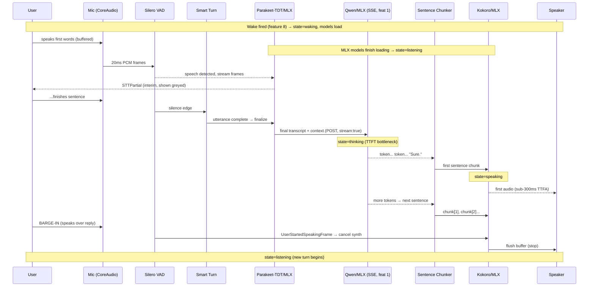

# Low-Latency Voice Interface
> Priority/build order: 7  ·  Tier: deep

## Summary
The low-latency voice loop is how the user *talks* to Jarvis and gets a snappy spoken reply, entirely on-device on a fanless MacBook Air M3 (16GB, macOS Tahoe 26.5). It is the real-time companion to the typed chat core (feature 2): the same Qwen-via-MLX brain (feature 1), the same memory ingestion (feature 3), but driven by speech in and speech out.

The loop is orchestrated by **Pipecat**, a Python real-time conversational-AI framework that wires audio frames through a pipeline of processors. The stages are: macOS native mic input → **Silero VAD** (acoustic voice gate, sub-millisecond) → **Pipecat Smart Turn** (semantic end-of-turn detector, prevents premature interruption) → **Parakeet-TDT via MLX** streaming STT (tens-of-ms partials) → **Qwen** LLM streaming tokens over SSE (reusing feature 1's local inference server) → a **sentence chunker** → **Kokoro (MLX, 4-bit)** streaming TTS (sub-300ms time-to-first-audio) → macOS native speaker output.

The design principle is **stream everything and chunk at sentence boundaries**. We never wait for a full transcript before prompting the LLM, never wait for a full LLM response before speaking, and never wait for a full reply before emitting the first audio. Sentence-level chunking of LLM tokens into TTS is the single biggest perceived-latency win. After warm-up the target is **~700ms–1.5s perceived first-audio** following end-of-speech; the LLM time-to-first-token (TTFT) is the bottleneck, not STT or TTS.

The voice loop lives inside the **menu-bar voice daemon** (see deployment), which also hosts the wake word (feature 8). Wake word triggers model load; the first turn pays the cold-start cost behind a "waking up…" indicator. Barge-in is fully supported: if the user speaks while Jarvis is talking, TTS is cancelled immediately and the new utterance takes over.

## Data flow  *(REQUIRED)*

**Inputs**
- Continuous 16kHz mono PCM audio frames from the default macOS input device (CoreAudio via Pipecat's local transport), 20ms frames.
- Wake/activation signal from feature 8 (`session.activate`) OR a push-to-talk press from the menu-bar UI.
- LLM token stream (SSE) from feature 1's local Qwen inference server.
- Conversation + memory context from feature 2 (turn history) and feature 3 (retrieved memories injected into the system prompt).

**Processing pipeline (mic → VAD → STT → LLM → TTS → speaker)**
1. **Capture** — CoreAudio delivers 20ms PCM frames into the Pipecat `LocalAudioInputTransport`. Frames are pushed downstream as `InputAudioRawFrame`s.
2. **Acoustic gate (Silero VAD)** — Silero VAD classifies each frame as speech/non-speech in <1ms. On rising edge (silence→speech) emit `UserStartedSpeakingFrame`; this triggers **barge-in** if TTS is active.
3. **Semantic turn detection (Smart Turn)** — While speech continues, Smart Turn evaluates whether the utterance is *complete* (intonation/syntax) vs. a mid-thought pause, so a 600ms breath doesn't cut the user off. Falls back to a VAD stop-secs timeout (default 800ms) if the model is uncertain.
4. **Streaming STT (Parakeet-TDT/MLX)** — Audio frames stream into Parakeet-TDT. It emits `STTPartial` interim transcripts continuously (tens of ms latency) and a final `TranscriptionFrame` on turn end. Fallback engines: faster-whisper small int8 or Moonshine v2 (sub-200ms TTFT) selectable via config; Apple `SpeechTranscriber` (on-device, macOS 26) as an alternative.
5. **Aggregate + prompt** — On final transcript, the user message is appended to the conversation context (feature 2) with retrieved memories (feature 3) and POSTed to feature 1's `/v1/chat/completions` (SSE, `stream: true`).
6. **Streaming LLM (Qwen/MLX)** — Tokens arrive over SSE. The bottleneck stage; TTFT is masked by speaking the first sentence as soon as it's ready.
7. **Sentence chunking** — Incoming tokens are buffered and flushed to TTS at sentence boundaries (`. ? ! …` and newlines), with a min-length guard and a max-buffer flush so the first audio starts ASAP.
8. **Streaming TTS (Kokoro/MLX 4-bit)** — Each sentence chunk is synthesized to PCM and streamed out as `TTSAudioRawFrame`s (TTFA sub-300ms per chunk). `TTSChunk` metadata tracks ordering.
9. **Playback** — `LocalAudioOutputTransport` plays frames through the default output device. While playing, the VAD acoustic gate stays armed for barge-in.
10. **Capture turn** — On completion, the full `VoiceTurn` (transcript + reply + timings) is handed to memory ingestion (feature 3) and chat history (feature 2).

**Outputs**
- Spoken audio reply via the macOS default output device.
- `VoiceTurn` record persisted to conversation store (feature 2) and queued for memory ingestion (feature 3).
- Live UI events to the menu-bar app: state changes, waveform levels, partial + final transcript, reply text.
- Latency telemetry (per-stage ms) to a local metrics log.

**Schemas** (TypeScript on the Node/orchestration side; Python dataclasses mirror these in the daemon)

```ts
// One complete request→reply exchange.
interface VoiceTurn {
  id: string;                 // uuid
  sessionId: string;
  startedAt: number;          // epoch ms, end-of-user-speech
  userText: string;           // final STT transcript
  sttEngine: 'parakeet' | 'faster-whisper' | 'moonshine' | 'apple';
  sttConfidence: number;      // 0..1
  assistantText: string;      // full LLM reply (joined sentences)
  bargedIn: boolean;          // did user interrupt the reply?
  timings: {
    eosToSttFinalMs: number;  // end-of-speech → final transcript
    sttFinalToTtftMs: number; // transcript → first LLM token
    ttftToFirstAudioMs: number;
    eosToFirstAudioMs: number; // headline perceived latency
    totalTurnMs: number;
  };
}

interface STTPartial {
  sessionId: string;
  text: string;               // interim hypothesis
  isFinal: boolean;
  stability: number;          // 0..1, how likely text is to change
  tsMs: number;
}

interface TTSChunk {
  turnId: string;
  index: number;              // sentence order, 0-based
  text: string;               // the sentence synthesized
  sampleRate: 24000;          // Kokoro native
  bytes: number;              // PCM byte count
  firstAudioMs: number;       // synth start → first PCM out
}

type VoiceSessionState =
  | 'idle'        // daemon up, models may be unloaded
  | 'waking'      // wake fired, models loading (cold start)
  | 'listening'   // capturing + streaming STT
  | 'thinking'    // turn ended, awaiting/streaming LLM tokens
  | 'speaking'    // streaming TTS to speaker
  | 'error';      // recoverable fault, returns to idle
```

## Frontend flow  *(REQUIRED)*
The voice UI is the **menu-bar app** (Electron/SwiftUI shell; see architecture). It is deliberately minimal — a status item plus a small popover.

- **Menu-bar icon** reflects `VoiceSessionState`: idle = static glyph; waking = pulsing/spinner; listening = animated mic; thinking = dots; speaking = animated waveform; error = badged glyph.
- **Popover panel** (shown on click or auto on wake):
  - **State label**: "Idle", "Waking up…", "Listening…", "Thinking…", "Speaking…".
  - **Waveform / level indicator**: real-time input RMS while listening (driven by VAD level frames); a separate output meter while speaking.
  - **Transcript display**: live partials from `STTPartial` rendered greyed-in, solidifying to black on final. Assistant reply streams in below as LLM tokens arrive.
  - **Push-to-talk button**: press-and-hold to force `listening` regardless of wake word; release ends the turn (overrides Smart Turn). Also a keyboard shortcut (global hotkey).
  - **Barge-in**: no explicit control — just speak. The UI flips speaking→listening the instant Silero VAD fires; the partial reply remains visible, marked interrupted.
  - **"Waking up…"** banner on first turn after wake while models load, with an indeterminate progress bar; if cold start exceeds ~4s, show "Still loading models…".
- **Events**: the daemon pushes UI events over a local IPC channel (WebSocket/loopback) — `state`, `level`, `partial`, `final`, `token`, `tts_start`, `barge_in`, `error`. The UI is purely a view; all logic lives in the daemon.
- **Accessibility**: text transcript is always available so the loop degrades to a readable chat if audio fails; mute toggle silences TTS while keeping transcript.

## Logic / rules  *(deep tier)*
- **Deterministic vs AI boundary** — *Deterministic* (rule/code): Silero VAD acoustic gating, the sentence chunker, the `VoiceSessionState` machine, barge-in cancellation, timeouts, device routing, ordering of TTS chunks. *AI / model-driven*: Parakeet-TDT STT, Smart Turn semantic completion, Qwen LLM, Kokoro TTS. The deterministic layer must always be able to *override* the AI layer (e.g. push-to-talk release forces turn-end regardless of Smart Turn; barge-in cancels TTS regardless of synth state).
- **State machine** — Legal transitions only: `idle→waking→listening→thinking→speaking→(idle|listening via barge-in)`. Any state `→error→idle`. Barge-in is the only edge that jumps *backwards* (`speaking→listening`). Push-to-talk can force `*→listening`.
- **Turn-end decision** — A turn ends when **(Smart Turn says complete)** OR **(VAD silence ≥ stop-secs, default 800ms)** OR **(push-to-talk released)**. Smart Turn shortens perceived latency by ending early on clearly-complete utterances; the VAD timeout is the safety net.
- **Sentence chunking rules** — Flush a chunk when: a sentence terminator is seen AND buffer ≥ min-chars (default 12, avoids "Hi." being its own micro-chunk for the *first* chunk we relax this to ship audio fast); OR buffer ≥ max-chars (default 200) with no terminator; OR LLM stream ends (flush remainder). First chunk is prioritized: as soon as the first clause is plausibly speakable, ship it.
- **Barge-in policy** — Default mode is **`confirmed`** (echo-resistant: the live mic path has no AEC, so raw VAD during playback is as often Jarvis's own speaker audio as the user). A `speech_start` during `speaking`/`thinking` does NOT cancel anything; cancellation requires a **final transcript that is not an echo** of the assistant's recent speech (token-containment ≥ 0.8 against the current reply text plus a ~5s post-reply grace window — `@jarvis/voice` `echoFilter.ts`). On a confirmed barge-in: (1) cancel in-flight TTS synth, (2) cancel the LLM SSE stream (configurable), (3) transition to `listening`, (4) mark the prior `VoiceTurn.bargedIn = true`, (5) the interrupting final becomes the next turn's transcript. Trade-off: interruptions take effect at end-of-utterance rather than instantly. Legacy **`immediate`** mode (speech_start cancels at once, 150ms echo-debounce window) remains selectable via `bargeInMode` for AEC-equipped capture paths.
- **Warm-up handoff** — On `session.activate` from feature 8: if Qwen/Parakeet/Kokoro are unloaded, enter `waking`, kick MLX model loads in parallel, show "waking up…". STT can begin capturing immediately (buffer audio) so no user words are lost; the buffered audio is fed to STT once it's ready. First turn absorbs cold start.
- **Latency masking** — Always start TTS on the first sentence rather than the full reply. If TTFT is slow, optionally play a tiny earcon/"hmm" filler (configurable) so the user knows Jarvis heard them.
- **Idle unload** — After N minutes idle (configurable, default 10), unload Kokoro/Parakeet to reclaim RAM on the 16GB machine; Qwen unload policy owned by feature 1. Next wake re-warms.
- **Memory + history** — Each completed `VoiceTurn` is appended to feature 2's conversation and enqueued to feature 3's ingestion (non-blocking; never on the speaking path).



### Latency budget (post-warm-up, M3 Air, all-local)

| Stage | Budget ms | Notes |
|---|---|---|
| End-of-speech detection (Silero VAD edge) | 0–10 | <1ms classify; edge fires on silence |
| Smart Turn semantic decision | 20–50 | small model; can end turn early |
| STT finalize (Parakeet-TDT/MLX) | 50–120 | streaming, partials already done; final flush |
| Transcript → LLM TTFT (Qwen/MLX) | 300–700 | **bottleneck**; prompt-dependent, KV warm |
| First sentence chunk ready (chunker) | 10–40 | first clause flushed early |
| TTS time-to-first-audio (Kokoro/MLX 4-bit) | 150–300 | sub-300ms TTFA per chunk |
| Output buffer → speaker | 20–50 | CoreAudio playout |
| **Perceived first-audio (eos→audio)** | **~700–1500** | sum of critical path; LLM dominates |

## Edge cases & safety

| # | Edge case | Detection | Handling |
|---|---|---|---|
| 1 | Model cold-start mid-turn | wake fired, models unloaded | enter `waking`, buffer audio so no words lost, show "waking up…", feed buffer to STT when ready; first turn eats cold start |
| 2 | Barge-in / interruption | Silero VAD fires during `speaking` | cancel TTS synth, flush output, optionally cancel LLM SSE, →`listening`, mark `bargedIn` |
| 3 | False VAD trigger mid-sentence (breath/pause) | VAD silence but Smart Turn says incomplete | keep `listening`, do NOT finalize; only end on Smart Turn-complete OR stop-secs timeout |
| 4 | Background noise / TV | VAD flapping, low STT confidence | raise VAD threshold adaptively; if STT confidence < floor, ask "sorry, didn't catch that"; don't prompt LLM on garbage |
| 5 | STT mishears | low `sttConfidence` or empty/garbled final | confidence gate; if below floor, reprompt or show partial for user correction; never silently act on low-confidence |
| 6 | TTS underrun (synth slower than playout) | output buffer drains before next chunk | pre-buffer first chunk; insert tiny silence rather than glitch; if persistent (thermal), drop to lower-quality voice |
| 7 | No-speech timeout | wake fired but no speech within N s (default 6s) | abandon turn, →`idle`, dim UI; no LLM call |
| 8 | Overlapping speech (user + Jarvis) | VAD speech during `speaking` <150ms in | echo-debounce window + AEC; if real user speech persists past window → treat as barge-in |
| 9 | Thermal throttle (fanless M3) | rising latency / CPU temp signal | degrade: switch STT to Moonshine, TTS to lower bitrate, reduce LLM max-tokens; surface "running slower" hint |
| 10 | Audio device change (AirPods plug/unplug) | CoreAudio device-change notification | gracefully re-route transport to new default device mid-session; pause/resume capture; never crash the daemon |
| 11 | LLM stream stalls / errors (feature 1 down) | SSE timeout or 5xx | abort turn, speak/show "I had trouble thinking — try again", →`error`→`idle`; log |
| 12 | Empty LLM reply | stream ends with no tokens | speak a graceful fallback line, don't emit empty TTS |
| 13 | Mic permission revoked | CoreAudio capture fails | show permission prompt deep-link, fall back to push-to-talk/typed chat |
| 14 | Very long user monologue | STT buffer grows large | periodic interim commits; cap utterance length, finalize on max-duration |
| 15 | RAM pressure on 16GB | macOS memory warning | trigger idle-unload of voice models early; keep Qwen per feature 1 policy |

**Safety**: all audio and transcripts stay on-device (no network egress for the voice path; HF is only for heavy non-voice tasks). Mic capture only while `listening`/wake-armed, with a visible indicator whenever the mic is hot. Mute toggle and push-to-talk give the user hard control. No recordings persisted beyond the `VoiceTurn` text unless explicitly enabled.

## Dependencies  *(REQUIRED)*
- **Internal features**
  - `features/1-local-qwen-inference-core.md` — Qwen/MLX LLM server; SSE token streaming endpoint; model load on wake; unload policy.
  - `features/2-conversational-chat-core.md` — conversation/turn history, system-prompt assembly, message store.
  - `features/8-wake-word-and-hands-free.md` — `session.activate` signal, wake-triggered model load, hands-free arming.
  - `features/3-memory-capture-and-ingestion.md` — consumes completed `VoiceTurn`s for ingestion; provides retrieved memories for prompt context.
  - `architecture/architecture.md` — daemon/orchestration topology, IPC channel, Node↔Python boundary.
  - `architecture/deployment.md` — menu-bar voice daemon packaging, model files, launch-at-login.
- **External / OSS (all local, free)**
  - **Pipecat** — real-time pipeline orchestrator (Python); local audio transport, VAD/STT/LLM/TTS processor abstractions, frame system, interruption handling.
  - **Parakeet-TDT via MLX** — streaming STT (primary). Fallbacks: **faster-whisper** (small, int8), **Moonshine v2**, Apple **SpeechTranscriber** (macOS 26 on-device).
  - **Silero VAD** — acoustic voice activity detection.
  - **Pipecat Smart Turn** — semantic end-of-turn model.
  - **Kokoro (MLX, 4-bit)** — streaming TTS.
  - **MLX / mlx-lm** — Apple-Silicon model runtime (shared with feature 1).
  - **CoreAudio** (via Pipecat local transport) — native mic/speaker I/O.
- **Runtime**: Python 3.12 (voice/ML daemon) + TS/Node (orchestration & UI IPC). macOS Tahoe 26.5, Apple Silicon M3.

## File structure  *(deep tier)*
```
voice-daemon/                         # Python: Pipecat real-time loop
  pipeline.py                         # builds & runs the Pipecat pipeline (snippet below)
  transports/coreaudio.py             # local mic/speaker transport wiring
  stt/parakeet_mlx.py                 # Parakeet-TDT/MLX streaming STT service
  stt/fallbacks.py                    # faster-whisper / moonshine / apple selector
  turn/smart_turn.py                  # Smart Turn semantic end-of-turn processor
  vad/silero.py                       # Silero VAD config + level metering
  llm/qwen_sse.py                     # SSE client → feature 1 inference server
  tts/kokoro_mlx.py                   # Kokoro/MLX 4-bit streaming TTS service
  chunking/sentence_chunker.py        # token→sentence flush logic (snippet below)
  state/session.py                    # VoiceSessionState machine + barge-in
  warmup.py                           # wake→model-load handoff, audio buffering
  schemas.py                          # VoiceTurn/STTPartial/TTSChunk dataclasses
  telemetry.py                        # per-stage latency logging
  config.py                           # thresholds, engine selection, timeouts
src/voice/                            # TS/Node orchestration + UI bridge
  voiceClient.ts                      # spawn/supervise daemon, IPC channel
  events.ts                           # state/level/partial/token/barge_in events
  turnStore.ts                        # persist VoiceTurn → feature 2 / feature 3
menu-bar-ui/voice/                    # menu-bar voice UI
  VoicePopover.tsx                    # state label, waveform, transcript, PTT
  useVoiceState.ts                    # subscribe to daemon events
  Waveform.tsx                        # input/output level rendering
features/7-low-latency-voice-interface.md
```

### Code snippet 1 — Pipecat pipeline assembly (Python)
Wires CoreAudio → Silero VAD → Smart Turn → Parakeet-TDT → Qwen (SSE, feature 1) → sentence chunker → Kokoro, with interruption (barge-in) enabled.

```python
# voice-daemon/pipeline.py
from pipecat.pipeline.pipeline import Pipeline
from pipecat.pipeline.task import PipelineTask, PipelineParams
from pipecat.audio.vad.silero import SileroVADAnalyzer
from pipecat.processors.aggregators.llm_response import (
    LLMUserResponseAggregator, LLMAssistantResponseAggregator,
)

from transports.coreaudio import CoreAudioTransport, CoreAudioParams
from stt.parakeet_mlx import ParakeetMLXSTTService
from turn.smart_turn import SmartTurnAnalyzer
from llm.qwen_sse import QwenSSEService          # streams from feature 1
from tts.kokoro_mlx import KokoroMLXTTSService
from chunking.sentence_chunker import SentenceChunker
from state.session import SessionState

def build_pipeline(ctx, state: SessionState) -> PipelineTask:
    transport = CoreAudioTransport(CoreAudioParams(
        sample_rate=16000,
        # acoustic gate + semantic turn end:
        vad_analyzer=SileroVADAnalyzer(stop_secs=0.8),
        turn_analyzer=SmartTurnAnalyzer(),       # ends early on complete utterances
        audio_in_enabled=True,
        audio_out_enabled=True,
    ))

    stt = ParakeetMLXSTTService(emit_partials=True)          # tens-of-ms partials
    llm = QwenSSEService(base_url="http://127.0.0.1:8001/v1")  # feature 1 server
    chunker = SentenceChunker(min_chars=12, max_chars=200)   # see snippet 2
    tts = KokoroMLXTTSService(quant="4bit", sample_rate=24000)

    pipeline = Pipeline([
        transport.input(),                 # mic frames
        stt,                               # → TranscriptionFrame / STTPartial
        LLMUserResponseAggregator(ctx),    # build user msg + memory context
        llm,                               # → streaming LLMTextFrame tokens
        chunker,                           # token stream → sentence frames
        tts,                               # → TTSAudioRawFrame (streaming)
        transport.output(),               # speaker
        LLMAssistantResponseAggregator(ctx),  # record assistant reply
    ])

    task = PipelineTask(pipeline, PipelineParams(
        allow_interruptions=True,          # barge-in: cancel TTS on user speech
        enable_metrics=True,               # per-stage latency telemetry
    ))
    task.event_handler("on_user_started_speaking")(state.on_barge_in)
    return task
```

### Code snippet 2 — Sentence chunker (Python)
Feeds LLM tokens into TTS at sentence boundaries — the biggest perceived-latency win. Ships the first speakable clause as fast as possible, then flushes on terminators / max-buffer / stream-end.

```python
# voice-daemon/chunking/sentence_chunker.py
import re
from pipecat.frames.frames import (
    Frame, TextFrame, LLMFullResponseEndFrame, TTSSpeakFrame,
)
from pipecat.processors.frame_processor import FrameProcessor, FrameDirection

_TERMINATORS = re.compile(r'[.!?…](?=\s|$)|[\n]')

class SentenceChunker(FrameProcessor):
    def __init__(self, min_chars=12, max_chars=200):
        super().__init__()
        self._buf = ""
        self._min, self._max = min_chars, max_chars
        self._first = True   # relax min-length for the very first chunk

    async def process_frame(self, frame: Frame, direction: FrameDirection):
        await super().process_frame(frame, direction)

        if isinstance(frame, TextFrame):            # an LLM token / fragment
            self._buf += frame.text
            await self._maybe_flush()
            return

        if isinstance(frame, LLMFullResponseEndFrame):
            await self._flush(force=True)           # speak the remainder
            self._first = True
            await self.push_frame(frame, direction)
            return

        await self.push_frame(frame, direction)     # pass everything else through

    async def _maybe_flush(self):
        # Flush at the last sentence terminator inside the buffer.
        matches = list(_TERMINATORS.finditer(self._buf))
        if matches:
            end = matches[-1].end()
            candidate = self._buf[:end].strip()
            floor = 1 if self._first else self._min
            if len(candidate) >= floor:
                self._buf = self._buf[end:]
                await self._emit(candidate)
        elif len(self._buf) >= self._max:           # long clause, no terminator
            await self._emit(self._buf.strip()); self._buf = ""

    async def _flush(self, force=False):
        text = self._buf.strip()
        if text and (force or len(text) >= self._min):
            self._buf = ""
            await self._emit(text)

    async def _emit(self, text: str):
        self._first = False
        await self.push_frame(TTSSpeakFrame(text), FrameDirection.DOWNSTREAM)
```
