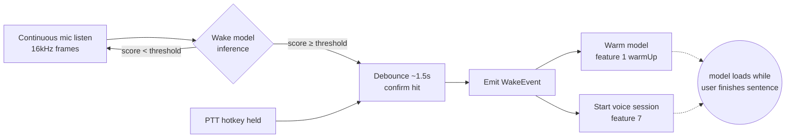

# Wake Word & Hands-Free
> Priority/build order: 8  ·  Tier: light

## Summary

Jarvis listens continuously for the spoken phrase **"Hey Jarvis"** and uses that
event to go hands-free: no clicking, no focus stealing, just speak. Detection
runs locally and always-on via free/OSS **openWakeWord** (alternative:
**Picovoice Porcupine**), with a **push-to-talk (PTT)** hotkey fallback for
noisy rooms, privacy moments, or when the user simply prefers a key.

The decisive design constraint: **the heavy Qwen model (feature 1) is unloaded
by default** to keep idle RAM low on a 16GB M3 Air. The wake event is therefore
*dual-purpose* — it is simultaneously (a) the trigger that **warms up the
inference core** and (b) the trigger that **starts a low-latency voice session**
(feature 7). Warm-up fires the instant the wake word is detected, while the user
is still finishing their sentence, so the multi-second cold start overlaps with
human speech instead of stacking on top of it. The UI shows a brief
"waking up…" state to make the cold start feel intentional.

Because wake detection runs while the big model is unloaded, it must be **tiny,
cheap, and always-resident** — a small DNN doing ~16kHz frame inference at a low
duty cycle, never on the latency-critical path of the heavy model. It lives in
the menu-bar daemon: a TS/Node orchestration layer supervising a small Python
audio process that hosts the wake model.

## Data flow  *(REQUIRED)*  (Inputs: continuous mic; Processing: wake model inference + debounce + signal emit; Outputs: wake signal to feature 1 + session start to feature 7; Schemas: WakeEvent)

- **Inputs**
  - Continuous microphone stream (default input device), 16kHz mono PCM, read in
    small frames (~80ms) by the Python audio process.
  - Config: `enabled`, `sensitivity` (0–1), `ptHotkey`, `mute` flag.
  - PTT hotkey keydown/keyup events captured by the Node daemon.

- **Processing**
  1. Python audio process streams frames into the openWakeWord model and gets a
     per-frame confidence score for "Hey Jarvis".
  2. Score crosses the **sensitivity threshold** → candidate hit.
  3. **Debounce window** (~1.5s cooldown) suppresses duplicate fires from a
     single utterance and rapid re-triggers.
  4. On confirmed hit, Python emits a `WakeEvent` to the Node daemon over the
     local IPC channel (stdout JSON line / unix socket).
  5. Node daemon fans the event out to two consumers **in parallel**.

- **Outputs**
  - **→ Feature 1 (warm-up):** immediate `warmUp()` call so the Qwen model loads
    while the user keeps talking. Fire-and-forget; daemon tracks load state.
  - **→ Feature 7 (session start):** open a voice session, begin capturing the
    actual command audio, show the live UI.
  - PTT path emits an equivalent `WakeEvent` with `source: "ptt"` (no model
    inference involved) and triggers the same two outputs.

- **Schema**

```ts
// WakeEvent — emitted on every confirmed wake (voice or PTT)
interface WakeEvent {
  id: string;                 // uuid for this wake occurrence
  source: "wakeword" | "ptt"; // how it fired
  phrase: "Hey Jarvis";       // matched keyword (fixed for v1)
  confidence: number;         // 0–1; 1.0 for PTT (deterministic)
  timestamp: number;          // epoch ms of detection
  deviceId: string;           // input device that captured it
  warmTriggered: boolean;     // true once feature 1 warm-up dispatched
}
```

## Frontend flow  *(REQUIRED)*  (menu-bar states: listening-for-wake, wake-detected, push-to-talk; controls: enable/disable wake, choose hotkey for PTT, sensitivity; journey)

- **Menu-bar icon states**
  - `listening-for-wake` — idle resting state; subtle icon indicating the mic is
    armed and the wake model is running (low CPU).
  - `wake-detected` — brief flash / "waking up…" label while feature 1 cold-starts
    and feature 7 spins up. This is the moment that masks the model load.
  - `push-to-talk` — shown while the PTT hotkey is held; identical downstream
    behavior, different entry path.
  - `muted` / `disabled` — wake listening is off; icon clearly distinct so the
    user always knows whether the mic is live.

- **Controls (menu / preferences)**
  - Enable/disable wake word (master toggle).
  - Choose PTT hotkey (global shortcut capture).
  - Sensitivity slider (maps to detection threshold; lower = fewer false rejects
    but more false accepts).
  - Mute toggle (privacy kill switch — stops feeding frames to the model).
  - Input device selector.

- **Journey**
  1. User glances at menu bar → sees `listening-for-wake`.
  2. Says "Hey Jarvis, what's on my calendar tomorrow?"
  3. At "Jarvis" the icon flips to `wake-detected` / "waking up…"; feature 1
     begins loading and feature 7 starts capturing — all while the user is still
     saying "…calendar tomorrow?".
  4. By the time the sentence ends, the model is warm (or nearly so) and the
     voice session has the full command buffered → response begins.
  5. If wake fails or the room is loud, the user holds the PTT hotkey instead and
     gets identical behavior.

## Edge cases & safety  (false wake/accept, false reject, noisy env, mic permission denied, wake during active session, privacy/mute, CPU budget)

- **False wake / false accept:** sensitivity tuning + debounce reduce these; a
  spurious wake at worst warms the model and opens a session that times out
  silently if no command follows (cheap, self-healing). Warm-up of feature 1 on a
  false accept wastes a load but harms nothing.
- **False reject:** user can lower sensitivity or fall back to PTT, which is
  deterministic and never misses.
- **Noisy environment:** thresholds drift up; PTT is the explicit escape hatch.
  Consider per-environment sensitivity presets later.
- **Mic permission denied:** daemon detects the OS permission failure, surfaces a
  clear menu-bar error state with a deep link to system settings, and disables
  wake until granted. PTT also requires mic for the actual command.
- **Wake during an active session:** ignore/de-duplicate wakes while a session is
  already live (or treat as barge-in per feature 7); never double-warm feature 1.
- **Privacy / mute:** the mute toggle stops feeding audio frames to the model —
  not just a UI flag. No audio leaves the device; nothing is persisted from the
  wake stream beyond the rolling in-memory frame buffer.
- **CPU budget:** wake runs while the heavy model is unloaded, so it must stay
  tiny and cheap (small DNN, low duty cycle). It must never block or contend with
  feature 1's load on the latency-critical path. If CPU pressure is detected,
  back off frame rate before dropping detection entirely.

## Dependencies  *(REQUIRED)*  — features/1-local-qwen-inference-core.md (warm-up trigger), features/7-low-latency-voice-interface.md (session start), architecture/deployment.md, architecture/architecture.md

- **features/1-local-qwen-inference-core.md** — wake fires the warm-up/load of the
  unloaded Qwen model; consumes `WakeEvent` to call `warmUp()`.
- **features/7-low-latency-voice-interface.md** — wake starts the voice capture
  session; barge-in / active-session handling lives here.
- **architecture/deployment.md** — menu-bar daemon packaging, autostart, OS mic
  permission flow, global hotkey registration.
- **architecture/architecture.md** — TS/Node orchestration ↔ Python audio process
  IPC contract, event bus, and the dual fan-out pattern.



## File structure

```
features/wake-word/
  daemon/                       # TS/Node orchestration (menu-bar daemon)
    wakeSupervisor.ts           # spawns/supervises Python audio process
    wakeEventBus.ts             # fans WakeEvent → feature 1 + feature 7
    pttHotkey.ts                # global hotkey capture → synthetic WakeEvent
    wakeConfig.ts               # enabled / sensitivity / hotkey / mute / device
    types.ts                    # WakeEvent and shared interfaces
  audio/                        # Python wake model process
    listen.py                   # mic stream + frame buffering (16kHz mono)
    wake_model.py               # openWakeWord (alt: Porcupine) inference
    debounce.py                 # threshold + cooldown window
    ipc.py                      # JSON-line / socket emit to Node daemon
  menubar/
    wakeStates.tsx              # listening-for-wake / wake-detected / ptt / muted
    wakePrefs.tsx               # sensitivity, hotkey, device, mute controls
  tests/
    debounce.test.ts
    wakeEventBus.test.ts
```
