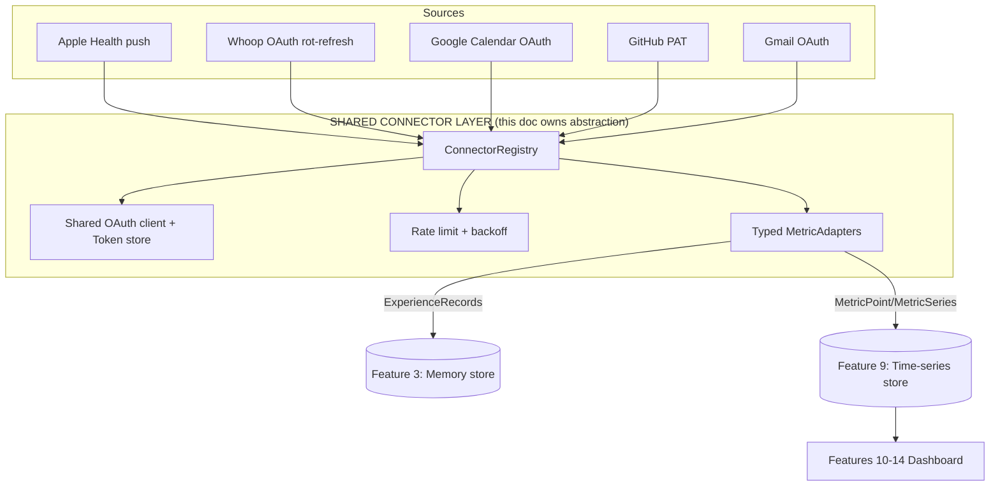

# Data Integration Framework
> Priority/build order: 9  ·  Tier: deep

## Summary

The Data Integration Framework is Jarvis's shared connector/ETL backbone: a deterministic, local-first layer that authenticates to external sources, fetches data on a schedule (or via webhook freshness bonus), normalizes it, and persists it as **metric series** for the dashboard (features 10–14). It is the producer side of the metrics half of Jarvis.

This feature and **feature 3 (Memory Capture)** share **one connector/auth layer** — the same typed adapters, the same OAuth clients, the same token store, the same rate-limit/backoff machinery. They diverge only at the *output stage*: feature 3 emits `ExperienceRecord`s into memory; feature 9 emits normalized `MetricPoint`/`MetricSeries` into the time-series store. This document **owns the shared `Connector`/`ConnectorRegistry` abstraction** plus the entire metrics ETL pipeline; feature 3 consumes the same registry and adds its own sink.

v1 sources (locked): **Apple Health** (push from iOS, no OAuth), **Whoop** (OAuth, *rotating* refresh token — serialized), **Google Calendar** (OAuth), **GitHub** (PAT), **Gmail** (OAuth). Finance via **SimpleFIN** is v2. Everything free/OSS, runs on the user's M3 Air (16GB), TS/Node for the framework, Python only where ML is unavoidable (not here). Default cadence is **daily-batch T+1**; webhooks are an opportunistic freshness improvement, never a correctness dependency.

**There is no LLM in this layer.** ETL is a deterministic boundary: same input bytes + same adapter version ⇒ same metric points. Any semantic/LLM enrichment happens downstream.

## Data flow  *(REQUIRED)*

### Inputs
- **Connector configs** (`Connector`): per-source enablement, auth handle, schedule, backfill window.
- **Triggers**: scheduler tick (cron-like, T+1 daily default), manual "Sync now", webhook event (Whoop, Calendar push), or Apple Health push (iOS Shortcut/HealthKit export → local endpoint).
- **Stored auth**: OAuth tokens / PAT from the shared token store (see `architecture/auth-and-integrations.md`).
- **Cursors** (`Cursor`): per (source, stream) high-water mark for incremental fetch.

### Numbered pipeline
1. **Trigger** — scheduler fires a `SyncRun` for a `Connector`, OR a webhook/push arrives and enqueues a `SyncRun` for the affected stream. All runs go through one queue; **Whoop runs are serialized** (concurrency=1 for that source) because its refresh token rotates.
2. **Acquire auth** — `ConnectorRegistry` resolves the connector, hydrates a valid access token via the shared OAuth client (refresh-if-expired, single-flight per source). PAT sources skip refresh.
3. **Fetch** — the typed `MetricAdapter` pulls pages from the source API starting at the `Cursor`, honoring per-source rate limits + exponential backoff with jitter. Raw responses optionally cached to disk for replay/debug.
4. **Normalize** — adapter maps source-specific payloads → `MetricPoint[]` with a *stable* `id` (deterministic hash of source+metric+ts+dims). Unknown/extra fields are tolerated (schema-drift safe); required-field absence is logged, not fatal.
5. **Upsert metric series** — points are written via `upsertSeries()` into the time-series store. Upsert is **idempotent on `MetricPoint.id`** — re-runs and overlapping pages never duplicate.
6. **Advance cursor** — on full-page success, the `Cursor` high-water mark advances; partial failure leaves the cursor unmoved so the next run resumes safely.
7. **Record run** — the `SyncRun` is finalized (status, counts, error, nextCursor) and surfaced to the ETL health view.
8. **Expose query API** — features 10–14 read via `querySeries(metric, range, agg)` (downsample/rollup at read time). No feature reads raw source APIs directly.

### Outputs
- `MetricSeries` rows in the local time-series store (the canonical metrics dataset).
- `SyncRun` records (run log / health).
- Updated `Cursor`s.
- Query results to the dashboard (features 10–14).

### Schemas
See **Logic / rules** for full TS definitions of `Connector`, `MetricPoint`, `MetricSeries`, `SyncRun`, `Cursor`.

## Frontend flow  *(REQUIRED)*

**Settings → Integrations screen** (shared with feature 3's source list — one list, two consumers):
- Each source row: icon, name, **status badge** (`disconnected` / `connected` / `error` / `needs-reconsent`), **last-sync** timestamp (relative), next scheduled run, and a **Connect / Reconnect / Sync now** button.
  **Implemented** in `/settings/integrations`: token state is read from the Keychain (read-only),
  run history from `sync_runs`; Connect/Reconnect launches the connect CLI's loopback consent flow
  and Sync-now runs `npm run connect -- sync <source>` (whoop|gcal|gmail|github|simplefin).
- Connect flow: OAuth sources open the system browser → loopback redirect → token stored; PAT sources show a paste field; Apple Health shows setup instructions + the local push endpoint URL/token.
- A small per-source toggle controls whether it feeds **Memory (feat 3)**, **Metrics (feat 9)**, or both — the registry is shared, the sinks are independent.

**ETL health / run-log view** (`/settings/integrations/health`):
- Table of recent `SyncRun`s: source, stream, trigger, started/finished, duration, points written, status, error message.
- Filter by source + status; "Retry" on failed runs; expandable raw-error + cursor diff.
- A freshness panel: per metric, "last point at" vs "expected (T+1)" with a stale indicator.

States to handle: empty (no connectors), connecting (browser spinner), error (re-consent CTA), syncing (live progress), backfilling (first-connect long-run with progress bar).

## Logic / rules  *(deep tier)*



**Adapter pattern (HPI-style).** Every source implements a typed `Connector` exposing one or more `MetricAdapter`s. Adapters are the *only* code that knows source-specific shapes; everything upstream/downstream speaks the unified `MetricPoint` schema.

```ts
// Unified connector + adapter contract (shared with feature 3)
export type SourceId = 'apple_health' | 'whoop' | 'gcal' | 'github' | 'gmail';
export type AuthKind = 'oauth' | 'pat' | 'push';

export interface Connector {
  source: SourceId;
  auth: AuthKind;
  enabled: boolean;
  feeds: { memory: boolean; metrics: boolean }; // shared registry, split sinks
  schedule: string;            // cron expr; default '0 5 * * *' (T+1 daily 05:00 local)
  backfillDays: number;        // window pulled on first connect
  concurrency: number;         // 1 for whoop (serialized rotating refresh)
  metricAdapters: MetricAdapter[];
}

export interface FetchCtx {
  token: string;               // resolved by registry (refreshed if needed)
  cursor: Cursor | null;
  since: string; until: string;
  signal: AbortSignal;
}

export interface MetricAdapter {
  source: SourceId;
  stream: string;              // e.g. 'whoop.recovery', 'github.commits'
  // deterministic: same input -> same points; NO LLM here
  fetch(ctx: FetchCtx): AsyncIterable<{ points: MetricPoint[]; nextCursor: Cursor }>;
}

export class ConnectorRegistry {
  private connectors = new Map<SourceId, Connector>();
  constructor(private oauth: OAuthClient, private tokens: TokenStore) {}

  register(c: Connector) { this.connectors.set(c.source, c); }
  get(s: SourceId) { const c = this.connectors.get(s); if (!c) throw new Error(`no connector ${s}`); return c; }

  // single-flight token resolution shared by feat 3 + feat 9
  async resolveToken(s: SourceId): Promise<string> {
    const c = this.get(s);
    if (c.auth === 'pat') return this.tokens.getPat(s);
    if (c.auth === 'push') return ''; // no token needed
    return this.oauth.getAccessToken(s); // refresh-if-expired, serialized per source
  }
}
```

```ts
// Metric upsert + query API (the read/write boundary for features 10-14)
export interface MetricStore {
  // idempotent on MetricPoint.id; safe for overlapping pages & re-runs
  upsertSeries(points: MetricPoint[]): Promise<{ inserted: number; updated: number }>;
  querySeries(
    metric: string,
    range: { from: string; to: string },
    agg?: { fn: 'sum' | 'avg' | 'min' | 'max' | 'last'; bucket: '1h' | '1d' | '1w' }
  ): Promise<MetricSeries>;
}

export function makeMetricId(p: Pick<MetricPoint, 'source' | 'metric' | 'ts' | 'dims'>): string {
  const dims = Object.entries(p.dims ?? {}).sort().map(([k, v]) => `${k}=${v}`).join('&');
  return sha256(`${p.source}|${p.metric}|${p.ts}|${dims}`); // deterministic key
}
```

**Key rules**
- **Idempotency**: `upsertSeries` keyed on `MetricPoint.id`. Re-running any `SyncRun` is always safe.
- **Cursor discipline**: advance only after a page is fully persisted; never advance on partial failure.
- **Whoop serialization**: `concurrency=1`; the rotating refresh token is read-modify-written under a per-source mutex; a failed refresh aborts the run without burning the next token.
- **Single-flight refresh**: concurrent feat-3 + feat-9 runs for one source share one token-refresh promise.
- **Determinism**: adapters perform no network-dependent randomness in IDs; timestamps normalized to UTC ISO-8601 at the boundary.
- **Read-time aggregation**: store raw resolution; downsample in `querySeries` so features 10–14 choose their own buckets.

### Schemas

```ts
export interface MetricPoint {
  id: string;                  // deterministic hash (makeMetricId)
  source: SourceId;
  metric: string;              // 'sleep.duration_min', 'hrv', 'commits', ...
  value: number;
  unit: string;                // 'min','ms','count','bpm','%'
  ts: string;                  // UTC ISO-8601 (instant the value pertains to)
  dims?: Record<string, string>; // e.g. {repo:'jarvis', sleepStage:'rem'}
  ingestedAt: string;          // UTC ISO-8601
  adapterVersion: string;      // bump invalidates/reprocesses
}

export interface MetricSeries {
  metric: string;
  unit: string;
  agg?: { fn: string; bucket: string } | null;
  points: Array<{ ts: string; value: number; dims?: Record<string, string> }>;
}

export interface Cursor {
  source: SourceId;
  stream: string;
  highWater: string;           // last fetched ts or opaque page token
  pageToken?: string | null;
  updatedAt: string;
}

export interface SyncRun {
  id: string;
  source: SourceId;
  stream: string;
  trigger: 'schedule' | 'manual' | 'webhook' | 'push';
  startedAt: string;
  finishedAt?: string;
  status: 'running' | 'ok' | 'partial' | 'error';
  pointsWritten: number;
  pagesFetched: number;
  error?: { code: string; message: string; retryable: boolean } | null;
  cursorBefore?: string | null;
  cursorAfter?: string | null;
}
```

## Edge cases & safety

| # | Case | Handling |
|---|------|----------|
| 1 | **Token expiry / re-consent** | Refresh on 401; if refresh fails (revoked/expired), mark connector `needs-reconsent`, surface CTA in Settings, halt that source's runs (no retry storm). |
| 2 | **Whoop rotating refresh** | Per-source mutex, `concurrency=1`. New refresh token persisted atomically before old is discarded; crash mid-rotate ⇒ keep last-known-good and re-consent if invalid. |
| 3 | **Partial pages** | Persist completed pages, leave cursor at last fully-written page, mark `SyncRun` `partial`; next run resumes from cursor. |
| 4 | **Duplicate points** | `upsertSeries` idempotent on `MetricPoint.id`; overlapping windows and webhook+schedule double-fire collapse to one row. |
| 5 | **Schema drift** | Adapters tolerate extra/unknown fields; missing optional fields ⇒ skip dim; missing required field ⇒ drop point + log, never crash run. `adapterVersion` bump triggers reprocess. |
| 6 | **Rate limits (429 / quota)** | Honor `Retry-After`; exponential backoff with jitter; per-source token bucket; on hard quota exhaustion, defer run to next tick (still T+1 correct). |
| 7 | **Backfill on first connect** | First run pulls `backfillDays` window in paged batches with progress; bounded concurrency; resumable via cursor if interrupted. |
| 8 | **Clock / timezone** | All `ts` normalized to UTC at the boundary; source-local dims preserved separately; DST handled by storing instants, bucketing in `querySeries` against display TZ. |
| 9 | **Store unavailable** | Writes buffered to a local WAL/queue; run marked `error retryable`; auto-retry next tick; no data loss, no cursor advance. |
| 10 | **Source outage (5xx)** | Retry with backoff up to N; then `error retryable`, alert in health view, retry next schedule; cursor untouched. |
| 11 | **Apple Health push gaps** | Push is best-effort; missing days flagged stale in freshness panel; manual re-export instructions; no auto-fetch (no pull API). |
| 12 | **Duplicate concurrent runs** | Per (source,stream) run lock prevents schedule + manual + webhook stacking; later trigger coalesces. |
| 13 | **Clock skew / future ts** | Points with `ts` > now+slack rejected and logged (guards corrupt source data). |
| 14 | **Adapter crash** | Isolated per-adapter try/catch; one failing stream never aborts sibling streams or other sources. |

## Dependencies  *(REQUIRED)*

- `features/3-memory-capture-and-ingestion.md` — **shares this connector/auth layer**; consumes `ConnectorRegistry` + shared OAuth client; adds its own `ExperienceRecord` sink. This doc owns the shared abstraction.
- `features/10-health-and-sleep-metrics.md` — consumer of Apple Health + Whoop metric series.
- `features/11-finance-metrics.md` — SimpleFIN adapter (v2) plugs into this framework.
- `features/12-calendar-integration.md` — consumer of Google Calendar series.
- `features/13-work-and-productivity-metrics.md` — consumer of GitHub + Gmail series.
- `features/14-metrics-dashboard-ui.md` — primary reader via `querySeries`.
- `architecture/auth-and-integrations.md` — OAuth client, token store, redirect/loopback flow, PAT handling.
- `architecture/architecture.md` — process model, local time-series store choice (SQLite/DuckDB), scheduler.
- External libs (free/OSS): cron scheduler (e.g. `node-cron`), HTTP client with retry, embedded store driver (SQLite/DuckDB), `googleapis`/`@octokit/rest` SDKs.

## File structure  *(deep tier)*

```
src/integrations/
  registry.ts                 # ConnectorRegistry, single-flight token resolution
  types.ts                    # Connector, MetricAdapter, FetchCtx, MetricPoint, MetricSeries, Cursor, SyncRun
  oauth/
    client.ts                 # shared OAuth client (refresh, loopback) — used by feat 3 too
    tokenStore.ts             # encrypted local token + PAT store
  scheduler.ts                # cron ticks -> enqueue SyncRun; per-source concurrency locks
  runner.ts                   # executes SyncRun: auth -> fetch -> normalize -> upsert -> cursor -> record
  rateLimit.ts                # token-bucket + exponential backoff + jitter
  webhook/
    server.ts                 # loopback HTTP for Whoop/Calendar webhooks + Apple Health push endpoint
  adapters/
    appleHealth.ts            # push ingest -> MetricPoint[]
    whoop.ts                  # OAuth, rotating refresh (serialized), recovery/sleep/strain
    gcal.ts                   # OAuth, events -> calendar metrics
    github.ts                 # PAT, commits/PRs/issues
    gmail.ts                  # OAuth, volume/labels metrics (memory side in feat 3)
  metricStore/
    store.ts                  # MetricStore impl (SQLite/DuckDB): upsertSeries, querySeries
    migrations/               # schema + indexes (source, metric, ts)
    wal.ts                    # write buffer for store-unavailable recovery
  cursors.ts                  # Cursor read/advance with partial-failure safety
  health/
    runLog.ts                 # SyncRun persistence + freshness computation
src/ui/settings/
  Integrations.tsx            # connect/status/last-sync/sync-now (shared with feat 3)
  EtlHealth.tsx               # run-log table + freshness panel + retry
test/integrations/
  registry.test.ts  runner.test.ts  whoopRotate.test.ts  upsertIdempotent.test.ts
  schemaDrift.test.ts  cursorPartial.test.ts
```
